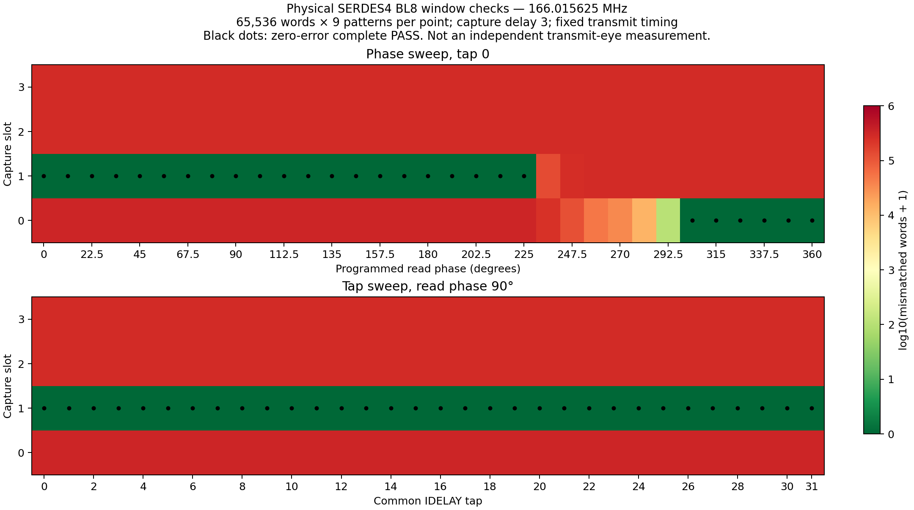

# Physical SDRAM burst-window measurements

The supplied combined tester was used as a hardware control without modifying
the archive. Its existing tester already issues BL8 transactions. A new JTAG
driver automated full-memory tests, read-phase/capture-slot/input-tap sweeps,
and masked writes. These are reference SERDES4 measurements, not MoonBub PHY
qualification or a 30 fps result.

## Identity and control

Reference: `D:/codex_archive_2026/gamebub/gamebub-source/fpga/vivado/gamebub_combined`.
The matching local release is `C:/xup/bub/gamebub_combined_v2/release`.
All 34 release-manifest hashes passed. BIT SHA-256:
`916baa841257cc7e79f75efa8f163000ceb631856091d55d04a48bb70fe37cb0`.
Fresh JTAG confirmed DONE=1, CRC=0 and USERID `47544301`.
The archived clock-calculation header matches the release input hash and was
used directly to generate profiles. The realized divider setting is
166.015625 MHz; internal command/read meters reported approximately
166.012–166.016 MHz. No oscilloscope phase or external AC/PVT signoff is claimed.

| Physical full-memory run | Programmed phase | Tap | Compared words | Mismatches |
|---|---:|---:|---:|---:|
| Initial control | 90° | 0 | 150,994,944 | 0 |
| Boundary check | 225° | 0 | 150,994,944 | 1,485 |
| Repeated interior control | 90° | 0 | 150,994,944 | 0 |

Each run fills and verifies all 16,777,216 words (32 MiB) using nine patterns,
with 301,989,888 completed word operations. Full-run capture delay/slot was
3/1. The two interior controls therefore supply 301,989,888 zero-error word
comparisons, separately from the intentionally marginal boundary run.

## Read-window and framing measurements

Each sweep case used 65,536 words (128 KiB), nine patterns and 589,824 complete
comparisons. Scope is the first-chip test region, not a full-memory test at
every timing point. Frequency and transmit configuration remained fixed.

- Fixed slot 1/tap 0: 33 distinct realized phase configurations from 0° to
  360°, quantized in 11.25° increments. The initial zero-error range was
  0°–213.75°. The next point, 225°, had one mismatch.
- Phase/slot refinement: 132 cases (33 phases × four slots), capture delay 3.
  Slot 1 passed through 225° in this shorter repeat; slot 0 passed
  303.75°–360°. The full-memory run above confirms 225° is marginal and should
  not be selected as a robust operating point.
- At 236.25°–292.5°, no tested slot passed. Incorrect neighboring slots also
  produced repeatable whole-word offsets outside that transition region.
- Tap/slot refinement: 128 cases at programmed phase 90° (32 common input
  taps × four slots). Slot 1 passed at every tap from 0 through 31. No tap
  boundary was reached in this tested range.

The plot distinguishes framing from sampling. A late-phase failure at slot 1
can become a complete PASS at slot 0; it is not automatically an electrical
eye failure. Likewise, the rounded 360° configuration retains a different
quarter-clock offset, so do not collapse it onto 0° without its slot setting.
Tables retain requested and realized phase separately: requested 85° realizes
90°; requested 220° realizes 225°.

## Write-path verification and limits

At the interior read profile (90°, tap 0, capture 3/1), direct uncached AXI
operations seeded eight 16-byte blocks before checking them. Locations cover
row and bank transitions and the final SDRAM word (`0x61fffffc` in the CPU
aperture). Forty 32-bit writes and 64 comparisons passed, including selective
updates of one word while preserving its three BL8 neighbors.

The full nine-pattern controls and masked writes establish successful
read/write operation at that configuration. They do **not** measure an
independent write eye. This release exposes read phase and input IDELAY;
independent write-window measurement needs a separate transmit timing control
and fill-at-candidate/read-at-reference sequencing. No write-eye width is
inferred from the read sweep.

## MoonBub consequence and recovery

The [MoonBub SDR1 capture](SDR1-HARDWARE-READBACK-20261105.md) independently shows
the complete expected burst in raw samples 5–12 while the response path starts
with sample 6. All three runs reported 28/32 word mismatches. The reference
control above supports investigating MoonBub's capture/response selection and
its timing-model assumptions before blaming the memory or replacing the PHY.
Reference delay/slot numbers cannot be copied numerically into the different
100 MHz MoonBub implementation.

Next: expose latched capture/response selection in the MoonBub burst probe,
replay the retained physical trace in simulation, then repeat longer BL8
fill/verify and masked/boundary tests on that exact path. Keep the full CPL1
image gated until literal burst readback and physical CRC pass. An independent
TX phase/delay control is a separate tester extension if write-eye data is
needed; the working archive stays intact.

The handwritten JTAG drivers owned the backend during these measurements;
the embedded UI's cached paused/fault labels were not the test oracle.
Snapshots include fresh run IDs, clock epochs, settings tags and actual tap
readback. Initial cable enumeration returned two aliases for one adapter; the
first driver stopped before starting a test, then selected the exact Digilent
path. Failed and successful attempts are retained.

Build50 was restored via volatile JTAG, with DONE=1, USERID `b0100004` and
USR_ACCESS `4d424f50`. The camera showed its color bars. Fresh USB identity
confirmed the same v32 ELF, unchanged heap/stack readings and advancing uptime.
No ESP32, SD or persistent FPGA flash writes occurred. No network stream was
started. Camera/raw serial captures remain private; selected numeric evidence
and plotting/test scripts accompany this report.
