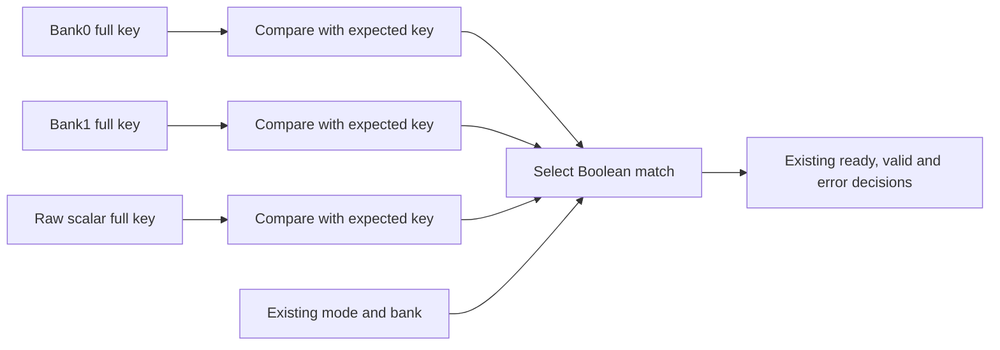

# V127: full-owner comparison before mode selection

**V127 is complete as a bounded experiment; 125 MHz timing still fails.**
Functional verification passes with zero public-cycle change. Global WNS improves
**−1.867 → −1.193 ns**, TNS **−4,427.979 → −1,762.554 ns**, and failing setup
endpoints **10,868 → 6,980**. This candidate is not promoted.

| Gate | Measured result |
| --- | --- |
| Python owner algebra | PASS; 69,499 finite cases, separate from sequential proof |
| Focused actual RTL | PASS; six selected scalar/generic/caller seeds |
| Full decoder/actual V97 transport, peer, byte/row parent | PASS; exact 4/2/4 raw stream sets and zero public-cycle delta |
| Tile-mode → all endpoints | −1.867 → +0.451 ns |
| Tile-mode → scratch state | −1.867 → +0.986 ns |
| Global 125 MHz setup | FAIL; −1.193 ns WNS and 6,980 failing endpoints |
| Hold, pulse, routing, internal clock coverage | Zero failures, routing errors or unconstrained internal endpoints |
| Routed cost versus V126 | −177 LUT, +165 FF, +1 control set; BRAM/DSP/CARRY unchanged |
| Whole-parent 125 MHz / sustained hardware 30 fps / validated hardware <10 ms | Open |

The selected change exposes raw scalar epoch/block views through scratch and
child ports and compares 32-bit epoch/16-bit block keys in bank0, bank1 and scalar lanes
before selecting a Boolean owner match. Exactly three of 18 selected origins
change. No production register, reset, public top port, wire format, quality or
public cycle is added. The existing V126 successor registers remain.

This is source structure, not proof that synthesis retains three isolated
physical lanes. Actual query gaps and partial named intermediates remain explicit.

See [functional results](functional-results.md), [complete routed results and
adverse changes](timing-results.md), the [machine-readable result](../../experiments/python-gamebub-v127/results.json),
and the [next timing proposal](next-timing.md). The independent native audit
passes 1530 integrity checks while explicitly retaining `design_timing_pass=false`.
The old tile-mode path improves, but RAW ingress validation → scratch state is
now worst, with admission header → tile reset/control close behind. Cursor→cache,
address→ROM and hidden-predicate/coordinate families also retain negative slack.
V123's historical −1.086 ns global result remains a comparison, not a qualification.

The [focused results](focused-results.md) preserve the initial strict-lint
verification-adapter failure and narrow output-binding repair. Successful full
regressions were rebuilt after an orchestration interruption; incomplete attempts
remain recorded without claiming a functional result. The [design](owner-design.md),
[frozen verification plan](verification-plan.md), [experiment plan](plan.md),
[Python model](owner-model.md) and [read-only query notes](pipeline-inspection.md)
define the evidence scopes.

One fresh 8 ns constrained native build was run from RTL using the fixed recipe.
The negative source was not rerouted unchanged. A positive source would require
a second identical fresh build before internal component qualification.
Qualified [B100](../cu66-v120/handoff.md), its 18 physical files and protected
marker fixtures stay unchanged. No hardware programming or board bitstream was
performed here.

The [future elastic-control option](elastic-control-options.md) specifies owned
tuples, tag-bound validation, local registered capacity, exact debts and an II=1
requirement. It is unimplemented and must be retargeted to the actual critical
boundary; an output queue alone is not a cure for RAW validation or reset cones.
Future latency changes require a new explicit contract, preserving values,
ordering, complete keys, first-error, cancellation and accepted request/ACK debt.

Row-profile counts remain 1,145,104 / 1,553,197 cycles: hypothetical 9.160832 /
12.425576 ms at a complete-parent 125 MHz. The stalled profile still needs 303,198
fewer cycles for strictly under 10 ms. The component clock, complete-parent clock,
real ESP32/Wi-Fi/QSPI/memory service, actual custom host endpoint and hardware
30 fps/<10 ms goals remain separate gates under the [V126–V130 plan](../gamebub-v126-v130-timing-streaming-plan.md).
