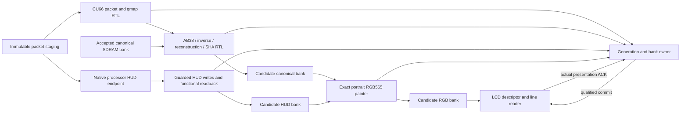

# V70 hardware-development handoff

V70 implements and tests the receiver integration proposed in [the plan](plan.md).
Complete CU66 packets now drive the real packet/qmap/base RTL, accepted reference
storage and global video/HUD commit. A separate command-level system connects
that owner to the SDRAM controller, portrait painter and native LCD scanout.

**Functional reconstruction passes. The clean streaming cadence gate fails.**
The real-controller model exposes a substantial memory/presentation bottleneck;
this is not a 30 fps release, a flashable board image or a target-fit result.
All v69 files and its 4,879-file integrity bundle remain unchanged.

## Implemented path

Packet staging is modeled as a synchronous byte memory. The HUD semantic
endpoint executes real native C++ on original HUD bytes; its CPU execution
time is outside simulated time. No live ESP32/QSPI/processor link is installed.
Native golden data is confined to scoreboards, not supplied as RTL reference
pixels or packet metadata. The control framing codec and native C++ HUD endpoint are also qualified
through encoded HC70/HR70 messages. Typed processor/RTL sidebands are used
in the command-level system simulation; physical control-link integration
remains open.

## Evidence and scope

| Gate | Result | What it establishes |
|---|---|---|
| Complete-packet receiver | 457 retained frames: 20 keys, 437 predicted; all canonical tiles and stored reference tags agree | Real parser/qmap/base/owner and actual prior RTL output as references; transactional RAM, painter/scanout completion models |
| Malformed/unsupported inputs | 28 reject-and-recover cases | No accepted reference/HUD change; late HUD/tag/hidden-coefficient failures and key-24 recovery |
| Memory component | 8 backend/seed/corner runs | Actual conservative controller commands, checked 32 MiB model, refresh=750, guards, cache coherency, concurrency and aborts |
| Display components | 91 full raster executions, 34,944,000 RGB565 word comparisons | Exact color rounding, HUD, borders and portrait/strip output; repeated fixtures, not 91 distinct captures |
| LCD component | Eight scanout frames / 3,072,000 pixels | Descriptor switching and safe whole-black-line underrun behavior; intentional starvation remains explicitly counted |
| Integrated real-command system | Two chronological frames with each painter | Exact 518,400 canonical bytes and 384,000 portrait RGB565 words/frame, 21,120 actual HUD aux-port readback words/frame, lost COMMIT ACK retry |
| Owner control | 618 assertions / 561 clocks | Length/generation checks, 512-cycle watchdog, ten stale notifications, drain retention, sticky fault and event ring behavior |
| Bank bounded checks | 16 safety assertions at 8/16/24 solver-state bounds; five witnesses | Bounded bank safety, including independent presentation during abort; not induction, liveness or CDC proof |
| HUD control framing | 11 Python tests | Correct opcodes, exact 32-byte header, header+payload CRC, bounds and fragmented framing |
| Native encoded HUD endpoint | Release and ASAN/UBSAN each457 histories /2,811 encoded commands; Python compatibility17valid/15malformed frames | Real C++ semantic endpoint, READ words/tags, retry/rollback and status; not deployed ESP32 transport or a wire-to-RTL system test |
| Exact target implementation | Unavailable | `xc7a100tcsg324-1` absent from current Vivado install; no synthesis/route/Fmax/fit result |

The [independent evidence audit](evidence-audit.json) reconciles3,315 declared
hash claims with no source/log mismatches. Its remaining warnings preserve
the cadence, model, bounded-proof, host-only endpoint and per-run tool
provenance limits; wrapper summary transcripts are not authoritative producer
command records. The source/log checks and requirement matrix remain separate
from functional and hardware verdicts.
The 457-frame campaign is retained study material across four histories. The
1,800-distinct-source-frame and physical ten-minute 30 fps gates remain open.

## What the command-level runs revealed

Both implementations preserve the same CU66 packet bytes, resolution, HUD and
decoded pixels. They differ only in presentation write ordering and buffering.

| Chronological input | Painter | Total modeled memory clocks | Painter clocks | SDRAM ACT commands | SDRAM PRE commands |
|---|---|---:|---:|---:|---:|
| Key frame 0 | Direct portrait writes | 12,839,737 | 9,337,009 | 407,598 | 405,968 |
| Key frame 0 | Eight-row strip | 10,958,523 | 7,455,795 | 128,433 | 128,888 |
| Predicted frame 1, concurrent scanout | Direct portrait writes | 24,813,942 | 18,251,458 | 508,681 | 481,457 |
| Predicted frame 1, concurrent scanout | Eight-row strip | 22,984,583 | 16,570,522 | 240,214 | 214,864 |

The eight-row strip uses 11,520 additional logical data bytes (13,696 bytes
including existing painter caches). It produces eight contiguous portrait words
per coded column and preserves every output pixel. Under this declared test
schedule, P-frame ACT counts fall 52.8%, while total clocks improve only 7.37%.
These ACT/PRE counts include all competing clients during each transaction.
Different transaction lengths also change the amount/phase of concurrent LCD
traffic; this is not a fixed-window, isolated-controller throughput comparison.

At the simulation's 10 ns memory period, those P transactions take approximately
248 ms and 230 ms. That excludes HUD software CPU time, network and live ingress,
and it does not establish an achieved FPGA clock. The results already miss the
33.333 ms complete-frame target by a large margin.

Both system schedules record LCD underruns: 12,828 direct and 11,762 strip over
their respective full runs, including the same additional 3.5-million-clock
tail after the last commit. Those runs have different total durations, so raw
underrun counts must not be presented as a normalized improvement. The pixel
scoreboard checks each observed active line is either exact or wholly black;
black replacement lines remain lost display content and a failed cadence gate.
Descriptor presentation counts are not complete, clean displayed frames.
The live line checker finalizes14,227 direct and13,081 strip lines. Observed
pixel totals also include191/279 trailing pixels from unfinished lines; those
tails are not covered by the whole-line final check. Exact-line counts include
expected-black borders and naturally black content. Complete stored framebuffer
comparisons are separate and cover all384,000 words for every tested frame.

The source identifies two contributors worth addressing next:

1. The conservative controller performs single writes. Scalar request/reply
   handshakes and portrait row misses consume far more cycles than raw x16
   bandwidth suggests. The strip helps locality but does not create BL8 writes.
2. HUD, painter and LCD traffic share the aux read cache. Interleaved readers
   can evict each other even though canonical and aux clients have separate
   caches. The existing bridge already invalidates only aliasing cached blocks
   on writes. A stalled response holds the arbiter. Measure per-reader service
   and cache behavior before choosing a replacement.

## Transaction and recovery rules

- One root owner binds compressed staging, canonical/HUD candidate banks and
  RGB allocation to a 64-bit generation and frame ID.
- Packet replies echo generation, address and request sequence; stale replies
  cannot satisfy later reads within the same frame. Reference/write replies
  match generation, bank, plane and full-grid tile index.
- Qmap values and plane byte offsets come from packet RTL. Predicted samples
  are read from the previous accepted, RTL-written bank.
- HUD admission is generation/frame/region checked. The hardware adapter counts
  21,120 contiguous, completed word writes and seals the bank at transfer drain.
  The processor computes the HUD tag from actual functional SDRAM readback;
  the coverage count alone cannot attest word contents.
- Parser, base SHA, HUD semantic/transfer, painter and memory-drain gates must
  all agree before the shared commit edge.
- After committing, the decision is irreversible. Lost processor ACKs trigger
  idempotent COMMIT retries and block new dependent work. This reconciliation
  wait can be indefinite; a timeout must not silently undo accepted state.
- Before commit, errors/abort preserve accepted reference/HUD/front state.
  Accepted memory operations finish normally before allocations are released.
  Do not simultaneously cancel an adapter that the decoder is waiting on unless
  the integration provides an explicit cancel-completion/flush protocol.
- RGB buffers remain leased until the scanout's matching presentation ACK.
  Raw vblank alone is insufficient when descriptor delivery is delayed.
- Reset requires both clock domains and all adapters to be flushed together,
  with a fresh host generation. Pixel-only reset is not that operation.

## Diagnostics and bring-up tests

The owner exposes version/capability reads, timestamps, accepted/presented/
rejected/stale counters, a sticky first fault and an eight-entry event ring.
See [the diagnostic interface](diagnostics.md). Fault context includes the last
request address or tile tag, not a promise of the physical pin-level cause.
The ring is bounded and coalesces simultaneous events; dedicated counters and
timestamps remain the primary accounting records.

The replay scripts provide a deterministic software/simulation bring-up sequence:
memory addressing/guards, bars/edge/moving-pattern scanout cases, an actual key
and dependent P, readback checks, malformed-input and abort/recovery probes.
This is not an autonomous self-test ROM/firmware command installed on a board.

## Handoff boundary and next work

The next two milestones are **verified 30 fps**, followed by **validated decoding
under 10 ms**, with distinct acceptance criteria. Thirty fps measures sustained
complete presentations with bounded age/backlog and no unexpected normal-load
underruns. Under 10 ms measures complete-packet availability through verified
YUV/HUD storage and write drain, including post-staging queues, processor
service and transfer. RGB composition, vblank waiting and scanning remain
separately reported system costs, alongside capture-to-visible latency.

Use the observed campaign maximum for the under 10 ms gate and retain
p50/p95/p99/max, failed attempts and recovery costs. A pipeline can meet 30 fps
without meeting the latency target. The current 230 ms modeled transaction is
not decode-only latency; the earlier 7.61 ms desktop native measurement is not
target FPGA/ESP32 evidence. Neither target milestone is currently verified.
The authoritative [milestone definitions and instrumentation requirements](plan.md#sequential-milestones-verified-30-fps-then-validated-decoding-under-10-ms)
also address panel-quantized presentation spacing and the missing complete
packet/validated-ready/end-to-end timestamp chain.

Use the new sources as a correctness-first prototype and failure diagnostic.
They are not ready for claiming clean native-panel game streaming at 30 fps.
The next implementation should prioritize:

1. A dedicated streaming BL8 LCD path with a measured line deadline and bounded
   arbitration delay, rather than one scalar roundtrip per displayed word.
2. Reader-specific or associative aux caches, preserving the existing selective
   alias-invalidation rules and testing concurrent canonical/HUD/RGB commands.
3. Burst-capable strip/HUD writers with explicit completion and partial/abort
   rules. Reuse the exact-output strip as the comparison control.
4. Safe overlap of decode, provisional strip conversion and writes, while
   keeping validation and global publication atomic. Preserve canonical tags.
5. Exact-device OOC/full-board resource, RAM-port, timing and CDC checks; then
   a real ESP32 processor/memory/transport budget and physical presentation test.

A second architecture option is direct, transposed-YUV scanout with bounded
line caches and exact DSP color/HUD conversion. The new [traffic accounting](../../fpga/experiments/cu66-v70/system/logical-traffic.json)
estimates useful traffic at the declared native panel clock and30 game fps:
about122.91MB/s for the current copy-based path versus69.56MB/s for that
proposal. It omits command overhead/overfetch/cache misses and is **not** an
implemented path or performance proof. It explains why avoiding a full RGB
conversion/copy may be worth prototyping after the baseline. Preserve canonical
hash order and reference identity independently of physical storage layout.

More inverse-transform DSP lanes should follow measured stage profiling. They
will not by themselves fix the observed scalar memory and scanout bottleneck.
Keep the deployed JPEG backend as the hardware compatibility path during this
work. No deployed firmware, production RTL or board flash was changed here.

## Development failure retained

The expanded malformed-input campaign exposed a null HUD candidate in the
transactional testbench after semantic rejection. ASAN isolated a phantom drain
notification in the harness; the RTL already rejected the candidate with0x70.
The harness now requires successful preparation and an owned candidate before
emitting that notification. The complete457-frame replay and all28 negatives
were rerun against the corrected source. Pre-fix source/results and the failing
case remain archived; no failure was silently relabeled as a pass.
