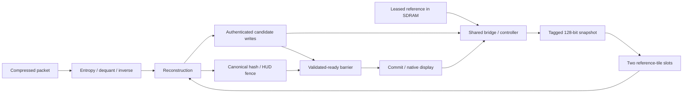

# V81 hardware-development handoff

## Implemented boundary

The new `cu81_reference_prefetch` accepts four tagged 128-bit blocks for each
512-bit reference tile. It preserves the two-slot bound, plane/tile walk,
reference-bank lease, exactly-once block completion and authenticated candidate
write retirement. Tags include generation, reference bank, plane, tile and block.
A mismatched/error block faults the epoch and is drained without publishing
successful data. Abort also drains accepted work and excludes canceled commits.

`cu81_memory_system` captures the existing SDRAM bridge snapshot, releases its
P0 command owner and holds the full block with tags until acceptance. A held
response cannot overwrite another response or release a newer write owner.
The controller, SDRAM model, decoder arithmetic, packet format and physical
canonical/HUD/native-display checks remain the existing implementations.

The new tags are internal RTL metadata. Sunshine and ESP32 packets have not
changed, and no new host or ESP32 firmware is required for these replay tests.
This is Game Bub decoder research; it is not a new VCS³ DSI bitstream.

The shared-memory dependency is:



The completed inverse can wait at reconstruction while its reference is still
being supplied. Display, reference reads, candidate writes and HUD transactions
share the same physical command path. The diagram does not imply that their
latencies add independently or that a candidate is visible before the fences.

## Configurations

`cu81_system` and `cu81_system_sim` use `PREFETCH_ENABLE`:

| Mode | Runner option | Meaning | V81 evidence |
|---|---|---|---|
| 0 | `--variant baseline` | Older legacy path | Strict lint; earlier frozen functional evidence |
| 1 | `--variant prefetch` | Conservative V80 stream | Retained compatibility, not newly qualified here |
| 2 | `--variant overlap` | Frozen V80 snapshot-overlap control | Strict lint and matched regular/combat replay |
| 3 | `--variant wide` | Tagged 128-bit block fill | Strict lint, components and system replay |

The experimental default is 3; choose it explicitly when reproducing. The
mode-2 regular/combat four-source runs reproduce all original V80 transaction,
timing and summary fields except CPU wall time and extra trace-row count.
Mode 2 and mode 3 use the same source pins and immutable packet releases.

## Bounded observations

All times are packet-complete to validated-ready, including admission queue,
at the modeled 100 MHz and `tAC=2 ns`. Neither mode changes the resolution.

| History/source | Mode-2 control ms | Mode-3 wide ms | Wide minus control ms |
|---|---:|---:|---:|
| regular 1 | 28.64745 | 28.64840 | +0.00095 |
| regular 2 | 26.41133 | 26.41083 | -0.00050 |
| regular 3 | 25.71498 | 25.71412 | -0.00086 |
| combat 1 | 35.47300 | 35.38423 | -0.08877 |
| combat 2 | 37.71609 | 37.71574 | -0.00035 |
| combat 3 | 38.82782 | 38.96009 | +0.13227 |

Keyframe timings are identical. The wide handshake does not establish a
consistent frame-level speedup. In source 1 of both bounded histories, median
first-offered-lookup wait drops from 126 to 119 cycles, while median write accept
to backend completion remains 136 cycles. Backend completion to receiver
completion is exactly two cycles. In wide mode, a captured snapshot commits
one cycle later. These observations overlap other work and must not be summed
as predicted latency savings. See [path-analysis.md](path-analysis.md).

## Complete-history measured results

The restarted detached campaign completed **457/457** source updates across
four independently reset continuous histories (119/119/119/100), without a
reset per source. All canonical, semantic HUD/readback and full native raster
checks passed with zero detected memory/display errors, underruns or black
lines. This full campaign uses `tAC=2 ns`; the separate two-source and component
7-ns checks are not a full-corpus second-corner qualification.

| History | Sources | Validated min / median / max (ms) | ACK within 33.333 ms | Under 10 ms | Faster / equal / slower than V80 mode 2 |
|---|---:|---:|---:|---:|---:|
| mass-effect-10000 | 119 | 14.13410 / 28.39921 / 30.71335 | 119 | 0 | 72 / 2 / 45 |
| mass-effect-4500 | 119 | 19.57636 / 30.45042 / 49.65601 | 82 | 0 | 87 / 3 / 29 |
| mass-effect-1600 | 119 | 12.45290 / 25.25408 / 29.14783 | 119 | 0 | 68 / 3 / 48 |
| mass-effect-combat | 100 | 21.65702 / 49.171365 / 71.44699 | 7 | 0 | 87 / 1 / 12 |

Pooled validated min/median/max is **12.45290 / 28.39921 / 71.44699 ms**, versus
V80 mode 2's 12.45290 / 28.52827 / 71.49397 ms. Every value is packet-complete to
validated-ready, including admission queue. Per-source paired differences have
median **−0.00314 ms**, range −2.08134 to +0.67903 ms: 314 improve, 9 are equal
and 134 regress. The paired median differs from subtracting the two pooled
medians. The overall gain is small; this is an integration/enabling experiment,
not achievement of the strict performance milestones.

**327/457** sources meet the separate serial ACK budget (V80: 326/457);
130 still miss it and **0/457** validate under 10 ms. The finite first-to-last
full-raster-start cadence remains 29.87903 fps in each 119-source history and
29.82627 fps in combat. That excludes startup/tail and covers only about four
seconds per history, from one walkthrough family. It is not one sustained
60-second stream, four independent games, or a physical 30-fps proof.

The full campaign checked 381,598,591 physical LCD pixels including borders,
repeated/partial rasters and tail. This is not a count of unique source pixels;
one 480×800 physical raster for each required presentation is 175,488,000 pixels.
Do not add overlapping bounded/diagnostic replays to the full-campaign total.

Machine-readable results and exact selected attempts are in
[`comparison.json`](../../fpga/experiments/cu66-v81/comparison.json) and
[`the campaign terminal record`](../../fpga/experiments/cu66-v81/campaigns/prefetch3-cf4c1d1f6426/results.json).
The four earlier histories interrupted by the chat turn remain unqualified
checkpoints with a separate interruption note. They are not completed failures
or passes and are not included in these counts. Detached logging was used for
the restarted campaign; all completed case exit statuses and terminal records
are retained.

## Why the next change targets memory service

The read-only diagnostic runs reproduce the original four-source system timings
and results. In predicted source 1, inverse arithmetic occupies 404,088 regular
and 499,020 combat cycles; a completed inverse output is held with not-ready
for 1,759,692 and 1,730,204 cycles respectively. These overlapping observations
do not label every held cycle as missing reference, but they rule out treating
all `WAIT_IDCT` time as arithmetic work.

For the recorded no-cache-hit delta traffic, the unchanged serialized bridge
also imposes a conditional 11.91342-ms minimum between first and last mandatory
physical command acceptances at 100 MHz, before LCD, refresh and row misses.
The reviewed source edge ledger gives minimum successor separations of 18
clocks after a read and 16 after a write. There are 35,040 mandatory reads and
35,040 writes. The calculation is conditional on that traffic and service path;
it is not formal proof or physical timing signoff.

Four/eight reference slots or bounded grant grouping may improve service and
queueing toward 30 fps. Under-10-ms validation additionally needs fewer physical
transactions or shorter/pipelined bridge/controller service. A small generic
shared cache has poor address reuse in the recorded screening; it is not an
assumed solution. See [next-bottleneck.md](next-bottleneck.md) for exact profiles,
cache-screening limits, the source ledger and proposed controlled experiments.

## Correctness and fault coverage

See [integration.md](integration.md) for the separate direct-core all-8,100-payload
and all-unused epochs, nine wrapper groups and actual SDRAM-model tests at
2 ns and 7 ns. Wrapper payload checks cover 7,806 visible tiles; the 294 hidden
tiles retire unused. Direct-core checks separately cover every payload.

The actual-system fault campaign passed bad-CRC rejection, partial-write abort
on an accepted physical reference read, complete drain, old reference/HUD/front
retention and successful retry with a lost CPU acknowledgment. The pending-lookup
coincidence was not observed; component cancellation tests are separate evidence.
A two-source combat system replay also passed at `tAC=7 ns`; this is distinct
from qualifying the entire corpus at that timing corner.

## Separate Python prototype: certified resident stores

This work is **not implemented in the wide-fill RTL**. A native decoder plus
Python model keeps the same three physical canonical banks. It models a
three-bit bank-residency mask for every tile, plus a shadow map published only
at authenticated commit. A store is eligible for elision only when the new tile
is unchanged and its candidate bank is already certified to contain that value.
The old accepted map's candidate bit clears before a modeled physical store;
aborting the frame does not restore an invalidated certificate.

On the four native histories, round-robin replay certifies 1,685,219 tile store
elisions: **6,740,876 hypothetical BL8 writes**, or 45.5255% of all canonical
writes. This is lower than the naive previous-frame equality estimate because
659,906 unchanged delta tiles lack candidate-bank residency. Every key writes
all tiles, and 40 deltas still have zero elisions. The fixed-service worst-case
floor therefore remains relevant; this does not establish under-10-ms decode.

The prototype checks every claimed reuse against native tile fingerprints and
checks the complete candidate frame at commit. Nineteen synthetic cases and a
native replay with partial-frame/late-auth aborts and lost-ACK retries exercise
certificate invalidation, leases and publication. These abstract tile operations
do not simulate individual partial BL8 beats or implement hardware integrity
checks. Reference reads, HUD transfers, logical decoding and canonical hashing
remain in the accounting. Metadata and scanout costs are unpriced. Two packed
3-bit maps require 6,075 logical bytes before control and implementation overhead;
no FPGA-fit claim follows.

See [residency.md](residency.md), its retained streams and scripts. The separate
`verify_residency_independent.py` replay imports no producer model and reproduces
both normal schedules and the 31 retained native abort events; synthetic and
lost-ACK records remain bound producer evidence rather than separate RTL tests. A future RTL
backend needs an explicit authenticated resident-store completion, actual
candidate-content invariants, abort/drain integration and full canonical/HUD/
native-raster replay. It must not turn a required store into an unverified
success. No Sunshine or ESP32 protocol modification is proven necessary by
this native model, and no physical speed gain is claimed.

## Reproduction and deployment gates

Use the repository mounted at the recorded absolute path in
`gamebub-cu66-v69-build`, with the existing Verilator backend. Build one compiler
job per unique variant/TAC directory. Reuse only binaries whose source map and
recorded SHA match exactly. For matching binaries on the existing build host:

```sh
python3 scripts/cu66-v81/verify_baseline.py
python3 scripts/cu66-v81/run_system.py --variant overlap --cohort 0 --frames 4 --mode fixed30 --trace --skip-build
python3 scripts/cu66-v81/run_system.py --variant wide --cohort 0 --frames 4 --mode fixed30 --trace --skip-build
python3 scripts/cu66-v81/run_history_campaign.py --prefetch 3 --workers 4
python3 scripts/cu66-v81/analyze_results.py
python3 scripts/cu66-v81/analyze_path.py
python3 scripts/cu66-v81/verify_evidence.py
```

On a fresh build machine use a separate working copy and preserve this published
package. Archive inherited `system/build-prefetchN-tacT.json` and matching
`/build/v81-system-prefetchN-tacT` objects (or use an empty `/build`), then omit
`--skip-build` for the first build of each variant/TAC. Do not rebuild while
another process uses that variant. Subsequent replay and the history campaign
require matching immutable binaries. Every attempt has a new directory and
retains source snapshots, source/log/binary hashes and a terminal verdict.
New local results change the published bundle manifest.

Simulation assumes a 100-MHz memory clock and zero-time native CPU HUD/control.
It does not establish target synthesis/fit, clock timing, CDC, ESP32 transport,
electrical behavior or physical display operation. Qualify those separately,
then use distinct-source 60/600-second runs and bounded queues. The strict
maximum packet-complete-to-validated goal remains below 10 ms; a shorter
cache-fill transaction or finite cadence alone does not close it.
