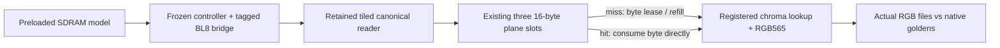

# V91l: consume canonical bytes directly from owned lines

This experiment removes the external byte request/response handshake when the
RGB565 converter already owns the required byte in one of its three plane-line
slots. A miss still uses the frozen byte lease, retained tiled reader, tagged
BL8 bridge, actual SDRAM controller and timed functional pin model. The scalar
implementation remains frozen and is rebuilt as the matched control.

The work remains **V91l partial**. It does not change codec syntax, resolution,
rate/quality, Sunshine/ESP32 wire headers or the HEVC/AV1 coding comparison.
The comparison uses canonical native memory preloaded before the frame fences;
it does not join live entropy/reconstruction, physical writes, semantic HUD,
hash/publication or all memory clients.



## Design and Python result

The source-derived Python model predicts **486,000 owned-line hits** and
**32,400 misses** per 518,400-byte canonical frame. Direct consumption saves one
request-service edge on each hit. This is a local 486,000-clock estimate; full
frame savings also reflect changed refresh/stall interactions.

The candidate adds **zero payload bytes** and retains the three existing 16-byte
plane slots and four registered 180×16 chroma RAM banks (1,440 logical bytes).
It adds two 64-bit diagnostic counters. Direct chroma fills use the same single
byte-enable write path, and row validity follows the final committed byte.
Interpolation, rounding, clipping, Q8 color conversion, RGB565 packing and
registered lookup latency are unchanged. The direct byte selector is a new
combinational path; this study does not establish its mapped area or timing.

`count_reads`/`count_responses` continue to count real external byte leases and
returns: 518,400 scalar versus 32,400 direct. Separate counters record 486,000
direct consumes and 518,400 total successful canonical bytes. Physical BL8 reads
remain 32,400/frame in both variants. This saves converter control cycles; it
does not claim another reduction in SDRAM payload traffic.

Probe eligibility requires the active matching epoch, valid plane/aligned tag,
idle adapter, no physical or byte owner, and no held response. Reset, cancel,
start, finish, bad epoch/range/tag or error suppress the probe. Only a successful
matching canonical-line response installs reusable data; the frozen reader
supplies it from a qualified retained row or completed physical reads. The core
offers an independent probe address so the hit-gated external request creates
no combinational loop.

The [model and contract](hit-contract.md) check both native canonical inputs
and a nonuniform synthetic edge fixture. The 360-byte chroma rows alternate
alignment: 120 of 239 adjacent row boundaries per plane share an aligned line.
Every consumed byte and each boundary is checked; bottom-row replication
requires no fictitious row 240.

## Qualified results and scope

| Complete base-RGB component fence | Frozen scalar | Direct owned line |
|---|---:|---:|
| Start → both engines closed | 3,360,839–3,362,747 clocks | 2,869,958–2,870,546 clocks |
| At assumed 100 MHz | 33.60839–33.62747 ms | 28.69958–28.70546 ms |
| Start → first RGB word | 5,299–5,312 clocks | 3,939–3,944 clocks |
| External byte leases/frame | 518,400 | 32,400 |
| Physical BL8 reads/frame | 32,400 | 32,400 |

Each matched pair saves 490,502–492,271 complete-fence clocks, or
**14.59–14.64% fewer cycles** (1.1709–1.1715×). The 486,000-clock local model
estimate and measured total reduction differ because memory/refresh and seeded
output stalls interact with the new schedule. The saved clocks are not a new
payload-bandwidth or compression result. At assumed 100 MHz the isolated
component now fits the nominal 30-Hz period, leaving about 4.63 ms of that period;
this margin is not a proven live decoder/shared-memory budget.

See [summary.json](../../experiments/python-gamebub-v91l-burst-converter/summary.json)
for exact timing ranges and matched pairs, the
[independent audit](../../experiments/python-gamebub-v91l-burst-converter/audit.json)
for source/byte/RGB/pin reconciliation, and the
[selected timed report](../../fpga/experiments/cu66-v91l-burst-converter/timed-results.json)
for commands, fences and state/wait occupancy. The final campaign covers both
static converters, seeds 912701/912702 and selected tAC 2-/7-ns functional
corners. Each mode executes seven directed/native checks and writes two full
native base-RGB outputs: 56 entries and 16 output files from two distinct images.

The independent checker replays every external byte lease, response and direct
consume against a separately derived canonical address order and original
source bytes. It checks actual RGB rows/files, logical line and physical read
order, actual pin commands/word values/capture timestamps, two-idle fences and
abort/drain ownership. It rejects 156 targeted corruptions to test the checker,
retaining the original/corrupted receipts and causal rejection reasons.
Original native RGB goldens are unchanged. Differing cycle counts imply
different positions in the same seeded output-ready sequence; the two variants
use the same stimulus rule, not identical absolute stall traces.

The [standalone probe test](../../fpga/experiments/cu66-v91l-burst-probe/results.json)
also exercises cold/stale tags, wrong epoch/range, pre-ACK/held-response exclusion,
three plane slots, shared-line chroma edges, start/finish/reset/cancel invalidation,
wrong-epoch physical drain and matching bus-error ACK/held error response/fresh
retry. This is directed RTL simulation, not exhaustive formal proof.
The selected probe run passes 255 checks in 88 clocks.

All reported milliseconds assume a 100-MHz source clock. Canonical preloads,
accelerated test-only power-up, the selected functional SDRAM model and two
native images are explicit limits. No hardware, routed frequency, SDF/PVT
electrical behavior or whole-device fit is established. An isolated display
component below the 30-Hz budget does not prove sustained hardware 30 fps or
complete validated decoding below 10 ms. Base RGB excludes semantic HUD.

## Reproduce and continue

Use the existing `gamebub-cu66-v69-build` container with Verilator 5.020 and
GCC 13.3.0. Builds retain assertions and strict HDL/C++ warnings, C++20, finite
watchdogs and two compile jobs. No new design-warning waiver is used.

```sh
python3 fpga/experiments/cu66-v91l-burst-converter/generate_converter.py
python3 scripts/cu66-v91l-burst-converter/run_comparison.py
python3 scripts/cu66-v91l-burst-probe/run_test.py
python3 experiments/python-gamebub-v91l-burst-converter/hit_model.py
python3 experiments/python-gamebub-v91l-burst-converter/verify_results.py
python3 scripts/cu66-v91l-burst-converter/summarize.py
```

All attempts, including the initial module-filename compile failure and
superseded source-freshness/interrupted campaigns, are retained. The selected
passing campaign binds current sources to snapshots, inputs, complete RGB
files, compressed receipts, exact build commands and tool logs. A hash manifest
binds the review bundle. Compiler version logs are retained byte-for-byte.
The [packaging check](../../experiments/python-gamebub-v91l-burst-converter/packaging-check.json)
records exact whitespace exceptions for raw compiler logs and one retained
space in the hash-pinned qualification driver/snapshots; other bundle files
pass the Git whitespace check. These are not HDL/C++ warning waivers.

Next follow the [live common-service integration plan](next-integration.md).
Join live writes/reference/scratch, integrity/publication and display reads on
one finite physical controller before V91m's complete fixed-source-cadence test.
Preserve both scalar/direct controls and original failed trials. All-RTL HUD,
mixed entropy or negotiated fallback, ESP32 costs, byte masking/RMW and later
7-series mapping/routing/hardware gates remain open.
