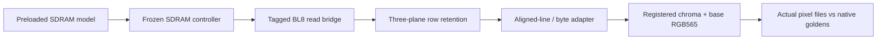

# V91l: physical BL8 reads and native base RGB565 conversion

This checkpoint joins the read side to the actual controller and timed SDRAM pin model, then joins the frozen base RGB565 converter to that same physical read path. The previous physical-write result and the new display result remain separate component fences. Native canonical memory is preloaded before the tests; no live decoder/writer, semantic HUD, hash/publication or common-controller workload is silently substituted into this lane.

The work remains **V91l**. V91m's complete functional source-cadence path and the V100–V110 physical/hardware goals are not promoted by these tests.



See the [summary](../../experiments/python-gamebub-v91l-readbridge/summary.json), [physical read audit](../../experiments/python-gamebub-v91l-readbridge/audit-readbridge.json), [converter audit](../../experiments/python-gamebub-v91l-readbridge/audit-converter.json), [combined pin audit](../../experiments/python-gamebub-v91l-readbridge/audit-timed-pins.json), and [ideal controller-work model](read-budget.md).

## Read bridge and retained canonical client

The new bridge accepts one tagged, aligned 16-byte physical read. It issues one controller READ in the original word-address aperture, captures all eight unbackpressured x16 return words, observes two consecutive controller-idle clocks, and only then offers the complete 128-bit response. It retains bank/epoch/generation and payload under backpressure. An invalid request produces no controller work. Warm cancellation stops an unaccepted command or drains all accepted words and the final fence before an error response. An already offered success or error remains immutable.

The frozen controller retains MRS 0x233, selected 100-MHz source clocks, read-capture phase and write/PRE/ACT/refresh behavior. Tests cover all three allowed bridge banks, a raw reserved fourth-bank controller read, both read/write turnarounds, cancellation before acceptance and after 0/3/7 captured words, invalid bounds/IDs, held responses and periodic refresh. Two source-backed canonical frames are then read in the converter's source-derived request order through the actual retention reader, bridge, controller and pin model.

| Native canonical frame | Independent gathers | Retained rows | Cycle reduction |
|---|---:|---:|---:|
| Key | 1,565,404 cycles /15.65404 ms | 846,844 cycles /8.46844 ms | 45.90% |
| Delta | 1,565,402 cycles /15.65402 ms | 846,703 cycles /8.46703 ms | 45.91% |

Times assume 10 ns per source clock; they are simulated, not achieved hardware timing. Both seeds reproduce these native windows. The fence begins after accepted reader start, before the first logical request, and ends after the final logical response ACK. It includes client/bridge scheduling, captured data, ACT/PRE/refresh and physical drain. It excludes actual RGB conversion, live reconstruction, HUD, validation/publication and other memory clients.

Eight modes pass 132 check entries and 3,111,744 pin/controller read-word comparisons. Native replays are at the selected 2-ns memory data-delay setting; both 2-/7-ns unit corners run with two seeds and both static retention settings. The independent checker reconstructs memory from original canonical fixtures, checks the pinned tile preload and line vectors, replays every command/data/capture timestamp, correlates all owners and verifies explicit idle-fence receipts. It rejects 32 deliberate trace corruptions. Preload is test setup outside every frame fence, not a physical-write or live-decoder integration result.

The reader's scratch-hit counter includes delivery from a just-returned burst. It must not be reported as inter-request reuse. Row-retention hits and actual physical-read reduction are checked separately. Retention still uses 1,472 data bytes plus tags/control and the converter's existing buffers; no whole-design fit claim is made.

## Actual converter join

The wrapper starts the frozen canonical-line converter and retention reader only with a valid, immutable bank/epoch/generation lease. It binds each logical line to a ticket/address owner, propagates faults/cancellation, and waits for both engines to close before done or reuse. The consumer really executes its registered chroma lookup, bilinear rounding, Q8 color conversion, clipping and RGB565 packing. This is not a precomputed-pixel replay.

A matched logical-service comparison preserves the original scalar converter and tests independent versus retained gathers with two seeds. All eight complete base RGB565 outputs match the original native goldens:

| Actual base RGB565 consumer with declared logical read actor | Independent | Retained |
|---|---:|---:|
| Closure cycles, four native frame/seed samples | 3,500,170–3,500,771 | 3,067,328–3,067,925 |
| Physical BL8 requests/frame | 64,800 | 32,400 |

That is 12.35–12.37% fewer complete consumer cycles. The earlier isolated reader-only improvement cannot be substituted for this result. The actor models eight payload cycles plus seeded wait/ready behavior; it contains no physical command/refresh schedule.

A separate timed top connects this same actual converter to the tagged bridge, frozen controller and timed SDRAM model. Its C++ driver advances every delayed event slot at 1-ps resolution between 10-ns source cycles. The full two-native-frame base RGB565 path measures 3,360,839–3,362,747 cycles (33.60839–33.62747 ms/frame at assumed 100 MHz); exact mode/seed/corner values and state/wait occupancy are in the selected report/summary. The native image corpus remains two frames, repeated across configurations; no broader gameplay corpus is implied.

The final timed campaign runs two seeds at both selected 2-/7-ns data delays, with seven checks per mode (28 total) and eight exact full base-RGB outputs. It checks actual RGB files and row digests against the original goldens, line and physical request order, controller words, capture timing, two-idle fences and final closure. Tests distinguish cancellation of an unissued bridge request from cancellation after a real controller READ and three captured words. A held RGB pixel stays stable until acceptance/cancellation. Already accepted physical work must drain before the wrapper releases its lease. Matching line returns are immediately ready in the frozen consumers, so a fictitious held-line-response condition is not claimed.

The independent combined pin audit heap-merges the actual pin and C++ sampling receipts by simulation timestamp. Across the final four modes it checks 259,576 controller READs, 2,076,608 captured words and 620,454 fence observations, rejecting 28 targeted pin/capture/fence corruptions. A separate timed RGB checker rejects 32 corrupted line/controller/pixel receipts; the logical-actor RGB audit rejects another 32. These repetitions cover the same two native images, not 16 distinct gameplay sources.

The base RGB result excludes semantic HUD decode/overlay. All complete RGB binaries are 691,200 bytes (345,600 words) in canonical 720×480 raster order. Start→first pixel, start→last pixel and final closure are reported separately. Neither these pixels nor a sub-10-ms isolated read-client window proves complete validated decoding below 10 ms.

## What the timing means for the goal

At assumed 100 MHz, a 30-Hz component budget is 3,333,333⅓ clocks. The current complete timed scalar display consumer is slightly over that budget, before live decode and shared-memory contention. This is useful negative performance evidence: the design is functionally joined, but this scalar configuration has not established sustained 30 fps. It is not a hardware FPS measurement or a new achieved frequency.

The next controlled consumer alternative is [burst-aware canonical consumption](next-converter.md). State/wait occupancy guides that work: avoid an external byte request/response lease for every byte already available in an owned 16-byte line, while preserving the current chroma RAM port structure, registered lookup, arithmetic, tags, backpressure and cancellation. Keep this scalar timed path as the exact control. No wire-format, bitrate, resolution, quality or HEVC/AV1 coding comparison changes in this checkpoint.

After that comparison, join live reconstruction/writes, accepted-reference and scratch reads, hashing/publication and display consumption on one finite controller with explicit deadlines and bank roles. Byte masking/RMW, all-RTL HUD and mixed-entropy or negotiated fallback remain open. Then run V91m's fixed 30-Hz source-cadence tests. Sustained hardware 30 fps and every complete validated FPGA decode strictly below 10 ms remain open physical/product milestones.

## Reproduce and scope

Use the existing `gamebub-cu66-v69-build` container (Verilator 5.020, GCC 13.3.0). All final campaigns use assertions, `-Wall`, strict C++20 compiler warnings, finite watchdogs and two compile jobs; timed lanes also enable `--timing`. The default timescale fills only missing declarations in frozen sources; declared timescales are preserved. No new design-warning or assertion waiver is used.

```sh
python3 scripts/cu66-v91l-readbridge/run_comparison.py
python3 experiments/python-gamebub-v91l-readbridge/verify_readbridge.py
python3 scripts/cu66-v91l-converter/run_comparison.py
python3 scripts/cu66-v91l-converter/run_timed.py
python3 experiments/python-gamebub-v91l-readbridge/verify_converter.py
python3 experiments/python-gamebub-v91l-readbridge/verify_timed_pins.py
python3 experiments/python-gamebub-v91l-readbridge/read_budget.py --check
python3 experiments/python-gamebub-v91l-readbridge/verify_budget.py
python3 scripts/cu66-v91l-readbridge/summarize.py
```

Sources, snapshot sources, original input receipts, exact preloads, actual output files, commands/tool versions, compressed event traces and all failed exploratory attempts are retained with hashes. Timed model initialization uses an accelerated test-only power-up delay outside frame fences. The model checks selected functional/command/I/O phase behavior; it is not a manufacturer/PVT electrical model, SDF timing, routed I/O/CDC signoff or board validation. The [existing manufacturer timing contract](../cu66-v91l-writepipe/timing-contract.md) remains the source for command assumptions.
