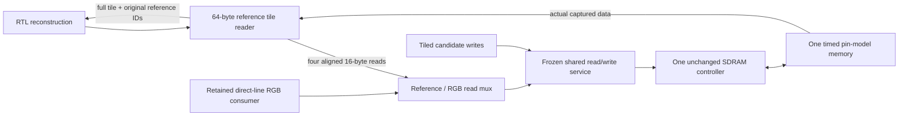

# V91l: accepted-reference tiles through real SDRAM reads

The live decoder now fetches accepted-reference tiles through RTL and the same
physical controller/pin-memory model used by candidate writes and base RGB
readback. The C++ reference-response and reference-ready drivers are removed.
The accepted mirror remains an observer for comparisons and exported artifacts;
it supplies no reference pixels to the DUT. No canonical/pixel SDRAM preload is
used. The previous serial shared-controller experiment remains frozen.

This advances **V91l partial**. Packed scratch requests still use the bounded
C++ memory actor, and native C++ still performs semantic HUD decoding before
RTL start. The nominal schedule remains serial decode/validate then base RGB;
there is no native decode/display overlap or fixed 30-Hz source-release test.
Mapping, routed timing, real firmware/transport and hardware remain unqualified.



## Native results

Seeds 912901/912902 at selected tAC 2-/7-ns functional memory delays pass four
configurations. All eight complete 720×480 RGB565 outputs match the original
goldens. All **8,200 actual RTL SHA digests** match independently recomputed C2,
HUD and seal values. These are two native source images repeated across the
configuration grid, not eight distinct gameplay scenes.

| Cycle-counter fence | Key | Delta |
|---|---:|---:|
| RTL transaction start → validated commit | 2,768,396 | 3,139,967–3,139,980 |
| Observed packet complete → validated commit | 2,730,185 | 3,112,271–3,112,284 |
| Subsequent base RGB stage | 2,936,376–2,937,396 | 2,936,742–2,936,809 |
| Serial start → RGB closure | 5,704,772–5,705,792 | 6,076,722–6,076,776 |
| Serial window at assumed 100 MHz | 57.04772–57.05792 ms | 60.76722–60.76776 ms |

The delta uses **7,806 reference tiles**, each assembled from four BL8 reads:
31,224 physical READ commands, 249,792 x16 words and 499,584 bytes. The key uses
no reference traffic. Hidden CONST tiles retain their no-reference path.
Each frame also retains 70,080 eight-byte candidate writes and 32,400 display
BL8 reads. Combined payload is 539,520 x16 words for the key and 789,312 for the
delta, before scratch traffic. Command, refresh, turnaround, arbitration and
drain costs are included in the measured physical service; payload division by
a clock does not produce latency.

This is additional real memory work replacing the former finite logical
reference response, not a coding gain or speedup claim. The earlier shared
control used different seeds and an eight-cycle logical reference actor; it is
a historical boundary control, not a matched performance denominator. Codec
bytes, resolution, quantization and intended pixels are unchanged. HEVC/AV1
rate/quality comparisons and host/ESP32 firmware are unchanged.

The observed packet-complete fence still excludes physical scratch service,
native HUD preprocessing and the remaining full-system work. Neither the
approximately 31.40-ms delta validation window nor the approximately 60.77-ms
serial window establishes sustained 30 fps or complete decoding below 10 ms.
All milliseconds assume a source clock; they are not achieved FPGA timing.

## Reader and bank ownership

The reader owns one 64-byte tile buffer plus metadata. It accepts only a
matching accepted-reference lease, legal plane/tile, nonzero epoch/generation
and bank 0–2. Frame ID **0 is legal**. Physical line starts are 19-bit offsets
in tiled canonical-plane storage, bounded by 518384. Tile address is
`plane_base + tile*64 + chunk*16`.
The final Y, Cb and Cr tile boundaries and all four chunk positions are checked.

The full 64-bit reference generation is captured and echoed without narrowing.
A separate nonzero 32-bit physical ticket identifies each line on the frozen
BL8 port. Physical ticket, address, bank and epoch must match before a return
can retire that owner. A wrong return cannot release/reuse it. New reads stop
on warm reset/cancel; accepted reads drain before reply or reuse. A response
already offered remains immutable through late reset/cancel.

The added logical payload is **64 bytes**, separate from existing reconstruction
storage and the frozen bridge/retention buffers. This is an RTL allocation,
not proof of BRAM inference, whole-device fit, frequency or routed area.

The read mux arbitrates complete 16-byte transactions between reference and
display clients, retaining routing through response ACK and physical drain.
Independent client resets do not cancel the other client. The original shared
service still arbitrates read transactions against candidate writes. Directed
contested traffic checks both arbitration layers; it does not prove native
overlap or display deadlines.

The adapter snapshots the descriptor and bank; it does not own the bank
allocator. Hint inputs may change after capture, but the caller must protect
the actual source bank from writes/reuse until requests and replies drain.
The joined native path retains the accepted key bank while constructing the
delta, and publication waits for reconstruction/reference closure and physical
write/hash completion. Allocation, accepted/front/pending roles and actual
commit/presentation hold fences remain in the trace.

## Evidence

- [Independent audit](../../experiments/python-gamebub-v91l-reference-reader/audit.json)
  joins both outer reference observers, four chunk handshakes, mux routing,
  physical bridge requests/returns, controller commands and actual SDRAM words.
  Every native read word must have been physically written before it is read.
- [Summary](../../experiments/python-gamebub-v91l-reference-reader/summary.json)
  binds exact per-mode timing, command/capture totals, source/input/artifact
  hashes and remaining product gates.
- [Directed tests](../../fpga/experiments/cu66-v91l-reference-reader/results.json)
  pass 698 adapter checks and 611 checks at each physical tAC delay: **1,920
  check entries**. They cover full-width generation, valid fid 0, wrong return
  identities, all planes/edges, changed hints, held replies, cancel/reset during
  each line position and reciprocal ungranted-client cancellation.
- The independent checker rejects **28 deliberate corruptions** with retained
  original/corrupted receipts and causal reasons. Unit handshakes and byte
  assembly are independently replayed. Unaccepted wrong-response stimulus and
  abstract cancellation timing also retain source-reviewed bench assertions;
  this is directed simulation, not exhaustive formal proof.
- [Python model and contract](reference-contract.md) check the source-derived
  reference schedule and byte assembly for three actual delta cases. The native
  RTL campaign covers only the selected key/first-delta pair.

The accepted canonical/HUD banks, quantizer-cache exports, full RGB files,
canonical line payloads, all SHA jobs and protected-bank contents remain exact.
Source review confirms actual RTL output handshakes generate the artifacts;
goldens are used for comparisons rather than injected pixels. The original
logical fault/rollback controls remain separate, unchanged campaigns.

## Reproduce

Use the existing `gamebub-cu66-v69-build` container, Verilator 5.020 and GCC
13.3.0. Builds retain assertions, strict HDL/C++ warnings, C++20, two compile
jobs and finite watchdogs. The timed model keeps the qualified clock phases,
functional delays and controller; no SDF/PVT electrical signoff is implied.

```sh
python3 scripts/cu66-v91l-reference-reader/run.py
python3 fpga/experiments/cu66-v91l-reference-live/make_wrapper.py
python3 fpga/experiments/cu66-v91l-reference-live/make_bench.py
python3 scripts/cu66-v91l-reference-live/run_test.py
python3 experiments/python-gamebub-v91l-reference-reader/reference_model.py --check
python3 experiments/python-gamebub-v91l-reference-reader/verify_generation.py
python3 experiments/python-gamebub-v91l-reference-reader/verify_results.py
python3 scripts/cu66-v91l-reference-reader/summarize.py
```

The runner builds each selected delay then runs four independent native
simulations with separate outputs; host parallelism does not change DUT
scheduling. Frozen controls, all failed/exploratory attempts, exact snapshots,
commands, source/fixture hashes, compressed receipts and actual output files
are retained. The wrapper and bench generators reproduce their current outputs
byte-for-byte without rewriting qualified sources.
The [packaging check](../../experiments/python-gamebub-v91l-reference-reader/packaging-check.json)
records exact whitespace exceptions for raw compiler logs, frozen snapshots
and one whitespace-only line in the generated qualified bench. Other bundle
files pass Git whitespace checks; no compiler warning or assertion is waived.

## Next work

1. Move the bounded packed-scratch read/write endpoint onto this controller.
   Preserve its 128-bit logical contract and charge actual write grouping,
   read bursts, addressing, masks/RMW and cancellation/drain. Retain this
   reference-inclusive serial control and reject unsupported writes explicitly.
2. Qualify native bank-safe decode/display overlap with real consumer leases
   and publication/scanout drain, using the serial run as the control. Measure
   wait/occupancy, memory scheduling and deadline behavior rather than adding
   isolated component times or assuming ideal overlap.
3. Only then compare bounded reference prefetch/overlap, reader/arbiter changes
   or copy/reference reuse alternatives, one change at a time with exact pixels
   and reference-bank lifetime preserved.
4. Close all-RTL HUD decode/overlay and mixed entropy or a tested negotiated
   fallback; run V91m's fixed 30-Hz distinct-frame workload. Continue the
   V100–V110 7-series mapping/placement/routing and hardware qualification gates.

V91m is not promoted. Sustained hardware 30 fps, complete validated decoding
strictly below 10 ms, real ESP32/transport timing and whole-device fit/timing
remain open.
