# V91l: live physical candidate writes and RGB on one SDRAM controller

The supported BR88 key/delta producer now writes its reconstructed pixels and
semantic HUD bytes through the actual tiled row bridge and SDRAM controller.
The existing RTL C2/HUD/seal checks validate the transaction. The direct-line
RGB converter then reads those written bytes from the **same pin-model memory**.
There is no canonical/pixel SDRAM preload. The scalar/direct display controls,
original row-writer control and earlier independent component results remain
frozen.

This remains **V91l partial**. Scratch and accepted-reference requests still use
finite C++ endpoints, and semantic HUD decoding still runs in native C++ before
the RTL start. Validation hashes include the HUD bytes; the RGB files cover base
video without HUD composition. The native experiment runs commit then RGB
serially. It does not demonstrate simultaneous native decode and display,
continuous source cadence, a complete physical-memory workload or hardware.

```mermaid
flowchart LR
    PACKET["Actual supported BR88 packets"] --> LIVE["RTL entropy / transform / reconstruction"]
    LIVE --> ROW["8-byte row writer"]
    ROW --> WR["Tiled four-word write bridge"]
    WR --> ARB["Transaction arbiter"]
    ARB --> CTRL["One unchanged SDRAM controller"]
    CTRL <--> RAM["One timed pin-model memory"]
    WR -->|"real write ACK"| HASH["RTL C2 / HUD / seal and atomic commit"]
    HASH -->|"validated bank lease"| RGB["Direct-line base RGB converter"]
    RGB --> RD["Retention reader / BL8 read bridge"]
    RD --> ARB
```



## Measured native result

The final grid uses seeds 912801/912802 at selected 2-/7-ns functional memory
data-delay corners, with two native source frames per configuration. All eight
691,200-byte RGB outputs match the original 720×480 goldens exactly. Each frame
also passes all 1,025 real RTL SHA-job digest comparisons against independently
recomputed C2, HUD and seal values: **8,200 digest jobs** across the grid.

| Fence | Key | Delta |
|---|---:|---:|
| RTL transaction start → validated commit | 2,768,396 clocks | 2,505,944–2,506,029 clocks |
| Observed packet complete → validated commit | 2,730,185 clocks | 2,478,248–2,478,333 clocks |
| Validated commit → RGB engine closure | 2,903,387–2,903,532 clocks | 2,903,476–2,904,540 clocks |
| Serial start → RGB closure | 5,671,783–5,671,928 clocks | 5,409,505–5,410,484 clocks |
| Serial window at assumed 100 MHz | 56.71783–56.71928 ms | 54.09505–54.10484 ms |

The audit also records the observed last accepted packet-input cycle and its
distance to validated commit. That conditional packet-complete fence still
excludes physical scratch/reference service and native HUD preprocessing;
it is not the complete validated-decode product gate.

These are measured simulation windows, not achieved FPGA timing or hardware
latency. The current serial schedule is outside a 33.33-ms frame period.
The earlier approximately 28.70-ms direct-line result was an isolated,
preloaded display control; these new results include real writes and validation
followed by shared-service RGB. This is an integration result, not a matched
speedup comparison, coding gain, firmware deployment or HEVC/AV1 rate/quality
improvement.

Each native frame produces 70,080 logical eight-byte writes, 280,320 actual
pin WRITE words and 32,400 BL8 reads with 259,200 captured words. That totals
539,520 x16 data words. Refresh, ACT/PRE, turnarounds, arbitration and drain are
included in the observed physical service. Dividing only that payload count by
a clock does not produce frame latency. Additional reference/scratch traffic
has not been charged to this controller.

## Ownership and correctness

The service grants one entire bridge transaction: one logical eight-byte row
or one BL8 read. It round-robins eligible simultaneous offers and retains the
grant through physical work, drain, held response and response ACK. It does
not interleave controller commands from different owners. The writer retains
its qualified group of up to four accepted words; the reader captures all eight
unbackpressured words before two consecutive idle observations.

The arbiter also blocks a second logical acceptance while releasing the old
grant. This prevents a continuously asserted client from starting a new bridge
transaction on the same edge that the arbiter releases ownership. Directed
tests keep both request streams asserted across responses to check that case.
Client warm reset/cancel drains accepted work; it does not reset the controller.
A response already offered remains immutable across late reset/cancel.

Writer identity is nonzero epoch plus opaque token, bank and address; token
zero is permitted and echoed by the frozen writer contract. Reader identity
requires nonzero epoch and generation plus bank/address. Invalid descriptors
may acquire a logical grant but return a held error response without controller
commands. The native frame lease correlates the two bridge identities.
The RGB adapter's 32-bit generation is explicitly range checked before starting
from the native 64-bit accepted generation; wider native generations are not
silently truncated.

Native receipts record allocation, accepted reference, front/pending bank roles,
real commit/presentation pulses and both publication hold fences. Candidate
writes target the provisional bank and cannot overwrite the accepted reference
or front/pending bank in this nominal chain. The delta's finite reference actor
reads an ACK-backed accepted key mirror and uses the actual captured registered
quantizer cache. It does not substitute reference fixture pixels. Its requests
still have logical rather than physical memory timing.

See the [Python ownership contract](ownership-contract.md),
[independent audit](../../experiments/python-gamebub-v91l-shared-service/audit.json),
[summary](../../experiments/python-gamebub-v91l-shared-service/summary.json),
[directed controller report](../../fpga/experiments/cu66-v91l-shared-service/results.json)
and [native live report](../../fpga/experiments/cu66-v91l-shared-live/results.json).

## Independent checks

The Python memory oracle starts from the documented default word pattern and
learns changes only from actual pin WRITE commands. It correlates every logical
request, controller acceptance, SDR column command, data word, return capture,
bridge fence, response offer and ACK. It checks command recovery, refresh,
capture timing and grant history using the frozen independent timing oracle.

For native frames it verifies every physical read word was previously written
through pins, every row payload and hash delivery against original source
bytes, protected bank contents, all canonical line returns, actual RGB rows
and complete files. It independently recomputes the C2 tree/HUD/seal and checks
accepted canonical/HUD and registered quantizer-cache exports. The two native
images repeated across seeds/corners remain two distinct source images.

The standalone controller regression passes **89 checks per corner**. It covers
contested traffic, same-address write/read ordering, continuous requests, held
success, invalid identities/bounds, cancellation before commands and during
write prefixes or read captures, warm resets, refresh and turnarounds. The
independent checker rejects 20 deliberate request/response/owner/pin/capture
corruptions across those two traces and retains their causal reasons.
The old logical write-error/rollback campaign remains a separate frozen control;
it is not claimed as a fresh physical bus-error injection into the native run.

All builds use Verilator 5.020, assertions, strict HDL warnings and C++20 warnings
as errors, with two compile jobs and finite watchdogs. A narrow testbench-only
`public_flat_rw` observation annotation avoids a retained Verilator coroutine
counter-folding failure; the failed generated-code evidence and consulted
official documentation are retained. Controller and pin-model RTL are unchanged.
No HDL/C++ warning or assertion was disabled to obtain these passes.

## Reproduce

Use the existing `gamebub-cu66-v69-build` container:

```sh
python3 scripts/cu66-v91l-shared-service/run.py
python3 fpga/experiments/cu66-v91l-shared-live/make_wrapper.py
python3 fpga/experiments/cu66-v91l-shared-live/make_bench.py
python3 scripts/cu66-v91l-shared-live/run_test.py
python3 experiments/python-gamebub-v91l-shared-service/ownership_model.py --check
python3 experiments/python-gamebub-v91l-shared-service/verify_generation.py
python3 experiments/python-gamebub-v91l-shared-service/verify_results.py
python3 scripts/cu66-v91l-shared-service/summarize.py
```

The native runner builds both selected corners, then executes four independent
simulations with separate outputs. That host parallelism does not change DUT
scheduling. Sources, inputs, snapshots, tool commands, actual RGB files,
compressed receipts and all failed/exploratory attempts are retained with hashes.
Re-running the independent audit on the retained selected reports does not
require rebuilding the RTL.
The [packaging check](../../experiments/python-gamebub-v91l-shared-service/packaging-check.json)
records exact raw-artifact whitespace exceptions for compiler output, frozen
source snapshots and compiler-generated failure evidence. Other bundle files
pass Git whitespace checking; qualified sources and diagnostic bytes are retained.

## Next V91l work

1. Put accepted-reference tile reads and scratch reads/writes on this same
   physical controller, preserving their finite tagged contracts. Charge all
   clients, write masks/RMW, refresh and turnarounds; no free memory endpoint
   may remain in a claimed full physical-service pass.
2. Add a controlled native overlap experiment: display an accepted bank while
   constructing another bank. Connect publication/scanout drain to real consumer
   leases and preserve the serial run as its control. Directed contested unit
   traffic alone does not qualify native overlap or display deadlines.
3. Measure per-client wait/occupancy, queues and memory/compute limits before
   changing arbitration, row overlap or reference caching. Compare one change
   at a time with exact pixels and accepted-reference lifetime intact.
4. Close bounded all-RTL HUD decode/overlay and mixed-entropy or negotiated
   fallback. Then run V91m with fixed 30-Hz distinct source releases and actual
   finite ingress/display work, followed by the 7-series implementation phases.

The 60-/600-second sustained hardware 30-fps tests and every complete validated
decode strictly below 10 ms remain open. Mapping/fit, routed timing, real
ESP32 Wi-Fi/QSPI/firmware costs, CDC/I/O constraints and physical board tests
are still required.
