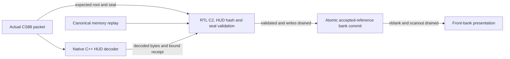

# V91l: real C2 validation and atomic publication partition

This checkpoint implements the actual frame content tree, semantic-HUD hash,
frame seal and atomic bank-publication gate in RTL. It connects them to the
existing native C++ HUD semantic decoder and source-backed canonical replay.
**V91l remains partial as an all-RTL receiver:** HUD decode/overlay, the live
canonical producer join and physical memory/display service remain open.



## Actual work and source provenance

Every nominal frame runs **1,025 real RTL SHA-256 jobs** through the frozen
engine: 508 canonical leaves, four empty leaves, 511 tree nodes, a semantic-HUD
hash and the 157-byte frame seal. Work totals 628,815 message bytes and 10,298
SHA blocks. The independent Python auditor compares every recorded digest,
not only the final root, with hashlib calculations from the actual input bytes.
The tree uses 32,768 logical node-storage bytes plus SHA buffers and control;
no physical RAM inference/fit is claimed.

The original CS88 packets carry the expected root and seal. The C++ bench
parses their actual HUD bodies and executes the unchanged HU25/HX32/HX33
semantic decoder against the prior accepted HUD. Its resulting 42,240 bytes
are compared with source-backed goldens, transferred to RTL and hashed again.
The bound receipt identifies epoch, frame/reference IDs and generation. A
supplied digest or a golden-only receipt does not substitute for decoding.

Four primary canonical frames match the qualified V91k output hashes. Three
additional native history rows provide real causal references: c0f2 and
c3f48/f49. Both cohorts start at actual keys, so no trusted-root restore
backdoor is used. Those extra canonical bytes are explicitly historical
validation replay, not newly decoded BR88 RTL output. Current/original packet,
semantic HUD and accepted-history provenance are recorded in the
[model contract](validation-contract.md) and
[model results](../../experiments/python-gamebub-v91l/model-results.json).

## Atomic reference and presentation behavior

Three bank leases distinguish provisional writer, accepted reference, pending
presentation and front scanout. Candidate writes cannot overwrite any accepted,
front or pending bank. A commit requires complete canonical/HUD streams,
matching computed root and seal, a matching producer completion and drained
candidate writes. The accepted identity, generation, root, HUD digest, seal and
reference-bank pointer change on one commit edge. A later presentation edge
requires both vblank and scanout drain; acceptance does not force an unsafe
front-bank switch.

Local reset/abort invalidates provisional state and preserves accepted metadata.
An accepted candidate write retains its lease until ACK drain, blocking retry.
Late canonical corruption, bad semantic HUD, bad seal, stale/unverified HUD
receipt or upstream producer failure cannot commit a partial frame. The bench
also holds vblank off, then scanout drain off, while a fully validated pending
frame exists, and verifies that front selection stays unchanged until release.

`writes_drained` is a trusted upstream authority backed by the bench's finite
one-byte write/ACK model. This module does not contain a tagged physical DMA
controller. Cold `power_on_reset` requires external quiescence; warm `reset`
retains accepted state and drains the current provisional writer.

## Measured scope

Two final strict seeds each replay seven source frames under FAST and SLOW
service: 14 nominal commits and **14,350 checked RTL SHA jobs per seed**. Across
both seeds this is 28 validated commits and 28,700 digest comparisons. It is
not a sustained frame-rate workload. The 54 directed test entries include
both-profile identity/replay/reference checks, stale receipt/producer epochs,
actual software HUD CRC rejection, late root/HUD/seal errors, pending-write
abort/reset, held write drain, negative vblank/scanout tests and clean retries.

FAST validated-commit service takes **1,290,445 simulated cycles** per frame.
SLOW observations and every write/hash fence are in the
[summary](../../experiments/python-gamebub-v91l/summary.json).
**Native C++ HUD decode, fixture I/O and original packet CRC parsing happen
before the RTL start fence and are excluded from those cycles.** Their runtime
and memory on ESP32 are unqualified. These counts cannot be added to earlier
converter counts as an end-to-end latency claim, nor converted into hardware
milliseconds without a qualified implementation clock and integrated service.

The [independent audit](../../experiments/python-gamebub-v91l/audit.json)
pins live/retained sources and vectors, actual packet commitments, all SHA jobs,
strict commands, test outputs and scope flags. Exact negative producer and
publication observations come from the pinned self-checking C++/RTL assertions;
this is simulation evidence, not formal proof.

## Next work

1. Join the live canonical producer and actual candidate write ACKs to this
   validation gate. Preserve both producer backpressure and exact bank ownership.
2. Qualify the HUD implementation boundary for the intended system. A full-RTL
   milestone needs actual HUD semantic decoding and overlay in the hardware path;
   a heterogeneous deployment must price actual processor time, memory and transfer.
3. Join base RGB565, exact HUD overlay and safe front scanout to the validated
   bank transaction. V91m must exercise finite transport, shared memory, display
   and recovery at 30-Hz source releases.
4. Retain V100–V110 for target mapping, placement/routing, timing and physical
   sustained 30 fps followed by complete validated decoding below 10 ms.

## Reproduce

```sh
python3 experiments/python-gamebub-v91l/model.py
python3 scripts/cu66-v91l/run_validation.py --seed 911801
python3 scripts/cu66-v91l/run_validation.py --seed 911802
python3 experiments/python-gamebub-v91l/verify_results.py
python3 scripts/cu66-v91l/summarize.py
```

Use the existing `gamebub-cu66-v69-build` container. The runner retains strict
source/vector/command snapshots, compressed inputs and all hash events,
including failed or superseded attempts. The compressed TSV contains a header
and seven data rows. Frozen SHA, bank and HUD implementations remain unchanged.
