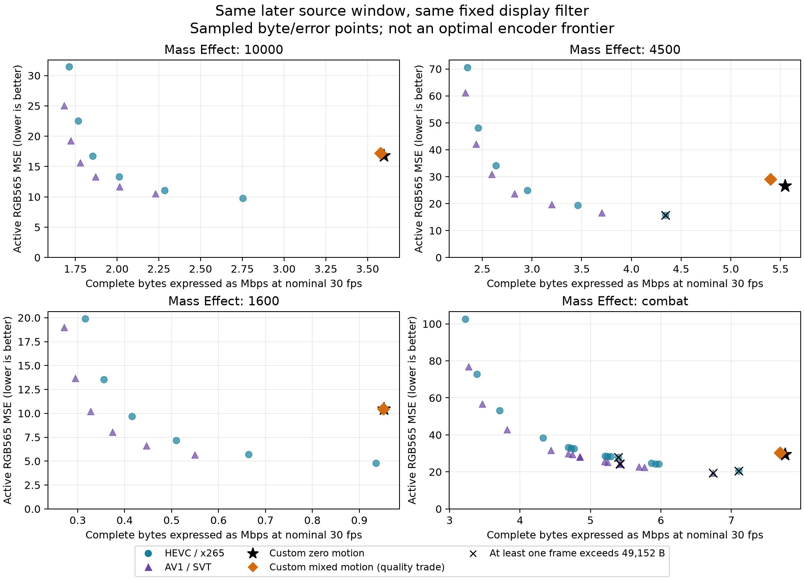

# Gamebub custom codec: six-hour Python research, v38–v67

Requested research window: 2026-11-05 07:14:21–13:14:21 UTC. This report collects Python codec experiments, independent verification, native CPU codec comparisons and hardware-oriented resource models. It does not report a physical 30 fps demonstration or an implemented HEVC/AV1 FPGA decoder.

The strongest next implementation candidates are exact entropy coding, a bounded inverse/receive pipeline, display-only filtering and row-based YUV scanout. The tested custom codec still needs substantially more bytes than HEVC and AV1 at the measured quality gates. An application-specific advantage must come from predictable decoder work, storage and recovery as well as compression.

## Source and comparison scope

The retained v40 source bundle contains 457 distinct RGB24 canvases from four related, precompressed Mass Effect clips. Three use the [6,10) second window and one combat clip uses [20,24). The combat material is 25 fps and was spatially upscaled before this work. These are not four unseen games or native 30 fps captures. Original RGB565 canvases are the metric reference; HUD pixels have a separate exactness check.

The later temporal qualification uses source IDs 24–47 in each clip, with a fresh independent key frame. It is a new window for the tested motion/filter policy, but the broader source material was already present in v40. Reusing these frames for different decoder, filter or native-codec experiments does not create additional unique source captures.

The source-v40 archive retains file hashes and preparation details, but its shared manifest does not establish original provenance for the 1600/combat extracts. Treat that as a dataset limitation. The **49,152 B experimental comparison/profile cap** is separate from the current JPEG transport parser's 262,144 B acceptance limit; neither figure demonstrates available BRAM or SRAM.

The native experiments produced **9,240 fresh access units across 138 parameter-point instances** during this run: v40 5,484, v41 2,100, v61 coarse 1,152 and v61 cap follow-up 504. Each stored access unit is redecoded and compared. HEVC uses x265 with immediate output, no B frames/lookahead and a low-complexity preset; AV1 uses SVT with corresponding low-delay settings. Complete byte counts include codec binding, exact HUD, metadata and codec extra data once. Mean-quality, mean-plus-peak and every-frame gates are separate; frame-cap failures remain in the evidence.

For native codecs the counted access units, HX33 HUD and extra data are actual stored bytes; the common **80 B binding is an accounting allowance**, not a serialized or deployed native wrapper packet. That allowance is included in every native point and the comparison cap. The custom complete packets are actual serialized fixtures.

Native CPU decoder results do not prove FPGA feasibility or cost. x265 VBV buffer sizes are in kbits; SVT CBR buffer sizes are in milliseconds. The legacy parameter field in a CBR case is not an effective CRF/QP. The v61 READMEs retain the actual options and clarify these labels.

## Results that survive exact verification

| Experiment | Result | What it proves |
|---|---|---|
| Adaptive binary coefficient coding, v38–v40 | **8,864,829 → 7,954,123 B (−10.2732%)**, 457 frames | Exact decoded references, HUD and display versus the preceding custom codec; largest packet 44,032 B |
| HUD packing, v42 | 137.603 → 34.352 ms, **4.006×** in the measured stage | Exact 48 outputs from 24 inputs; excludes upstream HUD generation and other encode work |
| Direct receiver, v43 | 145.341 → 89.006 ms whole-call mean in paired host trials | Removes redundant proof-adapter work over 577 causal calls; not 30 fps |
| Symmetric inverse, v45 | **49.8979% fewer logical sparse products** | Exact fixed-point rounding and output over 4,673,700 dequantized blocks; not DSP mapping or measured cycles |
| Rice-parameter search, v46 | 902 B saved across 24 complete frames, **0.2281%** | Exact reconstruction; too small to justify a broad performance claim |
| Tiled receive, v48 | Exact 577 arithmetic-only causal frames; traced allocation peak about 2.8 MB in the sampled calls | Handles dispatches 5/6 only; removes full coefficient/prediction arrays, but is slower Python and retains external full-frame/reference models |
| Recovery, v51 | 804 delivery actions, 800 receives, 588 accepts, 212 rejects | Rejection keeps published state unchanged and a later key recovers; API-level proof only |
| Fixed display filter, v60/v62 | Later-window custom MSE **−2.56% to −2.87%** | No byte or canonical-reference changes; HUD exact; filter frozen before the later window |
| Full-corpus fixed-filter qualification, v67 | **457/457 frames improve; aggregate SSE −2.55077%** | 265 additional temporal canvases beyond the two short windows, same known source library; no universal quality guarantee |
| Filtered scanout, v64 | **33,177,600 exact luma samples and RGB565 words** | Four cached vertical rows, one pending row, two-row lookahead; full-frame output unnecessary in this model |

These results involve different components and cohorts. They cannot be added or multiplied into a claimed end-to-end improvement. Host timings are Python/NumPy measurements on this machine; the operation schedules and bus budgets are explicitly assumed models.

## Honest comparison with HEVC and AV1

The v63 comparison evaluates all 69 measured later-window native points with identity and the same fixed strong display filter. It then applies explicit quality gates and the 49,152 B per-frame cap. This prevents the earlier mistake of selecting a native anchor before filtering and assuming it remains quality-matched after both decoders are filtered.

For the equally filtered zero-motion custom baseline, the sampled mean-quality/cap-gated results are:

| Related clip | Custom complete bytes, 24 frames | HEVC complete bytes | HEVC fewer bytes | AV1 complete bytes | AV1 fewer bytes |
|---|---:|---:|---:|---:|---:|
| 10000 | 359,645 | 185,445 | 48.44% | 177,871 | 50.54% |
| 4500 | 554,439 | 295,226 | 46.75% | 282,462 | 49.05% |
| 1600 | 95,180 | 41,520 | 56.38% | 32,728 | 65.61% |
| Combat | 776,074 | 520,851 | 32.89% | 485,066 | 37.50% |

These are minima among sampled points satisfying the stated mean gate, not an optimal encoder frontier and not a guarantee of no worse error in every frame. The stored comparison also reports mean-plus-peak and every-frame winners. Complete native frames that exceed the cap are ineligible for the table.



The figure plots all sampled native points and both custom motion policies after fixed strong filtering. Crosses retain cap failures. The horizontal axis expresses complete bytes as a **nominal** 30 fps data rate; it is not measured ESP32, FPGA, RF or display throughput. The [figure evidence](figures/prototype-v67/evidence.json), [SVG](figures/prototype-v67/sampled-rate-error.svg) and [render script](../experiments/render_prototype_v67.py) retain the source pins and 77 plotted points. No native encoding is repeated to make the figure.

## Motion results and quality drift

Global-grid motion was worse than zero motion in both bytes and source MSE on all four tested first-window cohorts. Mixing locally attractive quantized motion choices saved 0.96% of first-window bytes but increased aggregate source SSE by about 1.68%. On the next window the unchanged policy saved **1.293%** while increasing source SSE **4.515%**. Its local guard did not constrain the future error of its own changed reference history.

Two exact-canonical alternatives were also tested. The 32-pixel-block experiment found no eligible beneficial substitutions. The 16-pixel-cell experiment found 110 visible exact cells, but every such cell had the same coefficient arrays and no fine-bit advantage. Neither produced a selected complete-frame byte saving. Negative results and causal fixtures remain published; these policies are not recommended as a default.

A useful next inter-frame experiment should constrain cumulative source distortion over its own reconstructed history, use several motion magnitudes and scene cuts, and charge actual complete packet costs. It should not substitute a local proxy for the final quality gate.

## Display quality and storage

The display-only luma filter uses fixed integer thresholds and bounded edge correction on the 8-pixel grid. The strong profile was selected solely from the first-window zero-motion trajectories, then frozen. It improved mean MSE in all 16 later-window custom/native cases; the custom improvement was 2.56–2.87%. Grid error-jump energy fell around 18–24% for the custom cases. These are defined source-error metrics, not a subjective quality or flicker study.

The row implementation independently matches the full-plane filter and RGB565 result for 96 later-window zero-motion frames. At most four vertical-filtered rows, one pending row and two rows of lookahead are retained. Its **7,200 B logical row/output-data bound assumes one outstanding returned line** and excludes full YUV reference/reconstruction banks, HUD, static exclusion mask, metadata, Python temporaries, RAM ports and CDC. A consumer retaining many returned lines must pay for that extra storage. Owned line outputs remain correct when consumption pauses; reference planes and HUD remain unchanged. The host model averages about 44 ms including its assertions/hashes and is not a native speed or hardware throughput result.

The final v67 custom-only extension applies the unchanged strong filter to every one of the 457 archived CS38 frames and its original causal history. All 457 frames have lower source SSE, with no regressions or ties; aggregate SSE falls **8,266,662,386 → 8,055,798,880 (−2.55077%)**, or weighted MSE 20.67784 → 20.15040. The 265 frames after ID 47 in each sequence also all improve. Per-clip reductions over the full histories are 2.31–2.91%. All 7,954,123 encoded bytes, canonical reference tags and HUD words remain unchanged. Independent replay checks 157,939,200 filtered luma samples, 9,651,840 HUD words and 384 overlapping display variants against frozen earlier experiments. This extends the temporal qualification within the known source corpus; it does not establish subjective improvement or generalization to new games. A directed perfect-source counterexample explicitly demonstrates that the fixed filter can worsen other input.

The earlier unfiltered YUV scanout budget avoids a materialized RGB frame and models a 45.3888 MB/s shared-memory traffic reduction in an assumed 30-decode/60-scanout scenario. Memory clocks, bus efficiency and display timing still require hardware measurements. A line-buffer bound does not imply total BRAM/SRAM fit.

The fixed HUD normalization footprint can also avoid a full static boolean mask in a future implementation. A compact [mask program](prototype-v67-mask-program.json) stores four aligned uint16 rectangles in **32 B of actual packed constant data** and generates one owned 720 B row mask. Independent verification derives the rectangles from the original HUD geometry and checks all 345,600 pixels against the frozen 8×8 safe-block map, plus 42,720 horizontal and 42,480 vertical four-tap footprints. The proof harness still materializes the full mask as an oracle. This component is specific to epoch 25 / 720×480, is not yet wired into v64 and does not establish total process/device storage or FPGA fit. Changed HUD geometry requires a new verified program.

## ESP32 constraints are now explicit

The v65 read-only audit follows the actual Rust forwarder, rather than assuming a free transport: 40-byte headers, 1,024-byte chunks, internal DMA allocation, device lock, two identity reads and a credit read per chunk, then QSPI. **The current firmware/FPGA backend is JPEG-only; it cannot decode CS38.** No firmware file was changed.

The 457 custom packets require 7,988 hypothetical fragments. Their weighted mean IPv4/UDP data-only demand at nominal 30 fps is 4.46248 Mbps; the largest-frame equivalent is 11.26944 Mbps. The 44,032 B maximum uses 43 fragments. Ideal command/address/payload phases at an assumed 40 MHz consume 2.2188 ms for that frame. With an assumed 10 ms reserve, the remaining amortized unknown-work allowance is about **491 microseconds per fragment**. Actual CPU, CRC, locks, MMIO, RF and scheduling are unmeasured. The sensitivity sweep retains all deadline misses.

A hypothetical 40→8 B header saves about 3% of data-only L3 bytes here, with no payload-QSPI or fragment-count reduction. It is not implemented. The 1,065 B runtime DMA request excludes Wi-Fi, queues, descriptors, stacks, UI and other allocations. This is a source-based budget and measurement target, not ESP32 instruction-set/RF simulation or proof of SRAM fit.

## Canonical reference binding

The v66 campaign evaluates two explicitly configured candidate wire profiles on **577 presentations across eight histories**. Both remove a redundant 16 B pre-normalization tag and cache the verified reference tag. Complete bytes fall **9,674,118 → 9,664,886**, exactly 16 B per frame (about 0.095%). Coefficients, maps, normalized reconstruction, HUD and displayed pixels remain exact. CS66 preserves the legacy little-endian i16 canonical tag domain. CU66 validates canonical samples as integers in 0–255 before hashing an explicitly different packed-u8 domain. Old and cross-profile packets are rejected. The models fix geometry at 720×480 and epoch 25; they do not implement a live capability-negotiation handshake.

New-profile call spies observe **577 canonical calls per profile**. The validated legacy schedule is two full-frame video tags per key and three per P frame, totaling **1,705** over 26 keys and 551 P frames; that full-campaign legacy total is calculated from the schedule, not directly spied on every legacy call. New receives compute one canonical output tag and compare the incoming reference tag with the immutable published reference's cached tag. All entropy, output-tag and HUD checks complete before publication. Directed tests include wrong references/IDs, CRC, replay, output-tag failure, late HUD failure, visible bank corruption that changes output and key recovery. A hidden corruption normalized away is explicitly not an ECC detector. Cached-tag ownership requires protected reference banks in an implementation.

Host paired mean receive medians are 77.039 ms for CS38, 76.135 ms for CS66 and 75.939 ms for CU66—only about 1.17%/1.43% lower. The campaign ran under a non-isolated research workload, including a concurrent qualification job. These small CPU differences are descriptive; they are not a target speedup or 30 fps result.

The larger opportunity concerns a future iterative SHA core. A canonical 720×480 YUV420 tag hashes 1,036,804 bytes in the i16 domain or 518,404 bytes in the packed-u8 domain, including geometry. SHA padding gives 16,201 or 8,101 blocks. At an **assumed** one round per cycle / 100 MHz, an old three-tag P-frame demands 31.10592 ms of serial rounds, one CS66 tag 10.36864 ms and one CU66 tag 5.18464 ms. These are arithmetic workload scenarios, not measured RTL clocks, fit, memory traffic or end-to-end latency. The new profiles require changes at both ends; the current JPEG backend does not support them.

The companion v67 hash-stream experiment checks **457 causal frames / 914 tag results** from 8×8 tile-raster input with a single eight-row uint8 strip. Each domain consumes 3,701,700 tiles / 236,908,800 canonical samples. All legacy tags match stored canonical tags; packed-u8 tags match full-plane serialization. The **5,760 B strip-data bound** excludes an additional transient serialized row (1,440 B legacy / 720 B packed-u8), SHA context, ports, control and implementation temporaries. Malformed order/extra tiles during an active frame and incomplete finalization poison that context. Input after successful finalization raises an error, while the finished tag remains idempotent; a controller must honor that error and abort an unpublished transaction. Whole-frame canonical verification and HUD validation remain prerequisites for publishing a bank; streaming a hash does not authorize provisional scanout. Decode-side hash storage and display-side filter rows are separate resources unless an implementation proves safe sharing.

The full independent hash replay and five directed tests pass, including copied input ownership, pauses, duplicate/order failures, incomplete finalization and explicit domain behavior. This proves serialized content and a functional strip-storage contract. It does not prove a synthesized SHA engine, sustained tile input rate or a shared-memory schedule.

## Next implementation

The [hardware/software handoff](gamebub-v67-hardware-research-handoff.md) separates host, ESP32 and FPGA owners and gives acceptance criteria. The [integration audit](v67-integration-audit.md) addresses row drain, bank leases, dispatch compatibility and controller errors; the [final evidence audit](v67-final-evidence-audit.md) checks comparison fairness and claim limits. The immediate candidates are the exact entropy/inverse pipeline and fixed row-based display filter. Keep the real JPEG bring-up backend while implementing a newly negotiated experimental codec. Map and synthesize the actual target, include full-reference hash/memory/HUD work, and instrument the ESP32 fragment service path before claiming system capacity.

A physical 30 fps proof still needs unique completed presentations, bounded queues, drops/repeats and end-to-end latency over at least ten minutes with audio/input and the UI active. Python fidelity, bus inequalities, native codec benchmarks and component cycle models are complementary evidence, not that proof.

## Reproduction and publication

The final branch is `study/gamebub-specialized-v67-20261105`, inheriting published v58 commit `1dc2cfcc2b35532a928facf4621fb34ac936e4c3`. Earlier checkpoints v38, v39, v40, v41, v42, v46, v50 and v58 remain separately reviewable. Frozen artifacts are preserved; only the top-level README and application-codec plan are mutable indexes.

Run the portable verifier from the repository root:

```sh
python experiments/verify_prototype_v67.py
python experiments/render_prototype_v67.py
```

The run used CPython 3.14.4, NumPy 2.5.4, PyAV 19.0.2, Pillow 13.0 and Matplotlib 3.11.2; [environment details](prototype-v67-environment.json) include the native library versions. The V67 bundle retains **79 passing new unit-test cases** and 16 replay helpers, separate from its frozen parent evidence. The provenance inventory pins stored inputs, results, source files, test logs and helpers. Native libraries/encoder versions are also recorded in their own results. Stored-source replay requires no hardware or original video download. Fresh re-encoding is a separate reproducibility operation and can vary with native library builds.
