# Game Bub V111–V115: complete simulation and spatial FPGA execution

Planning date: 2026-11-08. Status: proposed implementation roadmap; no new
emulator, codec, RTL, timing or hardware result is claimed by this document.
Frozen starting point: Moonbub commit `aa25816bc17ecc2fa9d8f8d9304a160c2689b897`.

Build two tracks together: an executable Sunshine → ESP32-S3 → FPGA/display
simulation harness, and a decoder designed around dedicated pipelined hardware
stages. Start timing work in V111 rather than waiting for the harness to finish.
Use **125 MHz / 8.000 ns** as the new decoder target, retaining the original
100 MHz / 10.000 ns measurements as a comparison. Neither target is currently
qualified. A version advances by its recorded evidence, not its number.

## Starting evidence and terminology

[V110](cu66-v110/README.md) qualified nine source compositions on the same two
frozen regression seeds. The best final component route has WNS −1.022 ns at
10 ns, TNS −1125.069 ns and 4,620 setup failures. Hold/pulse/routing checks pass.
Forty-four of its fifty reported paths launch from header length data; four
launch from context block count and two from admission tile visibility logic.
An 8-ns build needs fresh synthesis/place/route; subtracting 2 ns from an old
slack report is not a new timing result.

The production parent is still JPEG. CS88 component verification does not
establish the [complete parent integration](cu66-v109/integration-gaps.md).
The existing [live emulator bridge](../fpga/experiments/throughput30/burst/live-multiframe-bridge/README.md)
transfers actual receiver bytes, but the simulators have independent clocks
and FPGA time freezes during socket waits. It is useful functional evidence,
not the requested full-system timing harness.

Two meanings of “temporal” must stay separate:

| Concept | Decision |
| --- | --- |
| Hardware time sharing: one arithmetic unit or controller serializes several tasks | Reduce it where measurements justify dedicated stages, lanes and local memories. |
| Video temporal prediction: reuse a previous frame to reduce transmitted data | Retain bounded prediction when it benefits quality and bandwidth. It can execute in spatial hardware. |

An all-intra stream can have simpler dependencies but exceed the byte/link
budget. More DSPs can reduce computation while making memory traffic or routing
worse. Select on measured clock, service, bytes and quality together.

## Fixed product goals and budgets

Preserve the primary **720×480 coded canvas, 30 distinct displayed frames/s**,
HUD/text quality and the current 49,152-byte frame-cap control. Freeze active
content mapping, panel orientation and actual scanout geometry in V111.
Keep CS88 q16/all-BR88 as the comparison profile. A new syntax/profile must be
named, negotiated and compared explicitly rather than silently replacing it.

| Quantity at 125 MHz | Budget or meaning |
| --- | --- |
| Decoder cycle | 8.000 ns |
| Average cycles per 30-Hz frame period | 4,166,666.67; use rational timestamps, not a truncated period |
| Strict FPGA validated-decode target | Less than 1,250,000 cycles for a single-domain exact 125-MHz measurement; equality is a failure |
| Coded pixel rate | 10,368,000 pixels/s |
| Whole-frame equivalent budget within 10 ms | About 3.617 cycles/coded pixel; includes stalls and validation, not just IDCT |
| Maximum compressed payload at cap × 30 fps | 1,474,560 B/s, before transport overhead |

The decode budget is for the complete FPGA decode/publication path. Separately
report host encoding, network, ESP32 forwarding and display wait. Raising the
clock 25% alone cannot establish the latency goal or increase SDRAM bandwidth.

Keep the external memory and pixel clocks at their qualified requirements.
A 125-MHz decoder may need CDC to the existing memory domain; it does not
authorize overclocking SDRAM, QSPI or the panel. Actual board I/O constraints,
clock generation and CDC/reset release must be implemented and checked.

## Harness architecture and evidence levels

```mermaid
flowchart LR
  S[Sunshine capture or deterministic frame source] --> E[Shared native codec and packetizer]
  E --> N[Timestamped bounded network service]
  N --> G[ESP32-S3 guest firmware]
  G --> P[GP-SPI and DMA peripheral model]
  P --> Q[Timed QSPI wire bridge]
  Q --> R[Actual FPGA ingress and decoder RTL]
  R --> M[Finite memory controller and framebuffer ownership]
  M --> D[LCD scanout and frame monitor]
  D --> O[Independent pixel, identity and deadline scoreboard]
  R -->|credits and commit status| Q
  Q --> P
  P -->|completion and status| G
  G -->|frame feedback| N
  N -->|delivery and commit feedback| E
```

Implement two operating modes using the same encoder/packetizer code:

1. **Live functional mode:** isolated Sunshine instance → emulator → RTL.
   Establish actual connectivity, bytes, commands, errors and recovery. Report
   wall time separately; live desktop capture cannot run backwards or slow down
   to match a slow simulator. Do not interrupt the installed Sunshine service.
2. **Deterministic timing mode:** capture the actual Sunshine encoder/packetizer
   output, including IDs, payload hashes, release schedule and measured host
   durations; replay it against one simulation time authority. Also run a
   deterministic frame-input backend through the same native encoding path.
   Replay is a timing experiment under declared host/network service, not a
   second live capture or a measured Windows/NVENC result.

The current Python sender, native Rust FFI join and receiver-core emulator are
useful controls, but none alone is “Sunshine running through full firmware.”
Record which executable and modules actually run for every result.

Sunshine's ordinary H.264/HEVC NVENC output is not a CS88 payload. Inventory
the fork's actual custom sender, then implement an opt-in capture-to-custom-codec
backend and shared native encoder where missing. Account for surface readback,
color/layout conversion, encoding and packetization. A native decoder benchmark
does not establish native encoder performance. Keep standard encoder controls
separate; custom streaming is not automatically GameStream-compatible.

### Emulator choice and capability gate

Start with the locally proven Espressif `esp-emu` receiver study. Current
[Espressif emulator documentation](https://github.com/espressif/esp-emulator)
advertises ESP32-S3 execution, networking, GP-SPI and DMA. Pin an exact revision
and test the required modes; that feature list is not timing validation.

[Espressif QEMU](https://docs.espressif.com/projects/esp-idf/en/stable/esp32s3/api-guides/tools/qemu.html)
is an alternative for S3 CPU/peripheral work. Its published
[capability matrix](https://github.com/espressif/esp-toolchain-docs/blob/main/qemu/README.md)
lists missing Wi-Fi and general-purpose SPI models, so it is not a drop-in
complete streaming platform. Renode's
[Verilator integration](https://renode.readthedocs.io/en/latest/advanced/co-simulating-with-an-hdl-simulator.html)
is useful bridge precedent, but ESP32-S3 firmware/platform support remains a
separate capability test. Do not change processor just to obtain a boot marker.

Require tests for boot, interrupts, timers, concurrent tasks, actual receiver,
bounded allocator use, SPI command/dummy/data phases, four-bit transfers,
DMA descriptors/ownership, completion IRQs and credit reads. Keep PSRAM disabled
unless the fitted board/configuration actually enables it. Track stack, heap,
DMA-capable/internal memory, copies and queue sizes; never embed golden frames
in the guest used for SRAM/performance accounting.

Classify each run as native receiver, emulated receiver core, full target
firmware, transaction-level peripheral bridge, or pin-level QSPI bridge.
Unsupported peripherals/stubs and ROM interceptions must be listed. A receiver
test app that bypasses GUI/USB/storage initialization is a useful lower-level
test, not a successful full production application boot.

### Time coordination

The coordinator owns monotonic integer simulation time with rational source
periods. Participants advance only to an agreed boundary; all causally earlier
network, guest, SPI, FPGA, memory and display events must be processed first.
Record tie-breaking and maximum synchronization quantum. If the chosen
emulator cannot expose a controlled time/step interface, add and test one or
leave the synchronized-timing gate open.

Continue memory refresh, LCD scanout and independent clocks while software or
network ingress is idle. Socket wall-clock waits must not become free target
time. Fail a deadlocked participant with a watchdog, not by manufacturing ACKs
or completing a frame in the adapter. Bound every bridge queue and account for
its bytes and backpressure. Check the bridge against short known wire traces.

Guest instructions, emulator virtual time and ESP32 silicon cycles are not
interchangeable. Give CPU/Wi-Fi/DMA service models explicit assumptions and
sensitivity ranges until remote hardware calibrates them. Report functional
CPU execution and conditional modeled deadlines separately from calibrated
device predictions. A synthetic AP is not an RF throughput measurement.

## Five-version roadmap

| Version | Harness work | Spatial/timing work | Exit evidence |
| --- | --- | --- | --- |
| **V111 — reproducible baseline and contracts** | Pin Sunshine/Moonbub/emulator/tools, inventory what actually executes, reproduce receiver boot/one-frame byte flow and JPEG control, add host-output trace capture and capability probes. | Implement and verify the V110 header-validation preparation; audit the other two actual routed path families. Route source-bound 100-MHz control and 125-MHz diagnostic. Define the new pipeline ownership/latency contract and whole-parent resource inventory. | Reproducible one-frame functional chain with explicit missing endpoints, immutable traces, clock baselines and tested emulator/time-control capabilities. Seek fresh-repeat 100-MHz closure; if absent, record it as open and carry the failing cones forward. No simulated system-FPS pass yet. |
| **V112 — synchronized bridge and local control** | Implement coordinator, actual bounded SPI/DMA or explicitly labeled adapter, QSPI pins, credit/commit/abort responses and concurrent memory/display clocks. Exercise the target firmware path and ten complete frames. | Replace broad combinational admission/cancel feedback with registered local stage ownership and bounded handoffs. Prepare static geometry/control on available earlier edges. Qualify CDC for the proposed 125-MHz decoder domain. | Shared-time causal traces, exact wire bytes/order, no hidden buffers, abort/reset/retry correctness, fixed queue bounds and explicit CPU-time fidelity. Source-bound stage timing at 8 ns; full decoder timing may remain open. |
| **V113 — spatial decoder pipeline** | Drive the actual custom-codec endpoints through the harness; retain JPEG comparison. Add independent coefficient/residual/pixel/owner scoreboards and per-cause stall counters. | Overlap entropy/assembly, dequantization, IDCT, reconstruction and emission. Separate arithmetic ownership from two finite result slots; pipeline arithmetic and BRAM outputs where required. Sweep 1/2/4 compute lanes using measured memory ports. | Same reconstructed content under an explicit latency-changing contract; no lost/duplicate/cross-owner tile. Fresh-repeat decoder-component route at **125 MHz**, or an explicit failed gate. Report simulated latency distributions and bottlenecks. |
| **V114 — application-specific parallel syntax and complete parent** | Put the selected native encoder/packetizer in isolated Sunshine and the matching negotiated receiver path in ESP32 firmware. Integrate custom decoder, actual memory/controller, frame validation and display ownership in the FPGA parent. | Compare restartable row/tile chunks, 2/4 independent entropy contexts and bounded copy/residual modes. Choose only Pareto improvements under fixed quality/wire/memory limits. Fuse reconstruction/color/HUD/hash work where it removes memory passes. | Versioned packet contract, Python/native/RTL round trips, malformed/recovery tests, 300 distinct frames over 10 simulated seconds under stated service, and full-parent fit/timing reports. Host-only codec comparisons cannot qualify FPGA decoding. |
| **V115 — integrated qualification and handoff** | Run isolated live functional demo plus deterministic 60-s and 600-s campaigns, fault/contended-service campaigns and calibrated-profile replay when hardware traces are available. Package runner, inputs, evidence schema and counter map. | Close the complete operational parent at **125 MHz**, retaining memory/panel interface requirements and production debug/counter access. Repeat the selected implementation from fresh RTL with identical constraints/method. | Strict simulated 30-fps and validated-decode gates, full-parent timing/CDC/I/O/memory qualification, bounded recovery and reproducible artifacts. Report model-only, uncalibrated and hardware-open items explicitly. A version number or component pass cannot close them. |

Harness and timing tasks run in parallel across these versions. A missed exit
gate stays visible; later exploratory work can proceed without relabeling it
as passed. V115 is the integrated target, not a promise that five labels alone
will close every prerequisite.

## Spatial computation experiments

### First improve execution without changing coding

Use dedicated registered stages and small local FIFOs rather than one controller
serializing all arithmetic and output. The
[V110 transform evidence](cu66-v110/transform-budget.md) shows coefficient
prefill overlap already exists, while launched inverse math and the 64-sample
residual burst remain serialized. The
[two-result-slot proposal](cu66-v110/overlap-next.md) is the first scheduling
experiment, with actual result-copy/read latency and physical ports included.

Keep immediate revocation at public boundaries, tagged local cancellation,
stable held output and real accepted-memory drains. Start/retry/publication
must wait for the correct owners and EOFs. The
[versioned control contract](cu66-v110/control-contract.md) is the starting
specification; do not weaken V110's exact-cycle checker to approve new latency.
Use independent accepted-event/value scoreboards for the new contract.

Separate operational handshakes from diagnostic observation. Define coherent,
epoch-tagged status/counter snapshots on a slower readout path instead of
exporting every arithmetic vector and raw internal state every decoder cycle.
Keep immediate error/revocation semantics at the operational boundary. Classify
each existing port before changing the production wrapper; tying off necessary
inputs or dropping required outputs to improve a report is not qualification.
Document any changed diagnostic/invalid-cycle meaning under the new contract.

Map regular arithmetic to **DSP48E1**, carry operations to Series-7 resources,
and tile/line storage to explicitly banked RAMB18/RAMB36 memories. Evaluate
input, multiply and output registers, numerical width, rounding/saturation,
fanout and actual mapped primitives. Reset owner/valid/control state where
needed; reset-free payload requires a proof that stale data cannot be consumed.
This follows AMD's guidance on
[pipelining](https://docs.amd.com/r/en-US/ug949-vivado-design-methodology/Pipelining-Considerations),
[DSP register inference](https://docs.amd.com/r/en-US/ug901-vivado-synthesis/DSP-Block-Implementation)
and [selective reset](https://docs.amd.com/r/en-US/ug949-vivado-design-methodology/When-and-Where-to-Use-a-Reset).

Preserve independent SRAM/SDRAM/interface limitations. Two advertised SDRAM
chips on one bus are not two independent bandwidth channels. Account for
refresh, row/bank changes, read/write turnaround, line-fetch priority, reference
reads, framebuffer writes and hash/HUD traffic. More lanes must stall safely
when ports or service are exhausted. Inventory the complete parent: the older
JPEG design's BRAM use and the custom OOC footprint cannot simply be added
under an assumption that the whole device is free. Keep JPEG fallback as a
separately qualified build if simultaneous instantiation cannot fit.

### Then improve the coding contract for that hardware

Keep complexity on the host: motion/region search, mode/rate decisions,
quantization and content classification. ESP32 forwards bounded opaque chunks;
it should not acquire pixel reconstruction or whole-frame decoding work.

Compare a small candidate set against unchanged CS88:

| Candidate | FPGA opportunity | Cost to measure |
| --- | --- | --- |
| Restartable tile-row/slice chunks with bounded lengths | Independent entropy contexts, local error recovery and multiple parsing lanes | Restart headers, alignment, CRC/directory overhead and lost compression context |
| Bounded zero/run/level codes with explicit escapes | Small predictable prefix machinery and bounded work per symbol | More bits on some textures; adversarial worst-case symbols |
| Small fixed transform/mode set plus sparse residual masks | Fixed DSP pipelines, local transpose banks and predictable scheduling | Quantization quality, metadata and sparse/dense crossover |
| Immutable committed anchor plus bounded integer copy/residual modes | Parallel tile reconstruction with bounded reference windows | Reference/cache misses, generation ownership and recovery/refresh traffic |
| Local exact-HUD/low-color blocks | Parallel exact RGB565 reconstruction in selected regions | Region metadata and byte budget; benefit may disappear on textured regions |

Restartable entropy chunks allow scheduling independence, not arbitrary
reference independence. Every reference boundary and neighboring-pixel
dependency must be declared. Retain temporal prediction when it reduces bytes
without violating bounded service. Test an intra-only control, but do not make
it the default just because its decoder is easier.

Use actual encoded payloads, native reconstruction, target RTL demand traces
and bit-exact format-specific oracles. Compare SSIM/PSNR, exact HUD masks,
per-frame quality tails, wire bytes, queue age, reference traffic, LUT/FF/BRAM/DSP,
post-route clock and latency. Freeze quality thresholds before selection.
Charge all framing, feedback, retransmission and restart overhead; oversize
frames and encode-time outliers stay in the results. Reuse the same captures
for JPEG, custom candidates and host HEVC/AV1 quality/rate controls, without
implying an implemented HEVC/AV1 FPGA decoder. Include independent raw gameplay
captures when available; compressed Mass Effect clips remain diagnostic inputs.

## Metrics and acceptance

Every run records source/tool/fixture hashes, exact modeled clocks, active
participants, fidelity/stub map, queue/memory limits, time quantum, service
assumptions, warm-up, simulated duration, wall duration, seed, commands and exit
status. Metrics join on session/epoch/frame ID; no cross-domain clock subtraction
without a tested mapping. Record these events:

- Host capture, encode start/end and packet release.
- ESP32 receive, CRC/reassembly result, DMA submission/completion and credit wait.
- FPGA first byte and last required compressed payload/metadata byte accepted,
  decode admission, last output, validation completion and safe publication.
- Actual modeled scanout selection, first visible sample and completed frame.

The strict decode interval starts at the last required compressed byte accepted
at FPGA ingress and ends at validated safe publication. Include any remaining
commit wait, parsing, reconstruction, memory drains, reference/HUD/hash checks
and ownership transition. Also report first-byte/admission intervals so overlap
cannot hide service cost. Publication and physical/display visibility are
different events; report capture-to-presentation separately.

For each latency report min, median, p95, p99, maximum and offending frame IDs.
Also report distinct presented FPS, frame age, all drops/repeats, wire goodput,
queue high-water marks, SRAM/stack/heap use, stage occupancy and service/stall
cycles. Do not add overlapping stage spans as serial work.

For the nominal no-loss profile, require 1,800 ordered distinct complete frames
within the defined 60-s steady-state simulated window, then 18,000 within
600 s, at rational 30-Hz releases. Declare boundary/warm-up policy in advance;
do not append drain time to turn a failed window into a pass. Require correct
content/reference/HUD/hash, bounded queues and zero scanout underruns. Every
qualified decode sample must be **strictly below 10 ms**; a good mean cannot
hide one violation. Loss/jitter/fault profiles have separate declared recovery,
freshness and drop criteria, without silently reducing the nominal target.

Test burst loss/reordering/duplication, corruption, scene cuts, maximum packets,
queue full, credit exhaustion, simultaneous audio/UI/input load, receiver reset,
FPGA reset, abort at every owner boundary, stale ACKs, epoch wrap, reference
loss, refresh collisions and delayed final writes/vblank. No unvalidated frame
may become a display/reference owner. A failed test, timeout or stubbed endpoint
remains explicit rather than becoming a performance sample.

## Timing and campaign execution policy

Use 8-ns constraints before synthesis for every 125-MHz trial. Qualification
requires setup/hold/pulse checks, intended clock coverage, route completion and
reviewed methodology/DRC/CDC/I/O results. Do not waive real paths or introduce
false/multicycle paths to rescue a failure. A component result and a full-parent
result are separate. Rebuild the selected source/method from fresh RTL; record
achieved slack/margin rather than just a requested clock. Aim for positive
margin; the hard gate is no failing required paths in both selected runs.

Bound each version's physical study before dispatch: at most three initial
source/method candidates and one fresh repeat for the chosen positive result.
Count every source/clock/method implementation as an initial trial, including
a new baseline run; reusing a frozen receipt is not a new run.
Preserve failures. Choose the next candidate from final routed cones, not an
earlier placement hypothesis or a blanket FSM directive. Reassess the budget
explicitly for a new version instead of silently extending a frozen policy.

Full-cycle 125-MHz simulation costs **7.5 billion cycles for 60 s** and
**75 billion for 600 s**. V111 must benchmark wall time per simulated millisecond
and disk growth before scheduling these campaigns. Use tiers: unit/formal
properties, one frame, ten frames, 300 frames/10 s, then full campaigns. Keep
checkpoints and continuous frame/owner state if runs are segmented. A faster
transaction/statistical model is useful for sweeps, but cannot replace a claimed
full-cycle RTL campaign. Any idle-cycle skipping needs its own equivalence and
timing justification. If the full run cannot finish, leave that gate open.

Retain the host policy: at most two heavy jobs, each two CPUs and 8 GiB with
no additional swap, available-RAM/pressure launch/stop gates, bounded watchdogs
and external build directories. Report partial runs honestly. Do not copy
large build trees into Git; publish source, reproducible manifests, compact
metrics and selected traces, with hashes/locations for larger artifacts.

## Work split and handoff

Plan independent owners for (1) Sunshine/native codec and captures, (2) ESP32
firmware/emulator/QSPI/time coordination, (3) spatial RTL/memory/125-MHz closure,
and (4) integration/oracles/evidence. Simple documentation, manifest and report
checks suit Luna agents; emulator scheduling, protocol ownership and timing
architecture need focused engineering review. This roadmap does not launch
those implementation agents or long-running builds.

Use new source/proof namespaces and branches. Keep V110's source, exact-cycle
goldens, reports and manifest reproducible at its frozen revision. Deliver
per-version manifests, native host/firmware/RTL binaries and build recipes,
wire/profile contracts, timing reports, trace schema/counter map, reproduction
commands, known gaps and the selected fallback. These are proposed deliverables;
none is marked implemented by this planning change.

Simulation can demonstrate the system under its declared models. Actual Wi-Fi
service, ESP32 cycle accuracy, board memory timing, sustained hardware 30 fps
and hardware validated decode below 10 ms need separate device evidence. That
distinction remains part of the V115 handoff even if all simulated gates pass.
