# Game Bub: spatial architecture review and V121–V125 exploration plan

**V124 measured follow-up:** [spatial owner lanes and native endpoint replay](cu66-v124/README.md)
pass all functional gates with exact cycles. The targeted busy return improves
0.524 ns, but global 125 MHz WNS regresses to **−1.170 ns**, TNS to −2,527.615 ns
and setup failures to 9,787. The route is not promoted. Production C++ serializer
→ actual Rust protocol parity and a native-file QSPI/CDC/JPEG RTL replay pass;
the [single-timebase harness, custom negotiation and calibrated physical service](cu66-v124/harness-boundaries.md)
remain open. The next bounded timing hypothesis is existing-edge tile-predicate
preparation/local control, with RAW/owner-tag/refill regressions retained in the
evidence. This does not close the broader V124 or V125 roadmap exits below.

**V123 measured follow-up:** [prepared scratch rank](cu66-v123/README.md) passes
all functional gates with exact cycles. The fresh 125 MHz route improves from
V122's −1.949 ns to **−1.086 ns WNS**, with 6,724 setup failures; it remains
unqualified. The mask's all-endpoint worst is +0.159 ns, while RAW and the new
emit-bank/owner-ready return still fail. Independent Python rank checks and a
causal finite-slot overlap prototype support the next experiments. Synthetic
two-slot gains are not measured hardware performance; the modeled-parent
<1,250,000-cycle exit, physical memory and hardware 30 fps / <10 ms remain open.

**V122 measured follow-up:** [bounds pipeline and service study](cu66-v122/README.md)
passes all four functional stages with zero public-cycle change. Admission
cursor/state improves from −1.347 ns to −0.250 ns, but global routed setup
regresses to −1.949 ns with 11,866 failing endpoints. No 125 MHz promotion.
Retained row accounting identifies 70,080 eight-byte writes; analytical burst
sensitivities and a synthetic edge-trace validator prepare the next experiment.
Actual exclusive-edge instrumentation, physical memory service and the remaining
V122 roadmap exits are still open. The next measured timing target is RAW
geometry/order validation into scratch state; see the
[bounded experiment proposal](cu66-v122/next-timing.md).

**V121 follow-up measured:** [existing-edge request preparation](cu66-v121/README.md)
passes focused/full/transport/peer/parent checks with zero public-cycle change.
The targeted issued → RAM-enable path now has +0.303 ns slack, and the new
prepared-address path has +0.581 ns. Global 125 MHz setup still fails at −1.347 ns;
admission cursor/state decoding is the next timing target. The roadmap's clock,
strict latency and physical frame-rate gates remain separate and open.

Reviewed **2026-11-09** against V120 evidence at
`ddace39683118b2fa97267f484f534ea046ed798`.
This is a literature review and proposed experiment sequence, not completion of
V121–V125 or a new timing/hardware qualification.

## Recommendation

Prioritize **registered request/control boundaries, local memory ownership and
overlapped reconstruction/validation** before multiplying decoder lanes.
The measured 125 MHz failure is dominated by a request-address/readiness path,
not an isolated multiply. Extra DSPs cannot directly repair that path.

Preserve the 720×480 coded canvas, 30 distinct frames/s objective and validated
decode strictly below 10 ms. Retain video temporal prediction where it saves
bandwidth. Spatial hardware architecture means concurrent physical stages and
local storage; it does not require an intra-only video codec.

Keep the [qualified V120 100 MHz Source B](cu66-v120/handoff.md) frozen for the
remote board team. Its 18 RTL/include files remain identical to `69c0f145`.
Use separate source compositions for the experiments below. The production
parent still uses JPEG/MSV1; the experimental CU66/CS88 decoder needs a
negotiated host/ESP32/FPGA integration before live custom-codec streaming.

This review extends the [post-V90 review](literature-review-2026-11-06/README.md)
and the [current 125 MHz work](cu66-v120/125mhz-next.md), rather than replacing
their negative results or historical checkpoints.

## What the measurements say

| Evidence | Current result | Implication |
| --- | --- | --- |
| Source B internal component at 100 MHz | Two fresh routes: WNS +0.174 ns; WHS +0.028 ns; no setup/hold/pulse failures | Qualified component control, not a complete board design |
| Same composition at 125 MHz | WNS −1.517 ns; TNS −3,931.934 ns; 10,524 failing setup endpoints | Several path families require repair; shifting the worst path is insufficient |
| Worst B125 path | Refill `issued` → `offset + issued` → replay bounds/readiness → BRAM `ENBWREN`; 8.990 ns data, 5.787 ns routing | Separate address preparation, request acceptance and local RAM service |
| Other B125 family worst slack | RAW mode −1.462 ns; context-emitted −1.386 ns; kill −1.357 ns; RAW coefficient −0.862 ns | Preserve cancellation correctness while shortening multiple control cones |
| Complete-parent timing | Not routed/qualified | Component MHz cannot be assigned to the actual board parent |
| Hardware milestones | Sustained 30 fps and validated <10 ms open | Neither is established by fixture cycles or vendor throughput |

Sources: [mapped paths](cu66-v120/B-native-initial-mapping.md),
[fresh-repeat handoff](cu66-v120/handoff.md),
[parent terminal audit](cu66-v120/B-parent-results.md).
The full functional evidence repeats six goldens/profiles; it is not a long
corpus of distinct gameplay frames. The header equality repair retains one
predicate FDRE and three writer CARRY4 cells; the routed design still has
4,198 CARRY4s. It did not eliminate arithmetic globally.

### Separate clock, latency and frame-rate gates

The retained row-service fixture measures **final accepted outer input byte →
validated commit**. It includes modeled waits and validation, excludes earlier
delivery, and uses abstract row service/software HUD semantics.

| Assumed complete-parent clock | Fast: 1,145,104 cycles | Bounded-stall: 1,553,197 cycles | Strict maximum cycles for <10 ms |
| --- | ---: | ---: | ---: |
| 100 MHz | 11.451040 ms | 15.531970 ms | 999,999 |
| 125 MHz | 9.160832 ms | 12.425576 ms | 1,249,999 |

At 125 MHz the stalled fixture needs **303,198 fewer cycles**, about 19.52%.
At 100 MHz the fast/stalled reductions are 145,105/553,198 cycles.
The profile difference is 408,093 cycles. If all improvement came from that
difference, at least 74.30% must disappear at 125 MHz. That is a sensitivity
calculation, **not a measured causal breakdown of stall cycles**.

Use 9 ms / 1,125,000 cycles at 125 MHz as an engineering margin target, not a
replacement acceptance threshold. Even the current fast fixture exceeds that
margin by 20,104 cycles. Aim to reduce useful-work serialization as well as waits.
Added elastic stages cost cycles; compare total saved versus added cycles.

At 30 fps, source releases are 33.333 ms apart. Throughput depends on pipeline
initiation interval and sustained service, not the reciprocal of the post-input
latency above. Capture, encoding, Wi-Fi delivery, QSPI, validated decoding and
display presentation need separate timestamps. A decode below 10 ms does not
mean glass-to-glass latency below 10 ms.

## Literature findings and applicability

These are primary sources: original papers, device/vendor documentation and
normative codec references. Their general mechanisms motivate our experiments;
none qualifies our part, full parent, ESP32 firmware or physical link.
The engineering proposals in the next sections are our inferences.

| Primary source | Finding relevant here | Proposed use and limitation |
| --- | --- | --- |
| [Carloni, McMillan, Sangiovanni-Vincentelli, 2001: Theory of Latency-Insensitive Design](https://sld.cs.columbia.edu/pubs/carloni_tcad01_lip.pdf) | Stallable modules and communication protocols can preserve functional behavior while channel latency changes. | Make explicit owned transactions at stage boundaries. Side effects, cancellation and accepted memory debt still need our own proof. |
| [Josipović et al., TRETS 2021: Buffer Placement and Sizing](https://doi.org/10.1145/3477053), [author PDF](https://www.epfl.ch/labs/lap/wp-content/uploads/2022/06/JosipovicMar22_BufferPlacementAndSizingForHighPerformanceDataflowCircuits_TRETS.pdf) | Buffer location and capacity affect both clock period and throughput; critical cycles matter. | Explore locations and token/bubble behavior, not just larger FIFOs. Their HLS/dataflow results are not measured speedups for our RTL. |
| [AMD UG949: Pipelining Considerations](https://docs.amd.com/r/en-US/ug949-vivado-design-methodology/Pipelining-Considerations) | Pipeline boundaries shorten combinational work at the cost of latency and alignment requirements. | Permit a versioned latency-aware interface instead of insisting every new architecture retain old public cycles. |
| [AMD PG373: Fully-Registered](https://docs.amd.com/r/en-US/pg373-axi-register-slice/Fully-Registered) | A two-deep fully registered channel can register payload, VALID and READY while supporting back-to-back transfers. | Use the mechanism as a custom-channel design precedent. Our request interface is not automatically AXI; adding an AXI wrapper is unnecessary. |
| [AMD UG949: When and Where to Use a Reset](https://docs.amd.com/r/en-US/ug949-vivado-design-methodology/When-and-Where-to-Use-a-Reset) | Selective resets reduce reset routing and can improve primitive inference. | Reset valid/owner/epoch state; omit payload resets only where invalid data is provably unobservable. Configuration GSR does not replace runtime abort. |
| [AMD UG949: Reducing Control Sets](https://docs.amd.com/r/en-US/ug949-vivado-design-methodology/Reducing-Control-Sets) | Series-7 slice packing depends on shared clock/reset/enable controls. | Count actual control sets. Generating a unique CE for every payload register can worsen placement. |
| [AMD UG949: Replicate High Fanout Net Drivers](https://docs.amd.com/r/en-US/ug949-vivado-design-methodology/Replicate-High-Fanout-Net-Drivers) | Local driver replication can improve distribution; blanket constraints are not a universal remedy. | Replicate phase-local control only where routed fanout/distance warrants it. Measure extra FFs, control sets and physical paths. |
| [AMD UG473 v1.14: Series-7 Memory Resources](https://docs.amd.com/v/u/en-US/ug473_7Series_Memory_Resources) | BRAM has optional output registers and defined read/write/collision behavior. Output pipelining adds a cycle. | Register response paths and bank scratch storage deliberately. It does not by itself cut today's address/readiness → RAM-enable path. |
| [AMD UG479 v1.10: DSP48E1](https://docs.amd.com/api/khub/documents/gu4oRPFEh_Pm2uaAlfY6Kg/content) | Pipelined 25×18 multiplication/48-bit arithmetic and selectable SIMD addition are available. | Map bounded transform/dequant arithmetic with exact rounding. Quad-12 SIMD addition is not four independent multipliers. |
| [Espressif ESP-IDF 5.4.3: SPI Master, ESP32-S3](https://docs.espressif.com/projects/esp-idf/en/v5.4.3/esp32s3/api-reference/peripherals/spi_master.html) | Queued transactions, DMA-capable aligned storage and completion ownership affect delivered service; unsuitable buffers can cause copies. | Measure two-buffer forwarding and per-transfer gaps. The documented 4,092-byte DMA default is configurable, not an absolute transfer ceiling. |
| [Espressif ESP-IDF 5.4.3: Wi-Fi Driver, ESP32-S3](https://docs.espressif.com/projects/esp-idf/en/v5.4.3/esp32s3/api-guides/wifi.html) | Modem sleep affects receive delay; `WIFI_PS_NONE` trades power for lower receive latency. Lab throughput depends on configuration. | A/B latency under actual load; vendor UDP benchmarks are not our goodput. Bluetooth coexistence can still restrict airtime. |
| [Game Bub core/hardware overview](https://docs.gamebub.net/developing-cores/overview/) | Rev4 documents XC7A100T, a 720×480 display, SDRAM and SRAM; framework interfaces are versioned. | Confirm fitted hardware and framework memory/display contracts. Capacities are not guaranteed bandwidth or integrated usable address space. |
| [JPEG committee: JPEG XS / ISO/IEC 21122](https://jpeg.org/jpegxs/) | Designed for low complexity, parallel implementation and few-line latency; typical ratios are up to 10:1, content dependent. | Borrow locality/bounded work as research ideas. JPEG XS is a separate format, not a drop-in bandwidth or compatibility improvement. |
| [Chen et al., 2026: FPGA displacement-vector search for JPEG XS intra pattern copy](https://arxiv.org/abs/2603.10671) | Pipelined search and reuse-aware memory organization target screen-content spatial redundancy. | Exploratory host-side search with a cheap bounded FPGA copy decoder. This encoder/search paper does not prove a decoder fits our Artix or meets our goals. |
| [AOM: AV1 Bitstream & Decoding Process Specification](https://aomediacodec.github.io/av1-spec/av1-spec.pdf) | Tiles, prediction, transform and filtering tools have explicit dependencies and decoder state. | Borrow bounded independent work and constrained prediction ideas. A custom profile is not an AV1 decoder; tile edges do not remove every filtering dependency. |
| [ITU-T H.265 specification, January 2026](https://www.itu.int/ITU-T/recommendations/rec.aspx?rec=16661), [contents](https://www.itu.int/dms_pubrec/itu-t/rec/h/T-REC-H.265-202601-I%21%21TOC-HTM-E.htm) | The normative format includes partitioning, prediction and entropy-decoding processes. | Keep HEVC as a matched rate/quality/latency comparison. Borrowing selected tools does not establish standard conformance or equivalent compression. |

### Ranking the codec directions

| Direction | Advantage for this system | Cost/risk | Decision |
| --- | --- | --- | --- |
| Existing CS88 semantics with spatial RTL | Same golden pictures and wire profile; directly attacks measured timing/service | Ownership and latency contracts need explicit redesign | **First priority** |
| Independent entropy substreams per tile/stripe | More parallel parsing and bounded recovery | Restart/context headers and worse compression; versioned encoder/decoder change | Measure only after existing entropy occupancy is attributed |
| Host-selected bounded copy/prediction plus simple residual lanes | Expensive search stays on PC; FPGA performs local fetch/add/transform | Reference locality, memory traffic and invalidation can dominate | Promising application-specific follow-up |
| Line/precinct-local wavelet path inspired by JPEG XS | Small working set and streaming computation | New codec and quality study; YUV420 already needs 10.546875:1 to fit 49,152 bytes before headers | Separate prototype, not immediate replacement |
| Full HEVC or AV1 RTL decoder | Standards interoperability and established coding tools | Complete tool/state/memory implementation and target fit not demonstrated here | Separate feasibility lane; not the shortest timing fix |
| Existing JPEG production path | Already integrated comparison/fallback | Independent frames may require more bandwidth at matched quality | Retain as hardware control |

We have not run new HEVC/AV1 rate-distortion tests in this review. Do not infer
equal quality, better compression or lower silicon latency from this table.
Compare against low-delay HEVC/AV1 on identical frames, scale, chroma, bitrate,
GOP/recovery policy and encoder latency; include HUD/text fidelity and worst
frame sizes. Preserve compressed-clip provenance; it cannot close the independent
raw-capture corpus requirement.

## Proposed spatial architecture

```mermaid
flowchart LR
    H[PC capture / custom encode / rate control] --> W[Wi-Fi packets]
    W --> E[ESP32 bounded RX and DMA stages]
    E --> I[FPGA ingress / admission]
    I --> Q[Owned request preparation]
    Q --> R[Registered request / credit slice]
    R --> M[Local RAM service and response queue]
    M --> C[Entropy / context tokens]
    C --> B[Banked coefficients]
    B --> T[Dequant / inverse lanes]
    T --> P[Reconstruction and row cache]
    P --> D[Row write service]
    P --> V[Ordered content / HUD validation]
    D --> J[Write ACK / validation / seal join]
    V --> J
    J --> F[Validated publication / display]
```



This is a proposed decomposition, not the current implemented hierarchy.
Logical revocation masks publication immediately. Accepted physical operations
retain an epoch/owner and must drain or receive an authoritative cancellation
ACK. A new frame cannot recycle their storage prematurely. Preserve reference
identity, first-fault ordering and stale-response rejection across all stages.

### A. Cut the actual request-to-enable path

Compare two controlled candidates against Source B:

1. **Prepared address/bounds on an existing owned edge.** Capture full-width
   request address and validity while offset/cursor/owner are stable. On accept,
   advance the issue cursor once; stalled requests retain their captured values.
   Do not narrow away wrap, signedness or caller-validity behavior.
2. **Explicit elastic request stage.** If the existing edge cannot shorten the
   path, introduce a two-entry registered request/response boundary. Local RAM
   enable consumes registered request state and locally reserved response space.
   Preserve enough response capacity for every accepted read; do not defer
   accounting until the response arrives.

Do not carry a combinational downstream `ready` chain back through bounds and
address arithmetic to RAM enable. Conversely, registered readiness must reserve
real capacity; it cannot promise credits already spent by in-flight work.
Measure both added latency and steady-state initiation interval under full
occupancy, back-to-back traffic and simultaneous drain/refill.

Retain the exact-cycle Source B regression as a control. A candidate that adds
stages needs a **declared new latency contract** and an independent accepted
transaction/semantic scoreboard. Compare pixels, errors, order, ownership and
drain behavior, plus bounded latency. Never silently remove a failing cycle
assertion to obtain a functional pass.

### B. Localize storage, then explore lane count

Start with one transform lane and ping-pong coefficient/result banks. Allow the
next block's entropy fill, current inverse transform and previous row's write
to overlap where their banks and dependencies permit it. Add a second lane only
after counters identify a compute bottleneck and distinct memory ports exist.

Explore 1/2/4 lanes in a transaction model, shortlist 1/2 for RTL first. A
four-lane crossbar or broadcast kill/CE can destroy placement gains. Bank by
explicit tile/plane/row ownership, place control near its bank, and account for
BRAM read latency and collisions. Additional DSP48E1 pipeline registers require
matching token, coordinate, quantization and validity delays. Preserve exact
integer widths, rounding and saturation, including negative extrema.

The sensitivity model deliberately varies the **unknown** parallelizable
fraction. With half the stalled fixture perfectly parallelizable, ideal two-lane
work would be 9.319182 ms at 125 MHz; if only one quarter is parallelizable it
would be 10.872379 ms. These optimistic scenarios exclude added control/memory
costs and are not predictions. Stage attribution must choose the actual design.

### C. Overlap validation without weakening it

Fork reconstructed, ordered samples into the existing canonical/HUD/hash
semantics while rows are written. Publish only after all required write ACKs,
reference checks, C2/HUD checks and seal completion join for the same epoch.
Do not replace the authoritative content digest with an easier checksum or
assume independent hash chunks can be concatenated arbitrarily. First measure
whether validation serialization is on the critical latency tail.

Use coherent epoch-tagged snapshots for diagnostic-only counters. Avoid a wide
live status mux feeding decode controls. Functional fault, revocation, ownership
and memory obligations keep their specified behavior; they are not delayed
merely because ordinary diagnostics can be.

### D. Memory service is part of the codec architecture

At 720×480, RGB565 is 691,200 bytes and YUV420 is 518,400 bytes. The latter
leaves only 5,888 bytes in a nominal 512 KiB SRAM, before metadata or another
buffer; RGB565 does not fit. SRAM is more plausible for compressed staging or a
bounded hot cache than a blanket replacement for reconstructed-frame SDRAM.

An illustrative RGB565 budget is 41.472 MB/s for 60 Hz scanout, 20.736 MB/s for
30 Hz writes and 20.736 MB/s for one full reference read: **82.944 MB/s**, before
validation reads, refresh, turnarounds, HUD and staging. The 100 MHz × 16-bit
bus's 200 MB/s raw ceiling is not delivered service. Two chips on one shared
16-bit bus do not provide two independent bandwidth pools.

The [local memory audit](external-memory-audit-plan.md) records that the existing
controller selects only SDRAM chip 0 and SRAM is not exposed by the current
`moonshine_top`. Also reconcile the prototype's 480×800 physical raster with
the 720×480 coded canvas/framework panel before applying these numbers to
actual scanout. Preserve the framework's documented interfaces.

Explore bounded row bursts, reference row caches and scanout reservations with
refresh/turnaround/row-conflict traces. Report maximum denied-service intervals,
queue ages and underruns, not just average utilization. Keep SDRAM/panel/QSPI
domains at their independently qualified clocks when decoder clock becomes
125 MHz; add and verify CDC boundaries where required.

## ESP32 Wi-Fi and QSPI work that must accompany the RTL

Local source inspection finds ESP-IDF **v5.4.3** in
`firmware/handheld/.cargo/config.toml`. `streaming/mod.rs::forward` requests
40 MHz quad payload writes; the FPGA driver offers 40/20/16/10 MHz data drivers.
The 80 MHz SPI configuration nearby is for **FPGA programming**, not evidence
of an 80 MHz streaming data link. Reads have a separate 16 MHz cap.

The current session allocates one DMA-capable internal receive buffer and
processes receive → identity/credit reads → blocking forward serially.
`protocol97.rs` models two owned DMA stages, but that is not evidence of queued
physical transfers in the active session. Bring the protocol core and actual
ESP-IDF adapter together before claiming overlap.

1. Implement bounded RX/forward concurrency with two aligned internal DMA
   buffers and explicit queued/in-flight/completed ownership. Count every copy,
   DMA submission/completion, shared-device lock wait and QSPI gap.
2. Cache stable identity/capabilities until reset/core change; track conservative
   credits including accepted work. Retain authoritative re-synchronization and
   abort/drain fences. Never treat transaction kickoff as completion.
3. Measure low-latency Wi-Fi settings against the pinned SDK: power-save policy,
   actual RSSI/channel, interference, buffers and UI/input/audio coexistence.
   Record heap/largest internal DMA block, CPU usage, task/ISR delays and drops.
   Do not assume PSRAM exists or is directly suitable for these buffers.
4. Negotiate compact framing and an MTU-safe payload only after compatible
   endpoints exist. Preserve frame IDs, lengths, CRC/profile negotiation and
   reset behavior. Current MSV1 has no per-fragment success ACK to remove.
5. Pace frames to prevent stale queue buildup. Prediction-dependent frames
   cannot be dropped arbitrarily: signal reference reset/recovery and budget
   its burst. Preserve audio/input deadlines separately from video throughput.

### Link and buffering bounds

The custom-codec cap is **49,152 bytes**, not the legacy JPEG 256 KiB cap.
At 30 fps it requires **11.79648 Mb/s compressed payload** at the cap.

| Framing assumption | Fragments/capped frame | Required rate including application + UDP/IPv4 |
| --- | ---: | ---: |
| Current 1,024-byte fragments, 40-byte application header | 48 | 12.57984 Mb/s |
| Hypothetical negotiated 1,400-byte fragments, same header | 36 | 12.38400 Mb/s |
| Hypothetical 1,400-byte fragments, 12-byte per-fragment + 16-byte frame setup | 36 | 12.14592 Mb/s |

These calculations exclude Wi-Fi/MAC/security, retries, feedback, FEC and IP
options/fragmentation. Header savings help, but cannot repair a deeply stalled
receiver or decoder. ESP32 Wi-Fi sustained application goodput and service tails
need measurements on the real system; advertised PHY rates are insufficient.

40 MHz quad data has a payload-only cap serialization lower bound of
**2.4576 ms**. Command/address phases, reads, DMA setup and scheduling add time.
There is no basis here to raise streaming QSPI beyond the existing request.
At the cap's mean payload rate, 8/16/32 KiB of queued data take
5.556/11.111/22.222 ms to drain. Extra buffering can improve burst tolerance but
also permits stale frames; bound both queue capacity and residence time.

## V121–V125 proposed milestones

Version labels below are a proposed continuation after V120, not passed gates.
Each version may retain failed candidates; stop enlarging a version once its
bounded question is answered, and report unmet gates explicitly.

| Version | Bounded work | Required evidence / exit gate |
| --- | --- | --- |
| **V121: request and control partition** | Source B control plus separately versioned prepared-request and elastic-request candidates; local kill/RAW/context control cuts guided by actual paths | Independent semantic/ownership proof, bounded-latency contract, then fresh 8 ns RTL synth/place/route; report all failing families. Qualify a passing source only after a separate fresh repeat. |
| **V122: memory and stall attribution** | Row/bank service, reference locality, burst arbitration and response credits; independent physical-memory timing model | Exclusive blocked-cause counters plus overlap traces; refresh/scanout/turnaround/loss stress; no stale writes, response leaks or underruns. Explain the 303,198-cycle gap using measured causes, not estimated percentages. |
| **V123: spatial compute and validation overlap** | Ping-pong results and 1/2-lane shortlist; pipeline DSP/control together; ordered validation/write overlap | Exact canonical/HUD/root/seal results, abort at each stage, resource/route evidence and complete-parent modeled latency <1,250,000 cycles across qualified profiles; target ≤1,125,000 for margin. Failure leaves the gate open. |
| **V124: real endpoint simulation/integration** | Custom Sunshine producer, actual ESP32 protocol adapter/firmware and Verilator parent on one simulation timebase; calibrated QSPI/Wi-Fi/memory service | Native endpoint parity plus timestamped contention/fault traces, finite buffers and frame identities. Label transaction models versus CPU-emulated firmware explicitly; simulation alone does not qualify RF throughput or silicon time. |
| **V125: board qualification and remote trial** | Actual board parent with negotiated profile/fallback, CDC/reset, I/O and memory/display constraints | Complete-top 125 MHz setup/hold/pulse/coverage/routing pass; repeat reproducibility; 1,800 distinct displayed frames/60 s then 18,000/600 s under real contention; every qualified decode <10 ms with calibrated traces. |

If component timing is not closed at V121, continue the bounded measured-path
repairs while V122 modeling proceeds independently. Do not declare V125 complete
because an OOC block passes or simulation releases 30 frame IDs per second.
The board team may continue the independent qualified 100 MHz trial throughout.

### Small, causal experiment matrix

| Axis | Initial alternatives | Reject or stop when |
| --- | --- | --- |
| Request boundary | Source B / existing-edge preparation / registered two-entry slice | Ownership changes silently, true cycle contract unspecified, or another combinational ready loop remains |
| Storage | Current / ping-pong local banks / registered BRAM response | Port demand, read/write collision or physical budget is unsupported |
| Compute | One lane / two lanes; four only analytically at first | Memory/entropy stalls dominate or added crossbar/control worsens route |
| Validation | Current schedule / exact ordered overlap | Digest changes, reference/HUD checks omitted, or publication outruns write ACK |
| Forwarding | Current blocking / two-buffer queued | Heap/DMA fit or bounded credits cannot be demonstrated |
| Syntax research | Existing profile / explicit independent entropy units | Extra bits/recovery costs exceed rate/quality benefit |

First use Python transaction modeling to eliminate impossible service/port
combinations, then focused RTL tests, complete golden regressions, Series-7
mapping and fixed-recipe fresh routes for the shortlist. Avoid a Cartesian
product of every option. Keep physical-only experiments separate from RTL
changes so a result has a causal interpretation.

For every synthesis/route, retain part, top, all source/parameter hashes, tool
image, clock-before-synthesis recipe, WNS/TNS/failing endpoints, hold/pulse,
unconstrained internal endpoints, inferred BRAM/DSP/FF/LUT/CARRY, control sets,
high-fanout nets, congestion and targeted path families. Use the existing
two-job resource cap. No arbitrary false/multicycle exceptions, weakened clocks
or guessed board I/O timing. Floorplan only after identifying locality and
congestion evidence; a blanket Pblock is not a substitute for pipeline design.

## Verification harness and metrics

Use one scheduler/time authority for host releases, modeled transport, firmware
events and RTL clocks. Socket waits must not freeze only the FPGA clock while
the rest of the experiment advances. Preserve actual endpoint code where
possible; record precisely which peripheral/task delays are modeled.
Renode or another ESP32 emulator is useful only after its relevant S3 CPU,
GP-SPI/DMA/interrupt/network behavior is established. A native Rust protocol
test is not a cycle-accurate ESP32 simulation.

Attach to each frame/epoch:

- Capture, encode-complete, host-release, receiver arrival/complete, QSPI first/
  last accepted byte, reconstruction, final write ACK, validated publication,
  vblank/presented identity timestamps and their timebase/calibration.
- Compressed size, queue occupancy/age, in-flight credits, memory deny intervals,
  entropy/compute/row/validation stalls, copies, DMA gaps and deadline violations.
- Distinct frame identity, full pixel/HUD/reference/hash/seal result and actual
  displayed CRC or equivalent board evidence; repeats are not new frames.
- Drops/retries/recovery reason, minimum/median/p95/p99/maximum decode and
  presentation interval, with worst-frame identity. Keep actual overlap traces
  so mutually overlapping stall counters are not simply added.

Stress packet loss/reorder/duplication, full queues, wraparound, slow memory,
refresh, read/write collision, abort after accepted read/write, reset/core change,
missing ACK, invalid headers and retry into a fresh epoch. Publication must
remain invalid on any incomplete validation/debt path.

The authoritative physical acceptance remains
[V110 hardware gates](cu66-v110/hardware-gates.md). The full simulation harness
can reject infeasible architectures and prove tested functional/contract
properties; physical clocks, RF behavior and hardware milestones require the
remote team's device evidence.

## Reproduce the budget calculation

```bash
python3 scripts/spatial-dse-review/budgets.py \
  --output experiments/spatial-dse-review-20261109/budgets.json
```

Python 3.10+ standard library only. The script verifies all 18 current Source B
hashes, binds the manifest/parent-audit hashes, reads the retained row-cycle
results and calculates strict bounds, packetization, QSPI lower bounds, queue
drain times, illustrative memory traffic and explicitly hypothetical lane
sensitivity. [Generated results](../experiments/spatial-dse-review-20261109/budgets.json)
are **analytical bounds**, not new RTL/ESP32/RF simulation, synthesis or hardware
performance. The next implementation experiment is V121's owned-request
boundary; this review does not modify the qualified decoder RTL.
