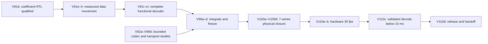

# Game Bub V91–V110: codec selection and 7-series implementation

Updated 2026-11-06. This is the active forward plan after V90 and the
[literature review](literature-review-2026-11-06/README.md). Version numbers below
reserve work phases; they are not completed results or promised calendar dates.

**Product goals:** retain 720×480 coded video, sustain 30 distinct source frames
per second, then validate complete FPGA decoding strictly below 10 ms. Preserve
exact intended canonical/reference pixels, HUD composition, RGB565 output and
publication checks for representation-only optimizations. Keep quality-changing
experiments in a separately versioned, matched-quality lane.

**User-requested focus:** V100 through V110, inclusive, concentrate on improving
RTL for **7-series technology mapping, placement, routing and timing closure**.
Freeze the selected codec before that phase so a physical implementation change
can be compared against a stable function and workload.

**V95a–c exact-palette software checkpoint qualified; no rate promotion.**
The [V95 pixel-palette study](cu66-v95/README.md) checks 8,226 plane variants,
2,542,828 independently decoded records and 4,113 complete native frames.
Canonical/reference pixels, HUD, RGB565, roots and seals remain exact; palette
tiles bypass coefficient reconstruction, so original-coefficient parity is not
claimed for those tiles. Minimum bytes remain 7,781,939 across 457 sources and
select no palettes. Work5/work15 bypass 2.15%/6.88% of active residual blocks for
3.47%/12.22% more complete bytes, with every selected frame below 49,152 bytes.
These are uncalibrated work/traffic tradeoffs. Keep the control; no palette RTL
or hardware milestone is qualified. Median diagnostic host preparation is
63.15 ms, excluding target generation. V95d's research decision is recorded;
product promotion, lossy clustering and wider-corpus validation remain open.
[Results](cu66-v95/results.md) retain the limits. Proceed to V96 actual addressed
reference/constant/display-memory service accounting, preserving the V91l,
V92d and V94 full-path gates and V100–V110 physical implementation focus.

**V94 partial checkpoint:** [table-inclusive byte-rANS](cu66-v94/README.md)
now has actual two/four-state, precision-8/9/10 packets, independent readers,
5,484 complete native reconstructions and a real RTL category/state kernel.
Rate-aware Rice-parameter tuning yields only eleven fewer complete bytes than
the earlier local minimum; no default-codec promotion is justified. The kernel
passes exact state/cursor checks and a reproduced/repaired cancel-edge race,
but does not parse complete packets or reconstruct/publish frames. tANS, fixed
calibration-only models and acknowledged cache modes remain unimplemented;
integrated physical cycles, ports, fit and both hardware milestones remain open.
[Results and exclusions](cu66-v94/results.md) retain those gates explicitly.
The isolated no-refill bypass saves 17.93% of matched kernel clocks on 19
actual-source context encodings; the 55-vector aggregate saves 21.67%.
This is functional cycle evidence with a potential critical-path tradeoff,
not routed frequency or complete-frame latency. Keep the staged control.

**V93 research update:** [V93a–c software evidence](cu66-v93/README.md) now covers
fixed arithmetic-unary/plain-suffix coding, a fixed SG32 small-block Rice control,
actual bytes, independent readers and 4,113 complete frame reconstructions.
Uniform suffix bypass cuts arithmetic decisions 41.30% versus uniform AB at
3.101% more bytes; minimum-byte selection adds no compression gain over V92.
SG32's metadata outweighs its smaller plain payload. Retain HY as a conditional
work-proxy candidate and reject SG32 as the default size policy for this corpus.
**V93d product promotion remains open:** no mixed-method RTL, calibrated full
memory/metadata cost, physical timing or hardware throughput is qualified.
[Results](cu66-v93/results.md) keep diagnostic oversized controls separate from
normal 49,152-byte admission. The V91/V92 integration and V100–V110 gates remain.

**V92 research update:** [V92a–c software evidence](cu66-v92/README.md) now covers
explicit EC92/CS92 framing, real per-context AB38/BR88 alternatives, independent
Python/native coefficient parity, 1,828 complete native frame reconstructions
and measured bounded host preparation on the 457-source corpus. Selection
matches all 4,096 combinations per frame. Under the same 15% allowance, remaining
adaptive decisions fall 1,444,956 → 464,660 for 31,453 additional complete bytes.
This does not advance V91l or qualify mixed entropy in RTL. **V92d remains open**
for integrated shared-memory/latency costs, the promoted receiver adapter and
complete-path goldens. [Measured results](cu66-v92/results.md) retain the small
compression gain and host-only timing limitations. Keep the V100–V110 physical
implementation phase and both hardware milestones unchanged.

## Lettered execution path from V91d

This section is the concrete next-work sequence. **V91e observability and V91f
bounded write overlap pass for the coefficient endpoint. V91g read prefetch and
its V91g2 two-bank preparation/delivery follow-up also pass. V91h synchronous
packet-staging ports, V91i1 restricted CS88 structural admission, V91i2a
all-BR88 residual dispatch/placement and V91i2b bounded refill overlap pass
functionally. V91j now passes actual dequantization/Q14 IDCT integration;
V91k canonical reconstruction and base RGB565 memory replay now pass,
including the measured registered chroma-row-cache and aligned-line-reader
comparisons. V91l now qualifies real RTL C2/HUD/seal hashing and atomic bank
publication with a native C++ HUD endpoint. Its [live write-ACK follow-up](cu66-v91l-live/README.md)
connects the actual BR88 reconstruction producer and accepted-bank delta
reference. The [physical BL8/base-RGB read join](cu66-v91l-readbridge/README.md) connects the actual display consumer to a timed controller with native preloaded memory. Its [direct owned-line follow-up](cu66-v91l-burst-converter/README.md) removes per-hit byte leases without adding payload memory. The [serial live shared-memory join](cu66-v91l-shared-service/README.md) now connects real candidate writes, validation and same-memory RGB without a native preload. The [physical reference-reader extension](cu66-v91l-reference-reader/README.md) now fetches accepted tiles from the same controller. The [physical packed-scratch extension](cu66-v91l-scratch-service/README.md) now connects all four external memory endpoints to this controller. The [native overlap extension](cu66-v91l-overlap/README.md) now qualifies key RGB alongside delta decoding under real shared-controller contention. V91l remains partial until full HUD, complete shared-service/source-cadence integration and physical qualification close.** Mixed entropy,
complete transactions, HUD/content validation and the monolithic memory/display
join stay open; they do not require additional V91i subcheckpoints.
The original unlettered V91 and published V91b/V91c/V91d retain their names.
No historical V91a release is implied.

Letters identify separately reviewable deliverables within a numbered work
phase. Use only the letters needed; the next unused letters through `z` remain
available for a failed gate, a measured alternative or an integration repair.
They are not 26 mandatory
releases, calendar estimates or permission to postpone a missing gate. Record
each checkpoint as planned, active, passed, rejected or blocked by a named
prerequisite. A rejected codec experiment may close its research phase while
the qualified control continues.

The functional integration path is the priority. V92–V98 research can proceed
on isolated branches alongside it. Integrate only qualified winners, one at a
time; completing an ANS, palette or transform experiment does not require adding
it to the product. A simpler candidate may reach hardware qualification while
an optional challenger remains a separate study. The V99 freeze must explicitly
list the selected features and deferred experiments.

### Finish V91: complete the functional decoder

| Checkpoint | Concrete deliverable | Promotion gate |
|---|---|---|
| **V91e** | **Passed for current coefficient endpoint:** stage/stall/queue counters, source/frame/chunk identities, timestamp definitions and expanded worst-case goldens. | All cycles/transactions reconcile and legacy metrics are unchanged. Current coefficient fences are measured; future full-frame first-byte/publication and packet-complete/validated-publication fences are defined but unset. |
| **V91f** | **Passed for current coefficient endpoint:** two bounded line owners overlap packing with real physical write ACK service, retaining one accepted outstanding request and exact runtime-off control. | [Two-seed evidence](cu66-v91f/README.md): 6.79–6.80% fewer SLOW actual-packet cycles; FAST effectively neutral; exact images/output, 720 control metric matches, 28 integrated + nine direct-interface checks per run. No bank reuse before old ACK drain, including semantic-error/same-edge acceptance. |
| **V91g / V91g2** | **Passed for the coefficient endpoint:** bounded read prefetch, then two-bank coded preparation concurrent with delivery; RAW retains its qualified path. | [V91g2 evidence](cu66-v91g2/README.md): another 16.08%/16.30–16.31% fewer FAST/SLOW actual-packet cycles than V91g, exact bytes/output, 720 control metric matches and exact RAW parity. Each seed passes 47 integrated + nine standalone checks; at most two tile owners and one accepted request. Physical fit remains unqualified. |
| **V91h** | **Passed functionally:** compile-time synchronous staging with one byte receive-write port, one registered byte-read port and bounded gather/held-word registers. | [Two-seed evidence](cu66-v91h/README.md): exact bytes/coefficient and legacy parity, 56 synchronous / 47 legacy integrated checks plus nine standalone checks per seed. Actual-packet cycle cost +0.1000% FAST / +0.0865–0.0921% SLOW; no speedup claim. Header/descriptor/padding, RAW, held sparse output and canceled pending reads pass. RAM inference/fit/clock remain V100–V110 work. |
| **V91i** | **Admission, BR88 dispatch/placement and bounded refill overlap passed for the documented subset.** Preserve provisional mode/scales, exact dense tuples and real child ACK ownership. Mixed entropy and complete transaction integration remain open alongside later consumers. | [V91i2b evidence](cu66-v91i2b/README.md): two static configurations per seed, exact V91i2a disabled control, unchanged coefficients and 5.1656% FAST / 4.2342–4.2450% SLOW native-cycle reductions under the defined service rules. No further V91i subcheckpoint is required before V91j. |
| **V91j — passed for BR88 residuals** | [Actual frame-to-residual integration](cu66-v91j/README.md): two bounded coefficient banks feed the unchanged V69 dequantizer and Q14 IDCT with frame/child/position ownership. | Independent exact signed20 DQ and signed24 residual goldens; two strict seeds, FAST/SLOW service, 48 boundary cases and active-math cancellation. Completion waits for the last accepted residual. No software transform substitutes for RTL; pixels/publication remain later gates. |
| **V91k — passed for the BR88 base path** | [Canonical reconstruction and base RGB565 replay](cu66-v91k/README.md): actual modes/residuals, leased accepted references, COPY/hidden CONST128, add/clamp and native color conversion. | Two strict seeds, 12 complete successful rows each, exact source-backed canonical/base RGB565 bytes, finite reference/write/read service, abort/reset/owner drain and retries. The RGB consumer replays actual canonical memory from a separate RTL simulation; a monolithic controller, HUD and publication remain later gates. |
| **V91l — partial; live physical candidate writes, validation and RGB** | [Real C2/HUD/seal RTL and atomic publication](cu66-v91l/README.md), followed by the [live BR88 reconstruction and tagged-write join](cu66-v91l-live/README.md). Native C++ HUD decode remains explicit. The [physical BL8/base-RGB read join](cu66-v91l-readbridge/README.md) now closes the display-consumer/controller boundary with preloaded native memory; the [direct owned-line follow-up](cu66-v91l-burst-converter/README.md) qualifies removal of per-hit byte leases, while the [serial live shared-controller join](cu66-v91l-shared-service/README.md) now reads actual physically written candidates after commit. The [physical reference extension](cu66-v91l-reference-reader/README.md) closes accepted-tile data reads; the [physical scratch extension](cu66-v91l-scratch-service/README.md) adds the bounded 128-bit scratch endpoint. All four external memory clients now use one actual controller; the [native overlap extension](cu66-v91l-overlap/README.md) adds immutable display leases and real publication drain. Full HUD and fixed source-cadence qualification remain open. | Preserve the replay control's 28 committed rows and 28,700 checked hash jobs. The live lane adds two strict seeds, eight validated commits, 8,200 checked RTL SHA jobs and 37 directed entries per seed using actual accepted-bank references and captured RTL quantizer cache, finite write ACKs, rollback and safe presentation; full RTL HUD decode/overlay, shared memory/RGB/display service and physical qualification remain open. |
| **V91m** | Run the complete functional frame path with finite transport, memory and display-consumer service models at 30-Hz source releases. | No hidden software pixel/HUD/publication endpoint in a claimed full-RTL pass; exact full frames, bounded queues, recovery and complete latency distributions. Simulation is still distinct from hardware 30 fps. |

V91i is divided into three reviewable integration gates:

- **V91i1 — structural admission (passed for the documented subset):** stage actual CS88 bytes, validate the supported
  envelope/mode/QM87/directory profile, and expose bounded typed descriptors only
  after all structural checks pass. Consume an explicit accepted-reference
  snapshot without modifying it. An admission receipt does not validate inner
  entropy, reconstructed pixels, HUD, content root or frame seal.
- **V91i2 — residual dispatch and placement:** connect admitted BR88 spans to
  V91h, bind dense coefficients to the decoded mode positions and quantizer
  cells, and preserve epoch/cancellation/physical ACK ownership. An AB38
  descriptor requires its own consumer or a negotiated sender fallback; merely
  recognizing its magic does not provide arithmetic decoding. Specify packet
  bank lifetime and read-port arbitration before connecting the stages. Price
  any duplicate packet staging explicitly; sharing a bank must not permit
  receive, descriptor reads or restart to overwrite bytes still owned by a
  consumer. Serialize or queue consumers with real bounded credits.
  **V91i2a passes for the documented all-BR88 subset:** two explicit 49,152-byte
  packet banks, retained provisional modes/scales, one-shot real quantizer
  snapshots, serial child jobs and exact positional outputs. **V91i2b now passes
  the bounded refill FIFO comparison**, preserving the exact disabled control,
  synchronous port, held-byte and ACK-drain contracts. Mode initialization was
  deliberately unchanged; it is not a new pre-V91j gate. Mixed entropy or a
  qualified negotiated fallback is still needed for the complete profile,
  but does not block V91j on the documented BR88 subset.
- **V91i3 — frame transaction ownership:** retain provisional modes/scales and
  descriptors until the complete reconstruction/validation transaction commits;
  test rejection, replay, retry and cancellation against accepted-reference and
  scanout ownership. Integrate the consumers in V91j–l before claiming complete
  frame acceptance. Unsupported native profiles remain explicit rejections.

**V91k closes canonical reconstruction/base conversion; V91l integration is active.**
[V91j](cu66-v91j/README.md) retains exact transform qualification.
[V91k](cu66-v91k/README.md) adds real admitted modes and accepted-reference
reads, full canonical candidate writes and separate RTL conversion from those
actual memory bytes. Base RGB565 excludes HUD. No additional V91i nesting is
needed; neither endpoint validates or publishes frames. V91l must verify
canonical/HUD content roots and seals before atomic accepted-reference and
publication commit; V91m joins the full finite-service workload.

The [registered two-row chroma cache](cu66-v91k-cache/README.md) now passes
that bounded scheduling comparison: 1,440 logical payload bytes, four registered
180×16 row/parity banks, exact output and 518,400 acknowledged reads/frame
versus the unchanged control's 3,110,400. FAST full conversion is 2,938,320
versus 10,022,400 cycles, including prefill and local RAM service; startup to
the first word grows (first accepted read → first word: 4,328 versus 28 cycles).
Two seeds check the retained matrix plus a separate nonuniform synthetic
edge fixture and 29 cache recovery checks. SLOW observations use the same
seeded service rules, not identical absolute stall traces. The actual RAM
mapping/fit/clock remains unqualified.

The [aligned 16-byte gatherer](cu66-v91k-lines/README.md) now qualifies the
bounded multi-byte follow-up: three 16-byte plane slots, 32,400 physical line
requests/frame, each priced as eight x16 data beats plus response overhead.
FAST conversion is 2,743,921 cycles versus 2,938,320 for the unchanged byte
cache. Both byte credits and physical read owners drain through reset/error;
no unpriced wide memory bus is assumed. A command-accurate controller/shared
service join and local lookup overlap remain separate measurements.

[V91l's qualified partition](cu66-v91l/README.md) computes every C2 tree/HUD/seal
hash in RTL and atomically commits accepted metadata/bank state only after
validation and write drain; presentation separately waits for vblank/scanout.
Its HUD semantic decoding is real native C++ work before the RTL start fence.
The [live canonical/write-ACK follow-up](cu66-v91l-live/README.md) now removes
canonical replay for the c0/f0 → c0/f1 chain, using actual committed bank bytes
and captured RTL quantizer-cache values for the delta. Actual HUD decode/overlay,
intended processor timing/memory and shared finite service are the next gates.
A proposed eight-byte tile-row write coalescer must retain this byte control and
price real x16 payload/command service; no request-count calculation alone
qualifies it as a speedup. V91m's
30-Hz finite-service and the later physical goals remain unproven.

The [eight-byte candidate row writer](cu66-v91l-rows/README.md) now compares
one bounded row against the unchanged byte writer in separate static builds.
It preserves live reconstruction and all validation/publication semantics;
its current-source audit carries exact bank/cache/hash and request/ACK replay.
Candidate requests are 70,080 versus 560,640/frame, with seven additional logical
payload bytes and no row overlap. The declared candidate response service charges
four versus one x16 payload transfers and the same per-request overhead rule.
Two strict seeds pass 16 commits and 16,400 independently checked SHA jobs;
FAST cycles reduce 36.64–38.56% and SLOW 55.65–57.51% under these declared rules.
This is candidate scheduling evidence, not a shared physical memory result.

**Before physical throughput claims:** use the qualified standalone row-to-word
bridge/controller gate below in the live shared path, charge all commands and
clients, and define byte masks/RMW for the control. The frozen scratch
128-bit and reference 64-byte service actors are not themselves x16 controller
schedules. Connect them, candidate traffic, RGB conversion and scanout to one
finite arbiter. Retain the single-row control before measuring two-row overlap.
The separate Python controller-FSM cost model is a prerequisite estimate, not
frame latency. RTL HUD decode/overlay, native processor/ESP32 cost and the V91m
continuous-cadence/full-path gates remain open.

The [physical read and base-RGB join](cu66-v91l-readbridge/README.md)
now advances V91l beyond logical read-service estimates. Tagged BL8 reads gather
eight actual controller words, observe two consecutive idle clocks and retain
ownership through cancel/reset and held replies. Both native canonical frames
remain exact; timed retained-reader windows improve 1.565M → 0.847M cycles.
Eight readbridge layout/seed/corner modes pass 132 check entries and 3,111,744
pin/controller word comparisons. Canonical memory is preloaded outside fences;
this does not join the earlier physical writer or live producer.

The actual frozen base RGB565 converter is now joined through the retained
reader and physical bridge/controller/model. The earlier matched logical-service
consumer comparison improves 3.500M → 3.067M cycles, while timed complete base
RGB conversion is about 3.36M clocks (33.6 ms at assumed 100 MHz). That is slightly
above an isolated 30-Hz budget, with no live/shared workload included. Full
native RGB bytes and physical receipts are independently checked; actual clock,
hardware cadence, semantic HUD and complete validated decode remain unqualified.

The [direct owned-line consumer](cu66-v91l-burst-converter/README.md) now
implements that controlled comparison. External byte leases reduce 518,400 →
32,400/frame while 486,000 direct consumes preserve the total canonical byte
order. Physical reads remain 32,400/frame; the three existing 16-byte line slots
are reused with zero extra payload. The same actual controller/timed-pin
comparison is about 2.87M versus 3.36M cycles (roughly 14.6% fewer), with exact
native RGB and separate ownership/error/recovery tests. This is inside the
isolated 30-Hz budget at assumed 100 MHz, before live producer/shared traffic;
it establishes no hardware cadence or complete-decode latency result. Exact
matched values and limitations are in the linked audit/summary.

The [serial live shared-controller join](cu66-v91l-shared-service/README.md)
now advances that boundary: actual live supported BR88 reconstruction writes
through the tiled physical bridge, validates in RTL, then produces exact RGB
from the same pin-memory model with no canonical/pixel preload. Four modes pass
eight RGB outputs and 8,200 independently recomputed RTL SHA jobs; the service
unit passes 89 checks per corner and 20 checker corruptions are rejected.
Live start→commit takes 2.506M–2.768M clocks, then RGB takes about 2.904M;
serial closure is 5.410M–5.672M clocks. The observed packet-complete→commit
window is 2.478M–2.730M clocks with finite logical scratch/reference and native
HUD preparation still outside the full physical-service scope. These partial
simulation windows do not pass hardware 30 fps or complete validated decode
below 10 ms.

The [physical reference-reader follow-up](cu66-v91l-reference-reader/README.md)
now closes accepted-reference data service: a bounded 64-byte tile reader
assembles four real BL8 returns, preserves full64 frame identity using a separate
32-bit physical ticket, and shares the frozen controller through a read mux.
Four native modes pass eight exact RGB files and 8,200 RTL SHA jobs; standalone
adapter/pin tests pass 1,920 entries and independent checker controls reject
28 corruptions. Each delta adds 31,224 BL8 reads/249,792 x16 words; its measured
start→commit grows to about 3.140M cycles under this retained reference-inclusive control.
Serial start→RGB closure is 5.705M key /6.077M delta cycles. Packet-complete
partial validation windows are 2.730M /3.112M cycles, with physical scratch and
native HUD still outside the complete service. No hardware cadence or full
under-10-ms claim follows.

The [physical packed-scratch follow-up](cu66-v91l-scratch-service/README.md)
now replaces the final C++ memory responder: aligned full 128-bit requests use
bank 3's reserved 256-KiB aperture and the same physical controller/pin model.
Every WRITE is eight single-word commands; every READ captures all eight BL8
words. The bridge and outer transaction arbiter preserve reset/cancel drain,
held replies and video-bank protection. Two tAC corners pass 1,668 directed
entries, including simultaneous grants in both round-robin directions.
Its [result table](cu66-v91l-scratch-service/results.md) records the native
key/delta cost and correctness gates. Scratch child epochs remain distinct
from outer frame epochs and must be accounted against their native frame IDs.
At assumed 100 MHz, the delta's start→commit window is 33.460–33.465 ms,
slightly over the 33.333-ms source-frame budget even before subsequent RGB.
Native overlap must also reduce decode cost; it cannot by itself close 30 fps.

The [native overlap follow-up](cu66-v91l-overlap/README.md) now overlaps
key RGB readout with the next native delta decode. A metadata-only guard binds
the accepted display source, blocks new aliasing candidate handshakes and
holds publication through actual consumer/physical drain. Standalone tests
pass 147 checks, with 14 independent corrupted receipts rejected. Native
natural timings use four seed/tAC configurations; a fifth guard run holds
only the old final pixel across delta commit and is excluded from performance
comparisons. See its [results](cu66-v91l-overlap/results.md) for exact paired
serial/overlap intervals and increased delta latency under contention.
This is two distinct source images, not a fixed-cadence or hardware result.
Natural pair completion improves from 121.852–121.867 ms to
98.832–98.837 ms (18.89%) at assumed 100 MHz, while contended delta
start→commit is 40.118–40.127 ms. A matched actual-pin comparison shows
ACTIVATE commands rising from 28,571 to 47,459 with the same READ/WRITE
counts; bank 0 accounts for 18,000 extra activations without new unique rows.
The [bounded tile-grant experiment](cu66-v91l-tile-grant/README.md) now
compares those four reference chunks in one source turn, with eight idle-gap
clocks and early yield on error/cancel/mismatch. A one-line configuration
matches the frozen mux cycle by cycle. Directed tests pass 2,056 entries and
18 corrupted policy traces are rejected; five native modes retain all exact
RGB, physical memory, SHA and publication checks. Pair completion improves to
97.043–97.051 ms, delta start→commit to 38.328–38.341 ms, while key RGB
slows to 36.865–36.866 ms at assumed 100 MHz. In the matched seed912901/tAC2
case ACTIVATE falls 47,459 → 36,713 with unchanged READ/WRITE counts. This
policy also changes read credits up to4:1 reference/display, so it does not
isolate locality's contribution. Compare balanced credit/service next, keeping
this experimental option and the per-line control rather than promoting a
throughput-only winner. Neither frame cadence nor hardware latency closes.

Next qualify balanced bounded read service against both tile-grant and
per-line controls, separating locality from changed credit weighting. Retain
the natural overlap and all-memory serial controls.
Price wait/occupancy, contention and publication/source-bank lifetimes.
All-RTL HUD, mixed entropy/fallback and measured ESP32 costs remain required
before V91m's full fixed source-cadence path. V100–V110 retain exact 7-series
mapping, placement/routing, I/O/CDC timing and hardware gates; V91m is not promoted.

V91f is promoted for functional scheduling under its bounded ownership contract;
physical resource fit is still unqualified. V91g is promoted only if measured
integrated service improves while its ownership and resource contracts remain
valid. V91g2 qualifies that coded preparation/delivery overlap with two banks
and one accepted request. Preserve all frozen controls and retained failures.
V91h adds registered staging service with a small measured cycle cost.
The worst tested slower-memory three-plane coefficient sum is now 990,859 cycles,
below the old one-million-cycle reference budget for this component. This is
not full-frame latency or an achieved-clock result. V91j measures transforms
through accepted residuals; reconstruction and validated publication remain open.

V91i2a now measures the actual frame-to-coefficient bridge: its largest tested
native-frame count is 1,140,868 cycles from frame start, or 1,068,582 cycles
after the last accepted outer packet byte, with 1,350 cache preload cycles
separately charged on QM6 rows. The older 990,859-cycle sum remains a chunk
component fence; the new counters are not a matched speedup comparison. Use the
new integrated baseline when evaluating refill/mapping changes. Neither fence
is complete validated decoding, and no routed operating frequency is implied.

Freeze the V91e timing definitions before optimizing further. Keep ingress and
end-to-end service timing even when work overlaps arrival: a short final-byte
latency cannot conceal an unsustainable frame service rate. The physical
milestone still needs a routed clock and measured memory/controller behavior.

### V92–V99: codec, host and transport selection

Each cell below names a separate checkpoint: for example, the four V92 columns
are V92a, V92b, V92c and V92d. The existing E1–E7 controls remain applicable.

| Version | a | b | c | d / exit |
|---|---|---|---|---|
| **V92** finer entropy/group choices | **Research grammar qualified:** EC92/CS92 context boundaries, explicit selectors, resets, RAW and complete-frame bounds. | **Actual alternatives qualified:** 21,936 EC92 chunks, both encoders once per plane, all headers/CRCs charged. | **Software evidence qualified on retained corpus:** independent Python/native decode, 1,828 complete exact pixel/reference/HUD reconstructions, bounded selection versus exhaustive search and measured host preparation. | **Open:** select with integrated memory/latency costs; implement any promoted RTL receiver adapter and rerun complete-path goldens. See [V92 evidence](cu66-v92/README.md). |
| **V93** prefix/suffix and adaptive Rice | **Specified:** EC93/CS93, fixed all-suffix bypass and 32-event small-block Rice control; no RLGR-conformance claim. | **Software qualified:** finite escapes/RAW, independent Python/native readers and all 256 selector patterns. | **Qualified on retained corpus:** complete-byte, reset/work/metadata and host-cost comparisons; 4,113 exact complete packets. | **Research decision recorded; product promotion open:** retain conditional HY work candidate, reject SG32 default size policy; no minimum-byte gain over V92. Require integrated RTL/memory/latency evidence before promotion. See [V93](cu66-v93/README.md). |
| **V94** bounded ANS — **partial** | **Inline rANS scope specified:** 2/4 states, precision 8/9/10, frequency-block CRC identity, literals and terminal/reset bounds. tANS/fixed/cache profiles remain open; unsupported modes reject. | **Inline byte-rANS software qualified:** actual model-inclusive packets, independent readers, bounded host preparation, rate-aware k search and 5,484 exact native frames. | **Symbol-kernel checkpoint passes:** actual CDF lookup/update/refill RTL, two stall seeds, malformed/abort/cancel-edge recovery and independent state/cursor goldens. Packet/literal/frame integration, tANS and physical table-port mapping remain open. | **Not promoted:** local compression gain is eleven bytes on this corpus. Complete mixed-method cycles, memory/display service, routed resources/ports and hardware qualification remain open. See [V94](cu66-v94/README.md). |
| **V95** application-specific palettes — **software checkpoint** | **Specified:** exact U8 pixel palettes, packed/TOP/LEFT/escape/RAW records, plane/frame-local reuse, CS95 and actual EC92 fallback. | **Implemented:** bounded six-profile host search, deterministic independent readers, 216 complete-plane tuples, direct candidate writes. | **Qualified on retained corpus:** 8,226 plane variants and 4,113 full native exact pixel/HUD reconstructions, malformed/recovery tests and byte-identical repeat. Predecoded targets; no coefficient-parity claim on palette tiles. | **Decision recorded; no promotion:** minimum-byte selection rejects palettes everywhere; work5/work15 trade +3.47%/+12.22% bytes for 2.15%/6.88% bypassed residual blocks. No calibrated latency, palette RTL or hardware proof. Keep lossy clustering separate. See [V95](cu66-v95/README.md). |
| **V96** reference and memory work | Inventory COPY/alias/constant lifetimes, traffic and display ownership. | Implement bounded copy, grouped bursts and scheduled constant generation. | Test actual addressed traffic, port/refresh/arbitration service and abort/reuse. | Merge qualified memory improvements into the complete frame path; no free generator, gather or cross-position alias. |
| **V97** Sunshine/ESP32/transport | Instrument actual host preparation and negotiate supported profiles/limits. | Integrate bounded ESP32 forwarding, aligned QSPI/DMA transfers and credits, with CPU/RAM budgets. | Exercise firmware and RTL together using supported emulation where available; explicitly label behavioral substitutes and missing ESP32/Wi-Fi fidelity. | Qualify loss/retry/reconnect, input/audio/UI contention and stale-frame/reference recovery; calibrate against hardware when available. |
| **V98** common-input comparisons | Obtain independent raw captures at native 30-fps cadence, preserving 720×480 target geometry. | Rebuild HEVC/AV1/JPEG and custom rate/quality controls with recorded low-latency settings. | Measure encode/decode cost, tails, HUD readability, temporal artifacts and scene-change failures; separate offline anchors from live capability. | Publish the rate/quality/latency frontier and candidate decision. Do not infer superiority from mismatched quality or different source frames. |
| **V99** candidate freeze | Choose one supported codec/profile plus a simpler fallback; list deferred tools. | Integrate promoted winners and run complete functional/recovery regressions on the broader corpus. | Freeze sender/ESP32/FPGA interfaces, board/part/memory assumptions, goldens and measurement counters. | Deliver rebuildable source, grammar, tests, manifests and a hardware-test bundle; record remaining physical prerequisites before V100. |

The minimum candidate must have an implemented sender/receiver path for every
negotiated mode. If a mode is deferred, the encoder must avoid it through a
validated supported profile, or negotiation/admission must reject it safely.
Future-content budget overflow needs a real split/fallback policy, not a claim
that the current corpus always represents worst-case input.

V97c must document what the available emulation actually models. Host-native
code or a behavioral queue does not measure ESP32 instruction timing, Wi-Fi
interrupt service, PSRAM contention or QSPI DMA arbitration. Use Renode and
Verilator where their configured platform/interfaces support the experiment;
retain hardware calibration as an explicit gate where they do not.

### V100–V110: keep the dedicated 7-series implementation phase

These lettered steps refine the numbered physical phases below; they do not
replace their target-part, constraints, signoff or evidence requirements.

| Version | a | b | c | d / exit |
|---|---|---|---|---|
| **V100** reproducible baseline | Freeze exact part/board, tool version, source/XDC/IP/memory-init hashes and top. | Cleanly recreate and synthesize the complete candidate; inventory ports, clocks, resources and unfinished endpoints. | Establish baseline placement/routing and workload reports with valid constraints. | Repeat the baseline and publish reproducible reports/checkpoints; missing device/tool support remains a prerequisite, not a pass. |
| **V101** constraints/methodology | Inventory primary/generated clocks, domains and reset behavior. | Derive actual interface delays and clock relationships from the board/controller requirements. | Audit methodology/DRC, CDC, exceptions and unconstrained paths. | Close critical issues and justify every exception; no invented delays or blanket false paths. |
| **V102** pipeline/control timing | Attribute long ready/credit, mux and arithmetic paths to measured cones. | Add bounded skid/register stages and trial justified retiming. | Recheck transactions, epochs, drain and stalls; compare cycle/queue effects. | Route matched A/B variants and retain the latency/resource/clock improvement. |
| **V103** parser technology mapping | Isolate supported parser widths/lanes and diagnostic-counter costs. | Compare inferred LUT6/mux/carry implementations of prefix/refill/control logic. | Recheck every escape, boundary, malformed input and full-path workload. | Select from routed area/cycle/clock results; no assumption that a carry chain automatically wins. |
| **V104** DSP48E1 arithmetic | Freeze bit widths, signedness, overflow and rounding proofs. | Compare DSP pipelines, symmetry, sharing and parallel transform lanes. | Confirm netlist primitive/register absorption and bit-true stall/epoch alignment. | Route and select using complete service cost, DSP/resources and achieved clock. |
| **V105** memory mapping/locality | Inventory every memory's depth/width, ports, latency and collision policy. | Map suitable packet/coefficient/table/line storage to RAMB18/36, LUTRAM or SRL structures. | Replay with implemented read latency, real arbitration/refresh and display consumers. | Prove whole-device memory fit and service bounds; remove accidental large register muxes without changing semantics. |
| **V106** fanout/congestion | Capture high-fanout, control-set and congestion evidence. | Localize grants/valid/epoch/reset and register long credit distribution where needed. | Compare narrowly justified replication/hierarchy/placement changes. | Route and keep demonstrated fixes with ownership/reset parity; avoid uncontrolled placement directives. |
| **V107** board/CDC integration | Wire the selected controller, transport and display interfaces with their real clocks. | Implement/review crossings, async FIFOs and synchronized reset release. | Exercise reset, clock start, traffic and hardware smoke tests when access exists. | Close CDC/interface timing and board integration; unavailable hardware tests remain pending. |
| **V108** placement/routing study | Freeze one source/constraint baseline and a small recorded strategy matrix. | Run at most six initial combinations, retaining failures, runtime and memory usage. | Cleanly repeat the selected winner. | Choose a reproducible routed frontier; expand trials only for a stated unresolved hypothesis. |
| **V109** integrated closure | Merge only qualified physical changes into the complete top. | Route and check setup/hold, pulse width, I/O, CDC, exceptions and methodology. | Replay full pixel/reference/HUD/hash workloads with actual primitive/controller costs and counter calibration. | Freeze the qualification candidate and fallback, with no unexplained functional paths or missing full-system endpoints. |
| **V110** hardware qualification | Verify clean boot, counters, pixel/reference integrity and failure/recovery behavior. | Pass sustained hardware 30 fps: 1,800 distinct frames/60 s, then 18,000/600 s, with real contention and bounded queues. | After the 30-fps gate, validate every qualified complete-decode sample strictly below 10 ms; publish distributions, maxima and worst identities. | Freeze rebuilt artifacts, bitstream/firmware hashes, profiles, procedures, evidence and known limits for handoff. |

Hardware smoke tests can occur earlier when the board and qualified artifacts
are available; they do not need to wait for V110. V110b/c are the formal product
qualification gates. If a gate fails, use the next needed letter for a bounded
repair and repeat the affected checks; do not advance the success claim simply
because a version number was reached.

### Milestone order

1. **V91m:** complete functional RTL frame path and finite-interface simulation.
2. **V99d:** selected candidate/fallback and reproducible hardware-development bundle.
3. **V109d:** complete routed implementation, valid constraints and calibrated counters.
4. **V110b:** measured sustained hardware 30 distinct fps at 720×480.
5. **V110c:** measured complete validated decoding strictly below 10 ms.
6. **V110d:** qualified release and handoff.

Early simulation may show a possible 30-fps or <10-ms budget, but the hardware
labels remain pending until their own evidence exists. The detailed product
gates at the end of this document define the conditions and timestamps.

## Evidence entering this roadmap

[V91e](cu66-v91e/README.md) adds reconciled instrumentation and the C3/f28
maximum-memory/sparse-write source, preserving all legacy cycle/traffic metrics.
Expanded SLOW scratch occupancy is 46.67% dense delivery/consumer hold, 9.76%
write ACK waits and 10.88% read ACK waits. These counters guide V91f/g; they are
not a new speedup or full-frame decode result. Three source service sums now
exceed the one-million-cycle reference budget before remaining pixel stages.

[V91d](cu66-v91d/README.md) joins validated packet metadata/end credits, packed
scratch RTL, finite acknowledged memory and dense coefficient delivery. Mask
clearing reduces actual selected-packet cycles 34.43%/27.10% in FAST/SLOW
scenarios, with exact bytes and recovery checks. Remaining work includes bounded
service overlap, reconstruction/reference/HUD/hash consumers and whole-top
physical qualification. Two SLOW source sums already miss the 1,000,000-cycle
reference budget before remaining stages.

[V91](cu66-v91/README.md) now supplies full-corpus coefficient parity,
directed/native/sanitizer checks and clocked RTL symbol-component evidence.
Its 32-bit all-ready real-stream comparison reduces cycles by 29.24%; CPU
candidates are slower. The V91b/V91c stages below extend its integration;
complete decoder timing and physical qualification remain pending.

[V91b](cu66-v91b/README.md) now derives DC/AC requests and emits validated sparse
addresses through one output slot. The full-corpus Python transaction matches
all coefficients; the clocked real-context comparison is 685,304 word versus
937,735 serial cycles. This substep matures E1; V91c below adds packet control
while V92 retains its finer entropy-choice experiment.

[V91c](cu66-v91c/README.md) adds complete residual-chunk packet/CRC/raw control
in RTL and a separate packed temporary-coefficient store model. All 457 sources
match; packed corpus peak is 134,352 B versus 658,432 B dense. V91d adds the
RTL metadata/allocator and finite memory ports. The packet staging model
uses combinational multi-address reads; V100–V105 must bank/register/schedule
actual RAM ports and remeasure cycles, resources and routed clock. Neither
component changes full-frame or hardware qualification status.

[V90](cu66-v90/README.md) evaluates 3,656 actual packet candidates from 457
retained sources. Its selected packets average 18,203.64 B and reach 48,744 B,
within the 49,152 B experimental admission cap. The four-source exhaustive
timing study still has a hard source at 10.80320/12.29713 ms under assumed
LOW/HIGH costs and 100 MHz. Those are conditional model results, not routed
clock timing or measured FPGA latency.

The [review](literature-review-2026-11-06/README.md) favors word-oriented Rice
parsing, finer/selective statistical coding, bounded-table ANS and host-selected
small palettes. It also prioritizes memory service and a receive-buffer
contract. Earlier HEVC/AV1 comparisons remain compression controls, not evidence
that the custom codec has surpassed their rate/quality performance.

Keep all V90 and earlier experimental artifacts frozen. Start new source/result
directories and record exact parent commits; do not rewrite historical results
to make a later implementation look like the original experiment.

## V91–V99: implement the review's experiments and select a candidate

The detailed functional tests and latency fences remain in
[E1–E7](literature-review-2026-11-06/experiments.md). This table assigns their
work to versions; a failed experiment can retain its control and negative result.

| Version | Work | Required result before promotion |
|---|---|---|
| V91 | E1: Python word-reservoir BR88 parser, bounded escapes and initial elastic RTL/counter calibration. | Existing bytes and coefficients match independent readers; refill, escape, scatter and stall costs are explicit. |
| V92 | E2: per-context AB38/BR88 choices, rather than only three whole-plane choices. | Actual new framing/bytes and bounded host selection; exact output and reset/replay parity; full cost frontier recorded. |
| V93 | E2: arithmetic-prefix/raw-suffix variant; small-block Rice and RLGR controls. | Measure statistical gain per coded field; retain finite escapes/raw fallback; account for all tags, resets and dependencies. |
| V94 | E3: 2/4-state rANS/tANS with bounded tables, literals and model IDs. | Table-inclusive packets, independent decode, lookup/port/state costs and accepted-model recovery; no kernel-only speed claim. |
| V95 | E5: 2/4/8-entry palette, left/top runs and residual/raw fallback, with clustering on the PC. | Real gameplay/UI wins beyond flat fixtures; exact canonical/HUD lane first; quality-changing clustering reported separately. |
| V96 | E6: bounded exact reference copy, group-oriented bursts and scheduled CONST128 generation. | Addressed traffic and lifetime/abort proof; charge generators, descriptors and display consumers; no free cross-position alias assumption. |
| V97 | E4: calibrated host selection plus finite Wi-Fi/ESP32/QSPI/decoder arrival-service model. | Held-out prediction errors, real host preparation cost, bounded occupancy and explicit stale-frame/reference recovery behavior. |
| V98 | E7: refresh HEVC/AV1/JPEG controls on common inputs; evaluate alternative transforms only when justified. | Complete rate/quality/latency curves, peak packet failures and scene-change/HUD/temporal results; distinguish original raw captures from old quantized reconstructions. |
| V99 | Select and freeze one implementation candidate plus a simpler fallback. Publish its independent decoder, grammar and RTL-facing goldens. | Explicit reasons for selection, supported tools/model bounds, resource/port budgets and integration gaps. A theoretical entropy win alone is insufficient. |

The 457-frame related corpus is an initial regression set, not the final
qualification corpus. Obtain independent raw captures with native 30-fps cadence
for the physical milestone; replay counts and the old 25-fps combat clip do not
create new distinct gameplay updates.

## Target and technology-mapping contract

Use **`xc7a100tcsg324-1`**, as identified by the retained
[routed JPEG report](../fpga/build-final/utilization.rpt), unless an explicitly
recorded board/part correction supersedes it. Freeze board revision, package,
speed grade, pinout, memory parts and the integration top in V100.

The retained report lists 63,400 LUTs, 126,800 registers, 135 BRAM tiles and
240 DSPs available. Its JPEG design uses 7,362 LUTs, 120.5 BRAM tiles and
32 DSPs. This is a historical comparator, not a custom-decoder fit. Do not add a
new decoder to those figures without accounting for replaced JPEG buffers and
all retained display/control/transport logic. Logical memory bytes do not prove
RAM primitive, port, placement or whole-device fit.

Prefer portable inferred RTL first, then compare a small 7-series wrapper only
when the mapped netlist shows a missed opportunity. Keep a generic simulation
model and a technology-bound implementation under the same transaction tests.
Inspect primitive counts and registers actually absorbed into DSP/BRAM blocks;
an RTL attribute or multiplier operator is not proof of mapping.

| Resource / design concern | Planned mapping experiment | Correctness condition |
|---|---|---|
| DSP48E1 | Dequantization and inverse-transform arithmetic; optional selected rANS state multiply. Compare sharing against parallel lanes and A/B/M/P pipeline registers. | Explicit signed widths, extension, intermediate overflow bounds and original Q14 rounding/saturation order. Align data, valid, coefficient/tile/epoch IDs and enables through every stall. |
| RAMB18E1 / RAMB36E1 | Coefficients, entropy tables, descriptors, line buffers and hash state; synchronous read and optional output registers. | Budget real read/write ports, banking, byte enables, latency and replication. Define or prevent every same-address collision; generic array behavior must match the implemented primitive. |
| SRL16E / SRLC32E and LUTRAM | Short delay alignment, small queues and local lookup tables where they reduce cost. | SRL payload storage lacks a reset function: retain reset/epoch/valid bookkeeping and prove stale data cannot be consumed. An elastic queue needs its own correct occupancy/control logic. |
| LUT6 / LUT6_2, carry and mux logic | Bounded prefix/escape decoding, comparisons, counters, address calculation and small decoders. Compare a pipelined LUT implementation with inferred arithmetic/CARRY4. | No assumption that leading-zero detection automatically benefits from a carry chain. Exhaustive small-function checks plus routed comparisons decide. Dual-output LUT packing must respect shared-input constraints. |
| Registers and control sets | Register long ready/credit chains; localize high-fanout control; simplify compatible enables/resets; compare FSM encodings. | Preserve drain/abort/publication ordering. Reset payload removal requires a validity proof; preserve CDC synchronizers and required reset behavior. |
| External-memory and display service | Burst grouping, bank/row locality, bounded outstanding work and line buffers. | Faster decoder logic does not accelerate an unchanged SDRAM clock or eliminate refresh/turnaround. Charge continuous scanout and prevent accepted-reference overwrite. |

These resources and inference practices are grounded in AMD's
[7-series CLB flow](https://docs.amd.com/r/en-US/ug474_7Series_CLB/Recommended-Design-Flow),
[carry-chain reference](https://docs.amd.com/r/en-US/ug474_7Series_CLB/Carry-Chain-Primitive),
[DSP48E1 guide](https://docs.amd.com/api/khub/documents/gu4oRPFEh_Pm2uaAlfY6Kg/content),
[7-series memory guide](https://docs.amd.com/api/khub/documents/9gZGbqBxtlKXxBfkBt~lAg/content)
and [2025.2 primitive library](https://docs.amd.com/r/2025.2-English/ug953-vivado-7series-libraries/RAMB36E1).
Do not import DSP48E2, CARRY8, UltraRAM or UltraScale-specific packing assumptions.

## V100–V110: dedicated RTL and physical implementation phase

| Version | Focus and concrete work | Evidence / exit gate |
|---|---|---|
| **V100** | **Reproducible 7-series baseline.** Freeze the V99 candidate, top, part, source/IP/memory-init/XDC hashes, Vivado build, parameters and supported packet profile. Recreate the design in a clean build directory. Route the unchanged baseline where possible; inventory remaining simulation-only endpoints. | Baseline synthesis/route checkpoints and reports, primitive/resource breakdown by hierarchy, top paths and full-cycle workload counters. Missing Artix support or incomplete endpoints remain explicit gaps. |
| **V101** | **Constraints, clocks and methodology.** Audit primary/generated clocks, real external I/O delays, clock interaction, CDC/reset domains and existing exceptions. Run methodology/DRC checks at synthesis and implementation. | No unreviewed critical methodology issue, unintended unconstrained functional path, or unjustified timing exception. Record actual board/interface requirements and each unresolved item. |
| **V102** | **Elastic pipelines and retiming.** Cut long ready/credit, mux and arithmetic cones with registered/skid stages; test retiming only where semantics permit. | Exact transaction/epoch ordering under arbitrary stalls, reset and abort; measured cycle/occupancy changes and placed/routed path comparison. No accidental combinational ready loops or throughput bubbles hidden by an always-ready test. |
| **V103** | **Entropy parser LUT/carry mapping.** Optimize the selected BR88/hybrid/ANS path: bounded prefix tree, reservoir mux/refill, run/scatter control or table address logic. Compare width and lane alternatives. | Inferred primitive/path evidence, escape/boundary/reject parity and stall-inclusive full-frame counters. Keep the smallest design that improves the relevant frontier. |
| **V104** | **DSP48E1 arithmetic mapping.** Pipeline dequantization/IDCT and any selected ANS multiplication; compare exact symmetry, sharing, pre-add/cascade use and parallel lanes. | DSP input/output pipeline usage confirmed in netlist; exact rounding/width proof and golden parity; routed frequency versus frame-cycle/resource tradeoff. DSP utilization alone is not the objective. |
| **V105** | **Memory inference and locality.** Replace accidental register arrays/large muxes with suitable BRAM/LUTRAM/SRL structures; bank tables/coefficient buffers; register outputs and distribute local memories. | Per-memory depth/width/port/collision/latency ledger, primitive counts and physical footprint. Re-run consumers with actual read latency, arbitration, refresh and display contention. |
| **V106** | **Fanout, control sets and congestion.** Localize grants, epoch/valid/reset distribution, descriptor selection and memory interfaces. Compare hierarchy boundaries and measured driver replication. | Before/after fanout, control-set and congestion reports plus routed path delay. Do not spread MAX_FANOUT, DONT_TOUCH or manual placement constraints without path evidence. |
| **V107** | **Clock/reset/CDC integration.** Close transport, decoder, memory and display crossings with proper synchronizers/async FIFOs and synchronized reset release. Treat any new decoder-clock option as a separate integration variant. | CDC inventory and reviewed exceptions, stable tags across crossings, reset/abort/clock-start tests, interface timing and metastability assumptions documented. Preserve memory/LCD clocks unless separately qualified. |
| **V108** | **Bounded placement/routing study.** Compare a recorded small set of synthesis/place/physical-opt/route strategies from the same source/constraints. Try soft hierarchy/pblocks or local placement only for measured locality/congestion problems. | Full trial matrix including failures, exact directives/tool version and route completion. Repeat the winner from a clean build; no unsupported random-seed knob or lucky single run as robustness evidence. |
| **V109** | **Integrated closure and calibrated decode.** Merge only individually qualified changes, re-route the complete top, and replay the fixed workloads with real primitive latencies and finite interfaces. Run targeted post-route simulation where it resolves implementation risks. | Setup/hold/pulse-width and route/methodology signoff, native/pixel/hash/HUD parity, full decoded-frame latency distribution and stall/queue accounting. OOC timing and zero-time software endpoints cannot pass full-system gates. |
| **V110** | **Hardware qualification and handoff.** Freeze the clean rebuild, routed candidate, fallback, bitstream hashes, constraints and device counter map. Test on the hardware system when accessible. | 60-second then 600-second distinct-frame 30-fps evidence, followed by strict validated-decode <10-ms evidence. If hardware is elsewhere/unavailable, deliver the exact test bundle and leave those gates pending rather than calling simulation a hardware pass. |

Every version may iterate until its gate is satisfied. Later physical experiments
can proceed on an available qualified control when a new coding tool fails;
there is no requirement to implement every speculative codec tool in one design.

## Timing, latency and experiment controls

Start with a **100-MHz decoder-domain target** (10-ns period) for comparison with
the existing conditional model; achieving it requires implementation evidence.
After a valid baseline, consider 125/150-MHz decoder-only targets as optional
experiments. Preserve actual memory/display timing and CDC boundaries. Do not
scale every old cycle count by a new decoder frequency and call that new latency.

For a single 100-MHz domain, strictly below 10 ms means **fewer than 1,000,000
cycles** between the frozen validated-decode fences. Added pipeline stages,
table initialization, CRC/hash/HUD service and waits all count. In a mixed-clock
design, use correlated timestamps or a common measurement clock; adding raw
cycle counts from different domains is invalid.

Make one architectural change at a time before combining winners. Keep source
frames, packet bytes, clock constraints, memory service, release schedule and
endpoint behavior matched for an A/B comparison. Route-only trials hold RTL
fixed; RTL changes retain a baseline strategy as well as the best tested one.
Record all failed trials and stop expanding a strategy sweep without evidence
that more trials address the diagnosed bottleneck.

Begin with at most six recorded strategy combinations and one clean rebuild of
the selected winner; expand only to test a stated new hypothesis. Respect the
host's available-RAM/memory-pressure build gate and disk budget. Start with one
heavy implementation run at a time, record thread limits, and keep independent
source/report review parallel without multiplying memory-heavy builds.

Use post-route setup/hold/pulse-width analysis at the tool's required timing
corners and verify routing is complete. Require WNS/WHS nonnegative and TNS/THS
zero for the qualified design, with no unexplained unconstrained functional
paths or pulse-width failures. Also inspect I/O, recovery/removal and clock-domain
requirements. Justified asynchronous/test exceptions need a documented scope;
do not hide a functional data path, invent a multicycle assumption or relax
clocks to report a pass. These rules follow the
[2025.2 timing-signoff guidance](https://docs.amd.com/r/2025.2-English/ug906-vivado-design-analysis/Report-Timing-Summary)
and [UltraFast methodology](https://docs.amd.com/r/2025.2-English/ug949-vivado-design-methodology).

Freeze the available Vivado version initially. The installed timing skill's
automated JSON workflow declares Vivado 2026.1+ compatibility; do not assume its
new flags work in 2025.2. Use reports supported by the installed version, and
record any tool upgrade as a separate baseline. Artix-7 device support is needed
for target synthesis/implementation; generic Python/RTL development can continue
while that dependency is resolved. No tool installation or design run is started
by this planning update.

## Required reports and handoff artifacts

Each physical trial retains its source manifest and exact build Tcl/XDC,
tool/version/part/parameters, command log, exit status, checkpoint hashes and
runtime/peak host RAM. Keep large generated checkpoints/logs in a documented
artifact store rather than duplicating them through source Git. The source
bundle must recreate the project without an undocumented local cache.

Collect, using the installed tool's supported commands:

- Utilization by hierarchy and mapped primitive: LUT logic/RAM/SRL, FF, control
  sets, CARRY4, DSP48E1, RAMB18E1/RAMB36E1, clocks and I/O. Include debug logic.
- Synthesis, placement and routed timing summaries; worst setup and hold paths
  by clock group, logic versus net delay, high-fanout/congestion findings,
  methodology/DRC, clock interaction, CDC, route status and exceptions.
- Parser/refill/escape/table/transform/hash/HUD/memory counters, stalls by cause,
  outstanding requests, FIFO high-water marks, abort drain and publication events.
- A comparison CSV containing trial/source/constraint/tool hashes, requested
  clocks, route status, WNS/TNS/WHS/THS, pulse-width/unconstrained-path status,
  resources, workload cycle distributions, complete bytes and exactness status.
  Label each value as simulation, implementation timing or hardware measurement.

Retain a generic reference implementation and small wrappers for any explicit
7-series primitives, with simulation/elaboration libraries and build instructions.
Golden cases must cover key/cold/reference reuse/hard-combat sources, mixed
entropy choices, maximum escapes, raw/dense input, stream boundaries, malformed
packets, bad CRC, lost ACK/exact retry, resets, aborts, held scanout and descriptor
ownership. The full HUD/validation/display endpoints cannot remain software
stubs in a claimed hardware pass.

## Product milestone gates

| Gate | Required evidence |
|---|---|
| Functional RTL candidate | Independent exact decoder and golden-output agreement; bounded interfaces and failure/recovery behavior. |
| Physical implementation | Complete selected top fits the exact part and meets routed timing with valid clocks/I/O/CDC constraints. Fmax and OOC fit alone do not establish frame throughput. |
| Sustained hardware 30 fps | 1,800 distinct frames over 60 seconds, then 18,000 over 600 seconds at fixed 30-Hz source releases; intended displayed identity/pixels/HUD, bounded queues and zero underruns, with Wi-Fi/QSPI/UI/audio/input contention represented. |
| Validated hardware decode <10 ms | Every qualified packet-complete → validated-publication sample is strictly below 10 ms, including entropy, reconstruction, memory waits, content/HUD checks and safe ownership publication. Report min/median/p95/p99/max and worst identities; no average-only pass. |
| Handoff | Rebuildable source/constraints, routed artifact and fallback hashes, negotiated profile, counter definitions, hardware run procedure, known gaps and all failed trials. |

Transport, capture/encode and presentation latency remain separately reported
end-to-end costs. Retain atomic validated publication; a partial early scanout
would need its own explicit integrity contract. Preserve the native resolution
and frame-rate goals throughout this phase.
