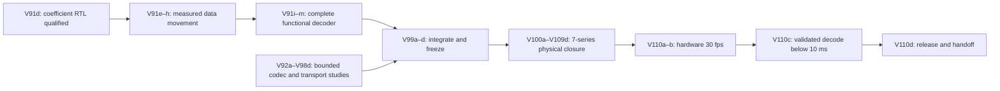

# Game Bub V91–V110: codec selection and 7-series implementation

Updated 2026-11-06. This is the active forward plan after V90 and the
[literature review](literature-review-2026-11-06/README.md). Version numbers below
reserve work phases; they are not completed results or promised calendar dates.

**Product goals:** retain 720×480 coded video, sustain 30 distinct source frames
per second, then validate complete FPGA decoding strictly below 10 ms. Preserve
exact intended canonical/reference pixels, HUD composition, RGB565 output and
publication checks for representation-only optimizations. Keep quality-changing
experiments in a separately versioned, matched-quality lane.

**User-requested focus:** V100 through V110, inclusive, concentrate on improving
RTL for **7-series technology mapping, placement, routing and timing closure**.
Freeze the selected codec before that phase so a physical implementation change
can be compared against a stable function and workload.

## Lettered execution path from V91d

This section is the concrete next-work sequence. **V91d is the latest completed
checkpoint; every label below is planned.** The original unlettered V91 and
published V91b/V91c/V91d retain their names. No historical V91a release is implied.

Letters identify separately reviewable deliverables within a numbered work
phase. Use only the letters needed; the next unused letters through `z` remain
available for a failed gate, a measured alternative or an integration repair.
They are not 26 mandatory
releases, calendar estimates or permission to postpone a missing gate. Record
each checkpoint as planned, active, passed, rejected or blocked by a named
prerequisite. A rejected codec experiment may close its research phase while
the qualified control continues.

The functional integration path is the priority. V92–V98 research can proceed
on isolated branches alongside it. Integrate only qualified winners, one at a
time; completing an ANS, palette or transform experiment does not require adding
it to the product. A simpler candidate may reach hardware qualification while
an optional challenger remains a separate study. The V99 freeze must explicitly
list the selected features and deferred experiments.

### Finish V91: complete the functional decoder

| Checkpoint | Concrete deliverable | Promotion gate |
|---|---|---|
| **V91e** | Add stage/stall/queue counters, source/frame/chunk identities and common timestamp fences. Expand golden workloads and identify worst cases. | Reconcile all service cycles and memory transactions; distinguish first-byte→publication, packet-complete→validated-publication and per-stage work. No coefficient-only fence described as full decode. |
| **V91f** | Overlap a bounded pair of write-assembler buffers with acknowledged memory service. Initially retain one accepted outstanding request. | Exact packed images; measurable stall reduction; no overwrite or new bank reuse before old ACK drain, including error/start races. |
| **V91g** | Prefetch bounded read lines and overlap next-tile preparation with current-tile delivery. | Exact dense output under consumer stalls; cache/queue occupancy and port costs explicit. Additional outstanding requests require a defined ordering/tag and cancellation contract. |
| **V91h** | Replace combinational multi-address packet staging assumptions with explicit synchronous memory ports and read latency. | Header, unaligned fields, replay, RAW and rejection parity under real port limits. This establishes functional RAM semantics; 7-series mapping/physical optimization remains V100–V110. |
| **V91i** | Integrate outer frame descriptors, modes, quantizers, profile negotiation, chunk placement and admission. | Sender/receiver agree on every supported mode and fallback; unsupported modes reject. A chunk packet or scratch seal cannot masquerade as complete-frame acceptance. |
| **V91j** | Connect bit-true dequantization and IDCT with bounded tile/epoch streams. | Exact signed widths, Q14 rounding/saturation order and native golden parity, including backpressure and abort. No zero-time transform substitute in the measured RTL endpoint. |
| **V91k** | Connect reconstruction, accepted references, COPY/constant handling, hidden-pixel normalization and output conversion. | Full canonical/reference and intended visible RGB565 pixels match. Reference/scanout ownership prevents overwrite; all memory service is charged. |
| **V91l** | Integrate HUD/content validation, frame hashes/seals and atomic validated publication. | Late errors never publish a partial frame or corrupt accepted references. Full publication fence, rollback/retry and held-scanout behavior are checked. |
| **V91m** | Run the complete functional frame path with finite transport, memory and display-consumer service models at 30-Hz source releases. | No hidden software pixel/HUD/publication endpoint in a claimed full-RTL pass; exact full frames, bounded queues, recovery and complete latency distributions. Simulation is still distinct from hardware 30 fps. |

V91f/g are promoted only if measured integrated service improves while their
ownership and resource contracts remain valid. Preserve the V91d control and
its retained failure reproduction. The current slower-memory source service
sums already exceed the one-million-cycle reference budget before transforms
and validation, so parser-only speedups cannot close the remaining work.

Freeze the V91e timing definitions before optimizing further. Keep ingress and
end-to-end service timing even when work overlaps arrival: a short final-byte
latency cannot conceal an unsustainable frame service rate. The physical
milestone still needs a routed clock and measured memory/controller behavior.

### V92–V99: codec, host and transport selection

Each cell below names a separate checkpoint: for example, the four V92 columns
are V92a, V92b, V92c and V92d. The existing E1–E7 controls remain applicable.

| Version | a | b | c | d / exit |
|---|---|---|---|---|
| **V92** finer entropy/group choices | Specify context/group boundaries, framing, reset semantics and budgets. | Emit actual AB38/BR88 alternatives with all tags/headers included. | Independent Python/native decode and exact pixel/reference/HUD parity; measure bounded host preparation. | Select with integrated memory/latency costs; implement any promoted receiver adapter and rerun complete-path goldens. |
| **V93** prefix/suffix and adaptive Rice | Define arithmetic-prefix/raw-suffix syntax and small-block Rice/RLGR controls. | Implement finite escapes, RAW fallback and independent readers. | Compare complete bytes, context resets, decoder work and host cost on the same inputs. | Promote only a measured improvement; otherwise retain the control and negative result. |
| **V94** bounded ANS | Specify 2/4-state rANS/tANS, model IDs, tables, literals and initialization/recovery. | Implement host encoding and independent decode with table-inclusive packets. | Prototype RTL/table ports/state arithmetic and test adversarial boundaries. | Compare full-path bytes, cycles and resource/port budgets; select or reject. A fast entropy kernel alone is insufficient. |
| **V95** application-specific palettes | Define exact 2/4/8-entry palettes, left/top runs and residual fallback. | Put bounded palette/search work on the PC; implement deterministic decoding. | Test UI/HUD, movement, noise and scene changes with complete reconstruction. | Select exact-lane wins. Keep quality-changing clustering in a separately negotiated, matched-quality experiment. |
| **V96** reference and memory work | Inventory COPY/alias/constant lifetimes, traffic and display ownership. | Implement bounded copy, grouped bursts and scheduled constant generation. | Test actual addressed traffic, port/refresh/arbitration service and abort/reuse. | Merge qualified memory improvements into the complete frame path; no free generator, gather or cross-position alias. |
| **V97** Sunshine/ESP32/transport | Instrument actual host preparation and negotiate supported profiles/limits. | Integrate bounded ESP32 forwarding, aligned QSPI/DMA transfers and credits, with CPU/RAM budgets. | Exercise firmware and RTL together using supported emulation where available; explicitly label behavioral substitutes and missing ESP32/Wi-Fi fidelity. | Qualify loss/retry/reconnect, input/audio/UI contention and stale-frame/reference recovery; calibrate against hardware when available. |
| **V98** common-input comparisons | Obtain independent raw captures at native 30-fps cadence, preserving 720×480 target geometry. | Rebuild HEVC/AV1/JPEG and custom rate/quality controls with recorded low-latency settings. | Measure encode/decode cost, tails, HUD readability, temporal artifacts and scene-change failures; separate offline anchors from live capability. | Publish the rate/quality/latency frontier and candidate decision. Do not infer superiority from mismatched quality or different source frames. |
| **V99** candidate freeze | Choose one supported codec/profile plus a simpler fallback; list deferred tools. | Integrate promoted winners and run complete functional/recovery regressions on the broader corpus. | Freeze sender/ESP32/FPGA interfaces, board/part/memory assumptions, goldens and measurement counters. | Deliver rebuildable source, grammar, tests, manifests and a hardware-test bundle; record remaining physical prerequisites before V100. |

The minimum candidate must have an implemented sender/receiver path for every
negotiated mode. If a mode is deferred, the encoder must avoid it through a
validated supported profile, or negotiation/admission must reject it safely.
Future-content budget overflow needs a real split/fallback policy, not a claim
that the current corpus always represents worst-case input.

V97c must document what the available emulation actually models. Host-native
code or a behavioral queue does not measure ESP32 instruction timing, Wi-Fi
interrupt service, PSRAM contention or QSPI DMA arbitration. Use Renode and
Verilator where their configured platform/interfaces support the experiment;
retain hardware calibration as an explicit gate where they do not.

### V100–V110: keep the dedicated 7-series implementation phase

These lettered steps refine the numbered physical phases below; they do not
replace their target-part, constraints, signoff or evidence requirements.

| Version | a | b | c | d / exit |
|---|---|---|---|---|
| **V100** reproducible baseline | Freeze exact part/board, tool version, source/XDC/IP/memory-init hashes and top. | Cleanly recreate and synthesize the complete candidate; inventory ports, clocks, resources and unfinished endpoints. | Establish baseline placement/routing and workload reports with valid constraints. | Repeat the baseline and publish reproducible reports/checkpoints; missing device/tool support remains a prerequisite, not a pass. |
| **V101** constraints/methodology | Inventory primary/generated clocks, domains and reset behavior. | Derive actual interface delays and clock relationships from the board/controller requirements. | Audit methodology/DRC, CDC, exceptions and unconstrained paths. | Close critical issues and justify every exception; no invented delays or blanket false paths. |
| **V102** pipeline/control timing | Attribute long ready/credit, mux and arithmetic paths to measured cones. | Add bounded skid/register stages and trial justified retiming. | Recheck transactions, epochs, drain and stalls; compare cycle/queue effects. | Route matched A/B variants and retain the latency/resource/clock improvement. |
| **V103** parser technology mapping | Isolate supported parser widths/lanes and diagnostic-counter costs. | Compare inferred LUT6/mux/carry implementations of prefix/refill/control logic. | Recheck every escape, boundary, malformed input and full-path workload. | Select from routed area/cycle/clock results; no assumption that a carry chain automatically wins. |
| **V104** DSP48E1 arithmetic | Freeze bit widths, signedness, overflow and rounding proofs. | Compare DSP pipelines, symmetry, sharing and parallel transform lanes. | Confirm netlist primitive/register absorption and bit-true stall/epoch alignment. | Route and select using complete service cost, DSP/resources and achieved clock. |
| **V105** memory mapping/locality | Inventory every memory's depth/width, ports, latency and collision policy. | Map suitable packet/coefficient/table/line storage to RAMB18/36, LUTRAM or SRL structures. | Replay with implemented read latency, real arbitration/refresh and display consumers. | Prove whole-device memory fit and service bounds; remove accidental large register muxes without changing semantics. |
| **V106** fanout/congestion | Capture high-fanout, control-set and congestion evidence. | Localize grants/valid/epoch/reset and register long credit distribution where needed. | Compare narrowly justified replication/hierarchy/placement changes. | Route and keep demonstrated fixes with ownership/reset parity; avoid uncontrolled placement directives. |
| **V107** board/CDC integration | Wire the selected controller, transport and display interfaces with their real clocks. | Implement/review crossings, async FIFOs and synchronized reset release. | Exercise reset, clock start, traffic and hardware smoke tests when access exists. | Close CDC/interface timing and board integration; unavailable hardware tests remain pending. |
| **V108** placement/routing study | Freeze one source/constraint baseline and a small recorded strategy matrix. | Run at most six initial combinations, retaining failures, runtime and memory usage. | Cleanly repeat the selected winner. | Choose a reproducible routed frontier; expand trials only for a stated unresolved hypothesis. |
| **V109** integrated closure | Merge only qualified physical changes into the complete top. | Route and check setup/hold, pulse width, I/O, CDC, exceptions and methodology. | Replay full pixel/reference/HUD/hash workloads with actual primitive/controller costs and counter calibration. | Freeze the qualification candidate and fallback, with no unexplained functional paths or missing full-system endpoints. |
| **V110** hardware qualification | Verify clean boot, counters, pixel/reference integrity and failure/recovery behavior. | Pass sustained hardware 30 fps: 1,800 distinct frames/60 s, then 18,000/600 s, with real contention and bounded queues. | After the 30-fps gate, validate every qualified complete-decode sample strictly below 10 ms; publish distributions, maxima and worst identities. | Freeze rebuilt artifacts, bitstream/firmware hashes, profiles, procedures, evidence and known limits for handoff. |

Hardware smoke tests can occur earlier when the board and qualified artifacts
are available; they do not need to wait for V110. V110b/c are the formal product
qualification gates. If a gate fails, use the next needed letter for a bounded
repair and repeat the affected checks; do not advance the success claim simply
because a version number was reached.

### Milestone order

1. **V91m:** complete functional RTL frame path and finite-interface simulation.
2. **V99d:** selected candidate/fallback and reproducible hardware-development bundle.
3. **V109d:** complete routed implementation, valid constraints and calibrated counters.
4. **V110b:** measured sustained hardware 30 distinct fps at 720×480.
5. **V110c:** measured complete validated decoding strictly below 10 ms.
6. **V110d:** qualified release and handoff.

Early simulation may show a possible 30-fps or <10-ms budget, but the hardware
labels remain pending until their own evidence exists. The detailed product
gates at the end of this document define the conditions and timestamps.

## Evidence entering this roadmap

[V91d](cu66-v91d/README.md) joins validated packet metadata/end credits, packed
scratch RTL, finite acknowledged memory and dense coefficient delivery. Mask
clearing reduces actual selected-packet cycles 34.43%/27.10% in FAST/SLOW
scenarios, with exact bytes and recovery checks. Remaining work includes bounded
service overlap, reconstruction/reference/HUD/hash consumers and whole-top
physical qualification. Two SLOW source sums already miss the 1,000,000-cycle
reference budget before remaining stages.

[V91](cu66-v91/README.md) now supplies full-corpus coefficient parity,
directed/native/sanitizer checks and clocked RTL symbol-component evidence.
Its 32-bit all-ready real-stream comparison reduces cycles by 29.24%; CPU
candidates are slower. The V91b/V91c stages below extend its integration;
complete decoder timing and physical qualification remain pending.

[V91b](cu66-v91b/README.md) now derives DC/AC requests and emits validated sparse
addresses through one output slot. The full-corpus Python transaction matches
all coefficients; the clocked real-context comparison is 685,304 word versus
937,735 serial cycles. This substep matures E1; V91c below adds packet control
while V92 retains its finer entropy-choice experiment.

[V91c](cu66-v91c/README.md) adds complete residual-chunk packet/CRC/raw control
in RTL and a separate packed temporary-coefficient store model. All 457 sources
match; packed corpus peak is 134,352 B versus 658,432 B dense. V91d adds the
RTL metadata/allocator and finite memory ports. The packet staging model
uses combinational multi-address reads; V100–V105 must bank/register/schedule
actual RAM ports and remeasure cycles, resources and routed clock. Neither
component changes full-frame or hardware qualification status.

[V90](cu66-v90/README.md) evaluates 3,656 actual packet candidates from 457
retained sources. Its selected packets average 18,203.64 B and reach 48,744 B,
within the 49,152 B experimental admission cap. The four-source exhaustive
timing study still has a hard source at 10.80320/12.29713 ms under assumed
LOW/HIGH costs and 100 MHz. Those are conditional model results, not routed
clock timing or measured FPGA latency.

The [review](literature-review-2026-11-06/README.md) favors word-oriented Rice
parsing, finer/selective statistical coding, bounded-table ANS and host-selected
small palettes. It also prioritizes memory service and a receive-buffer
contract. Earlier HEVC/AV1 comparisons remain compression controls, not evidence
that the custom codec has surpassed their rate/quality performance.

Keep all V90 and earlier experimental artifacts frozen. Start new source/result
directories and record exact parent commits; do not rewrite historical results
to make a later implementation look like the original experiment.

## V91–V99: implement the review's experiments and select a candidate

The detailed functional tests and latency fences remain in
[E1–E7](literature-review-2026-11-06/experiments.md). This table assigns their
work to versions; a failed experiment can retain its control and negative result.

| Version | Work | Required result before promotion |
|---|---|---|
| V91 | E1: Python word-reservoir BR88 parser, bounded escapes and initial elastic RTL/counter calibration. | Existing bytes and coefficients match independent readers; refill, escape, scatter and stall costs are explicit. |
| V92 | E2: per-context AB38/BR88 choices, rather than only three whole-plane choices. | Actual new framing/bytes and bounded host selection; exact output and reset/replay parity; full cost frontier recorded. |
| V93 | E2: arithmetic-prefix/raw-suffix variant; small-block Rice and RLGR controls. | Measure statistical gain per coded field; retain finite escapes/raw fallback; account for all tags, resets and dependencies. |
| V94 | E3: 2/4-state rANS/tANS with bounded tables, literals and model IDs. | Table-inclusive packets, independent decode, lookup/port/state costs and accepted-model recovery; no kernel-only speed claim. |
| V95 | E5: 2/4/8-entry palette, left/top runs and residual/raw fallback, with clustering on the PC. | Real gameplay/UI wins beyond flat fixtures; exact canonical/HUD lane first; quality-changing clustering reported separately. |
| V96 | E6: bounded exact reference copy, group-oriented bursts and scheduled CONST128 generation. | Addressed traffic and lifetime/abort proof; charge generators, descriptors and display consumers; no free cross-position alias assumption. |
| V97 | E4: calibrated host selection plus finite Wi-Fi/ESP32/QSPI/decoder arrival-service model. | Held-out prediction errors, real host preparation cost, bounded occupancy and explicit stale-frame/reference recovery behavior. |
| V98 | E7: refresh HEVC/AV1/JPEG controls on common inputs; evaluate alternative transforms only when justified. | Complete rate/quality/latency curves, peak packet failures and scene-change/HUD/temporal results; distinguish original raw captures from old quantized reconstructions. |
| V99 | Select and freeze one implementation candidate plus a simpler fallback. Publish its independent decoder, grammar and RTL-facing goldens. | Explicit reasons for selection, supported tools/model bounds, resource/port budgets and integration gaps. A theoretical entropy win alone is insufficient. |

The 457-frame related corpus is an initial regression set, not the final
qualification corpus. Obtain independent raw captures with native 30-fps cadence
for the physical milestone; replay counts and the old 25-fps combat clip do not
create new distinct gameplay updates.

## Target and technology-mapping contract

Use **`xc7a100tcsg324-1`**, as identified by the retained
[routed JPEG report](../fpga/build-final/utilization.rpt), unless an explicitly
recorded board/part correction supersedes it. Freeze board revision, package,
speed grade, pinout, memory parts and the integration top in V100.

The retained report lists 63,400 LUTs, 126,800 registers, 135 BRAM tiles and
240 DSPs available. Its JPEG design uses 7,362 LUTs, 120.5 BRAM tiles and
32 DSPs. This is a historical comparator, not a custom-decoder fit. Do not add a
new decoder to those figures without accounting for replaced JPEG buffers and
all retained display/control/transport logic. Logical memory bytes do not prove
RAM primitive, port, placement or whole-device fit.

Prefer portable inferred RTL first, then compare a small 7-series wrapper only
when the mapped netlist shows a missed opportunity. Keep a generic simulation
model and a technology-bound implementation under the same transaction tests.
Inspect primitive counts and registers actually absorbed into DSP/BRAM blocks;
an RTL attribute or multiplier operator is not proof of mapping.

| Resource / design concern | Planned mapping experiment | Correctness condition |
|---|---|---|
| DSP48E1 | Dequantization and inverse-transform arithmetic; optional selected rANS state multiply. Compare sharing against parallel lanes and A/B/M/P pipeline registers. | Explicit signed widths, extension, intermediate overflow bounds and original Q14 rounding/saturation order. Align data, valid, coefficient/tile/epoch IDs and enables through every stall. |
| RAMB18E1 / RAMB36E1 | Coefficients, entropy tables, descriptors, line buffers and hash state; synchronous read and optional output registers. | Budget real read/write ports, banking, byte enables, latency and replication. Define or prevent every same-address collision; generic array behavior must match the implemented primitive. |
| SRL16E / SRLC32E and LUTRAM | Short delay alignment, small queues and local lookup tables where they reduce cost. | SRL payload storage lacks a reset function: retain reset/epoch/valid bookkeeping and prove stale data cannot be consumed. An elastic queue needs its own correct occupancy/control logic. |
| LUT6 / LUT6_2, carry and mux logic | Bounded prefix/escape decoding, comparisons, counters, address calculation and small decoders. Compare a pipelined LUT implementation with inferred arithmetic/CARRY4. | No assumption that leading-zero detection automatically benefits from a carry chain. Exhaustive small-function checks plus routed comparisons decide. Dual-output LUT packing must respect shared-input constraints. |
| Registers and control sets | Register long ready/credit chains; localize high-fanout control; simplify compatible enables/resets; compare FSM encodings. | Preserve drain/abort/publication ordering. Reset payload removal requires a validity proof; preserve CDC synchronizers and required reset behavior. |
| External-memory and display service | Burst grouping, bank/row locality, bounded outstanding work and line buffers. | Faster decoder logic does not accelerate an unchanged SDRAM clock or eliminate refresh/turnaround. Charge continuous scanout and prevent accepted-reference overwrite. |

These resources and inference practices are grounded in AMD's
[7-series CLB flow](https://docs.amd.com/r/en-US/ug474_7Series_CLB/Recommended-Design-Flow),
[carry-chain reference](https://docs.amd.com/r/en-US/ug474_7Series_CLB/Carry-Chain-Primitive),
[DSP48E1 guide](https://docs.amd.com/api/khub/documents/gu4oRPFEh_Pm2uaAlfY6Kg/content),
[7-series memory guide](https://docs.amd.com/api/khub/documents/9gZGbqBxtlKXxBfkBt~lAg/content)
and [2025.2 primitive library](https://docs.amd.com/r/2025.2-English/ug953-vivado-7series-libraries/RAMB36E1).
Do not import DSP48E2, CARRY8, UltraRAM or UltraScale-specific packing assumptions.

## V100–V110: dedicated RTL and physical implementation phase

| Version | Focus and concrete work | Evidence / exit gate |
|---|---|---|
| **V100** | **Reproducible 7-series baseline.** Freeze the V99 candidate, top, part, source/IP/memory-init/XDC hashes, Vivado build, parameters and supported packet profile. Recreate the design in a clean build directory. Route the unchanged baseline where possible; inventory remaining simulation-only endpoints. | Baseline synthesis/route checkpoints and reports, primitive/resource breakdown by hierarchy, top paths and full-cycle workload counters. Missing Artix support or incomplete endpoints remain explicit gaps. |
| **V101** | **Constraints, clocks and methodology.** Audit primary/generated clocks, real external I/O delays, clock interaction, CDC/reset domains and existing exceptions. Run methodology/DRC checks at synthesis and implementation. | No unreviewed critical methodology issue, unintended unconstrained functional path, or unjustified timing exception. Record actual board/interface requirements and each unresolved item. |
| **V102** | **Elastic pipelines and retiming.** Cut long ready/credit, mux and arithmetic cones with registered/skid stages; test retiming only where semantics permit. | Exact transaction/epoch ordering under arbitrary stalls, reset and abort; measured cycle/occupancy changes and placed/routed path comparison. No accidental combinational ready loops or throughput bubbles hidden by an always-ready test. |
| **V103** | **Entropy parser LUT/carry mapping.** Optimize the selected BR88/hybrid/ANS path: bounded prefix tree, reservoir mux/refill, run/scatter control or table address logic. Compare width and lane alternatives. | Inferred primitive/path evidence, escape/boundary/reject parity and stall-inclusive full-frame counters. Keep the smallest design that improves the relevant frontier. |
| **V104** | **DSP48E1 arithmetic mapping.** Pipeline dequantization/IDCT and any selected ANS multiplication; compare exact symmetry, sharing, pre-add/cascade use and parallel lanes. | DSP input/output pipeline usage confirmed in netlist; exact rounding/width proof and golden parity; routed frequency versus frame-cycle/resource tradeoff. DSP utilization alone is not the objective. |
| **V105** | **Memory inference and locality.** Replace accidental register arrays/large muxes with suitable BRAM/LUTRAM/SRL structures; bank tables/coefficient buffers; register outputs and distribute local memories. | Per-memory depth/width/port/collision/latency ledger, primitive counts and physical footprint. Re-run consumers with actual read latency, arbitration, refresh and display contention. |
| **V106** | **Fanout, control sets and congestion.** Localize grants, epoch/valid/reset distribution, descriptor selection and memory interfaces. Compare hierarchy boundaries and measured driver replication. | Before/after fanout, control-set and congestion reports plus routed path delay. Do not spread MAX_FANOUT, DONT_TOUCH or manual placement constraints without path evidence. |
| **V107** | **Clock/reset/CDC integration.** Close transport, decoder, memory and display crossings with proper synchronizers/async FIFOs and synchronized reset release. Treat any new decoder-clock option as a separate integration variant. | CDC inventory and reviewed exceptions, stable tags across crossings, reset/abort/clock-start tests, interface timing and metastability assumptions documented. Preserve memory/LCD clocks unless separately qualified. |
| **V108** | **Bounded placement/routing study.** Compare a recorded small set of synthesis/place/physical-opt/route strategies from the same source/constraints. Try soft hierarchy/pblocks or local placement only for measured locality/congestion problems. | Full trial matrix including failures, exact directives/tool version and route completion. Repeat the winner from a clean build; no unsupported random-seed knob or lucky single run as robustness evidence. |
| **V109** | **Integrated closure and calibrated decode.** Merge only individually qualified changes, re-route the complete top, and replay the fixed workloads with real primitive latencies and finite interfaces. Run targeted post-route simulation where it resolves implementation risks. | Setup/hold/pulse-width and route/methodology signoff, native/pixel/hash/HUD parity, full decoded-frame latency distribution and stall/queue accounting. OOC timing and zero-time software endpoints cannot pass full-system gates. |
| **V110** | **Hardware qualification and handoff.** Freeze the clean rebuild, routed candidate, fallback, bitstream hashes, constraints and device counter map. Test on the hardware system when accessible. | 60-second then 600-second distinct-frame 30-fps evidence, followed by strict validated-decode <10-ms evidence. If hardware is elsewhere/unavailable, deliver the exact test bundle and leave those gates pending rather than calling simulation a hardware pass. |

Every version may iterate until its gate is satisfied. Later physical experiments
can proceed on an available qualified control when a new coding tool fails;
there is no requirement to implement every speculative codec tool in one design.

## Timing, latency and experiment controls

Start with a **100-MHz decoder-domain target** (10-ns period) for comparison with
the existing conditional model; achieving it requires implementation evidence.
After a valid baseline, consider 125/150-MHz decoder-only targets as optional
experiments. Preserve actual memory/display timing and CDC boundaries. Do not
scale every old cycle count by a new decoder frequency and call that new latency.

For a single 100-MHz domain, strictly below 10 ms means **fewer than 1,000,000
cycles** between the frozen validated-decode fences. Added pipeline stages,
table initialization, CRC/hash/HUD service and waits all count. In a mixed-clock
design, use correlated timestamps or a common measurement clock; adding raw
cycle counts from different domains is invalid.

Make one architectural change at a time before combining winners. Keep source
frames, packet bytes, clock constraints, memory service, release schedule and
endpoint behavior matched for an A/B comparison. Route-only trials hold RTL
fixed; RTL changes retain a baseline strategy as well as the best tested one.
Record all failed trials and stop expanding a strategy sweep without evidence
that more trials address the diagnosed bottleneck.

Begin with at most six recorded strategy combinations and one clean rebuild of
the selected winner; expand only to test a stated new hypothesis. Respect the
host's available-RAM/memory-pressure build gate and disk budget. Start with one
heavy implementation run at a time, record thread limits, and keep independent
source/report review parallel without multiplying memory-heavy builds.

Use post-route setup/hold/pulse-width analysis at the tool's required timing
corners and verify routing is complete. Require WNS/WHS nonnegative and TNS/THS
zero for the qualified design, with no unexplained unconstrained functional
paths or pulse-width failures. Also inspect I/O, recovery/removal and clock-domain
requirements. Justified asynchronous/test exceptions need a documented scope;
do not hide a functional data path, invent a multicycle assumption or relax
clocks to report a pass. These rules follow the
[2025.2 timing-signoff guidance](https://docs.amd.com/r/2025.2-English/ug906-vivado-design-analysis/Report-Timing-Summary)
and [UltraFast methodology](https://docs.amd.com/r/2025.2-English/ug949-vivado-design-methodology).

Freeze the available Vivado version initially. The installed timing skill's
automated JSON workflow declares Vivado 2026.1+ compatibility; do not assume its
new flags work in 2025.2. Use reports supported by the installed version, and
record any tool upgrade as a separate baseline. Artix-7 device support is needed
for target synthesis/implementation; generic Python/RTL development can continue
while that dependency is resolved. No tool installation or design run is started
by this planning update.

## Required reports and handoff artifacts

Each physical trial retains its source manifest and exact build Tcl/XDC,
tool/version/part/parameters, command log, exit status, checkpoint hashes and
runtime/peak host RAM. Keep large generated checkpoints/logs in a documented
artifact store rather than duplicating them through source Git. The source
bundle must recreate the project without an undocumented local cache.

Collect, using the installed tool's supported commands:

- Utilization by hierarchy and mapped primitive: LUT logic/RAM/SRL, FF, control
  sets, CARRY4, DSP48E1, RAMB18E1/RAMB36E1, clocks and I/O. Include debug logic.
- Synthesis, placement and routed timing summaries; worst setup and hold paths
  by clock group, logic versus net delay, high-fanout/congestion findings,
  methodology/DRC, clock interaction, CDC, route status and exceptions.
- Parser/refill/escape/table/transform/hash/HUD/memory counters, stalls by cause,
  outstanding requests, FIFO high-water marks, abort drain and publication events.
- A comparison CSV containing trial/source/constraint/tool hashes, requested
  clocks, route status, WNS/TNS/WHS/THS, pulse-width/unconstrained-path status,
  resources, workload cycle distributions, complete bytes and exactness status.
  Label each value as simulation, implementation timing or hardware measurement.

Retain a generic reference implementation and small wrappers for any explicit
7-series primitives, with simulation/elaboration libraries and build instructions.
Golden cases must cover key/cold/reference reuse/hard-combat sources, mixed
entropy choices, maximum escapes, raw/dense input, stream boundaries, malformed
packets, bad CRC, lost ACK/exact retry, resets, aborts, held scanout and descriptor
ownership. The full HUD/validation/display endpoints cannot remain software
stubs in a claimed hardware pass.

## Product milestone gates

| Gate | Required evidence |
|---|---|
| Functional RTL candidate | Independent exact decoder and golden-output agreement; bounded interfaces and failure/recovery behavior. |
| Physical implementation | Complete selected top fits the exact part and meets routed timing with valid clocks/I/O/CDC constraints. Fmax and OOC fit alone do not establish frame throughput. |
| Sustained hardware 30 fps | 1,800 distinct frames over 60 seconds, then 18,000 over 600 seconds at fixed 30-Hz source releases; intended displayed identity/pixels/HUD, bounded queues and zero underruns, with Wi-Fi/QSPI/UI/audio/input contention represented. |
| Validated hardware decode <10 ms | Every qualified packet-complete → validated-publication sample is strictly below 10 ms, including entropy, reconstruction, memory waits, content/HUD checks and safe ownership publication. Report min/median/p95/p99/max and worst identities; no average-only pass. |
| Handoff | Rebuildable source/constraints, routed artifact and fallback hashes, negotiated profile, counter definitions, hardware run procedure, known gaps and all failed trials. |

Transport, capture/encode and presentation latency remain separately reported
end-to-end costs. Retain atomic validated publication; a partial early scanout
would need its own explicit integrity contract. Preserve the native resolution
and frame-rate goals throughout this phase.
